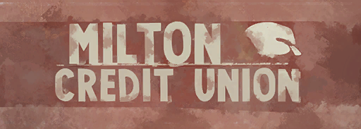

# Milton Credit Union

<table class="infobox">
<caption>Milton Credit Union</caption>
<colgroup>
<col style="width: 50%" />
<col style="width: 50%" />
</colgroup>
<tbody>
<tr>
<td colspan="2"><figure>
[Missing image: Milton_Credit_Union_exterior.jpg]
<figcaption>Milton_Credit_Union_exterior.jpg</figcaption>
</figure></td>
</tr>
<tr>
<td colspan="2" class="section">
<strong>Location</strong>
</td>
</tr>
<tr>
<td colspan="2"><figure>
[Missing image: Milton_Credit_Union_Location.png]
<figcaption>Milton_Credit_Union_Location.png</figcaption>
</figure></td>
</tr>
<tr>
<td>
Region
</td>
<td>
<a href="./Mountain%20Town.md" class="wikilink" title="Mountain Town">Mountain Town</a>|-
</td>
</tr>
<tr>
<td>
Description
</td>
<td>
A former bank with several rooms, including a bank vault.
</td>
</tr>
<tr>
<td colspan="2" class="section">
<strong>General</strong>
</td>
</tr>
<tr>
<td>
Type
</td>
<td>
Residential|-
</td>
</tr>
<tr>
<td>
Missions
</td>
<td>
<a href="./Episode%201%20-%20Do%20Not%20Go%20Gentle.md#Chapter_3" class="wikilink" title="Episode 1: Chapter 3">Episode 1: Chapter 3</a>
</td>
</tr>
</tbody>
</table>

**Spoiler Warning:***This page may contain spoilers from the <a href="./Wintermute.md" class="wikilink" title="story">story</a> of The Long Dark.*

<table>
<colgroup>
<col style="width: 33%" />
<col style="width: 33%" />
<col style="width: 33%" />
</colgroup>
<tbody>
<tr>
<td style="vertical-align: top; font-size: 3em; color: #5d5980; padding-right: 10px">
“
</td>
<td>
Dear Members, 
Due to global economic realities that are well known to you, we are unfortunately unable to remain in operation. All banking services are hereby suspended until further notice. 
- Management (September, 2012)

&#10;

- Milton Credit Union Letter

</td>
<td style="vertical-align: bottom; font-size: 3em; color: #5d5980; padding-left: 10px">
”
</td>
</tr>
</tbody>
</table>

**Milton Credit Union** is a bank and location in <a href="./Milton.md" class="wikilink" title="Milton">Milton</a> in the <a href="./Mountain%20Town.md" class="wikilink" title="Mountain Town">Mountain Town</a> region. According to a letter pinned outside the front door in Story mode, banking services were suspended in September 2012.

## Overview

The bank is located across the street from <a href="./Milton%20House%20%28Grey%20Mother%27s%29.md" class="wikilink" title="Milton House (Grey Mother&#39;s)">Milton House (Grey Mother's)</a> and a truck and car are parked beside it. The <a href="./Old%20Schoolhouse.md" class="wikilink" title="Old Schoolhouse">Old Schoolhouse</a> can be found behind the bank.

Inside there is an office room to the right of the entrance. In Wintermute, the desk in the small office contains a key to the <a href="./Bank%20Manager%27s%20House.md" class="wikilink" title="Bank Manager&#39;s House">Bank Manager's House</a>. Behind the glass-fronted counter is a room with computers, laptops and metal lockers, as well as a restroom off to one side.

In the back room of the building, there is a locked safe (with a random code). In **<a href="./Survival%20Mode.md" class="wikilink" title="Survival Mode">Survival Mode</a>**, the main bank vault door is open. In <a href="./Wintermute.md" class="wikilink" title="Wintermute">Wintermute</a>, the bank vault can only be opened after the *Bank Vault Code* <a href="./Collectibles.md" class="wikilink" title="collectible">collectible</a> has been obtained from the Bank Manager's House. The vault contains stacks of papers and books, lootable metal containers, and 20 deposit boxes. Eight of the deposit boxes are open and empty, a further eight can be looted, and the final four (#7, \#13, \#15 and \#20) require a *Bank Deposit Box Key* to unlock in the story.

**Bank Deposit Key Locations:**

The following keys can be found as part of the <a href="./Milton%20Safety%20Deposit%20Box%20Keys.md" class="wikilink" title="Milton Safety Deposit Box Keys">Milton Safety Deposit Box Keys</a> side mission:

- Key \#7: Milton House – After exiting the Bank manager's House, walk forward until you fully pass a house which will be slightly to your left, then enter the house slightly on your right. Look in the box under the bed.
- Key \#13: Southern River – Follow the river west of Milton, and walk the eastern bank south. Almost at the edge of the map, look for crows flying overhead. There’s a corpse with a backpack carrying this key.
- Key \#15: West Farm – Go to the farm following the road west from Milton. Get the key lying next to Hobbs when you enter.
- Key \#20: South Gas Station – South of Milton, there’s a gas station. Look for the truck parked by a pair of blue port-a-potties. The key is inside that truck.

## Gallery

<table class="gallery">
<colgroup>
<col style="width: 25%" />
<col style="width: 25%" />
<col style="width: 25%" />
<col style="width: 25%" />
</colgroup>
<tbody>
<tr>
<td><figure>
[Missing image: Milton_Credit_Union_-_Interior.jpg]
<figcaption>The interior of Milton Credit Union</figcaption>
</figure></td>
<td><figure>
[Missing image: TLD-SS-Milton-CU_(1).jpg]
<figcaption>TLD-SS-Milton-CU_(1).jpg</figcaption>
</figure></td>
<td><figure>
[Missing image: TLD-SS-Milton-CU_(4).jpg]
<figcaption>Frozen corpse with a pry bar</figcaption>
</figure></td>
<td><figure>
[Missing image: TLD-SS-Milton-CU_(2).jpg]
<figcaption>TLD-SS-Milton-CU_(2).jpg</figcaption>
</figure></td>
</tr>
<tr>
<td><figure>
[Missing image: TLD-SS-Milton-CU_(3).jpg]
<figcaption>Frozen corpse (robbery?) with a knife in the main bank vault</figcaption>
</figure></td>
<td><figure>

<figcaption>Exterior sign</figcaption>
</figure></td>
<td></td>
<td></td>
</tr>
</tbody>
</table>

**Lua execution error in Module:Navbox function navbox**

<a href="ru:%D0%9A%D1%80%D0%B5%D0%B4%D0%B8%D1%82%D0%BD%D1%8B%D0%B9_%D1%81%D0%BE%D1%8E%D0%B7_%D0%9C%D0%B8%D0%BB%D1%82%D0%BE%D0%BD%D0%B0" class="wikilink" title="ru:Кредитный союз Милтона">ru:Кредитный союз Милтона</a>

