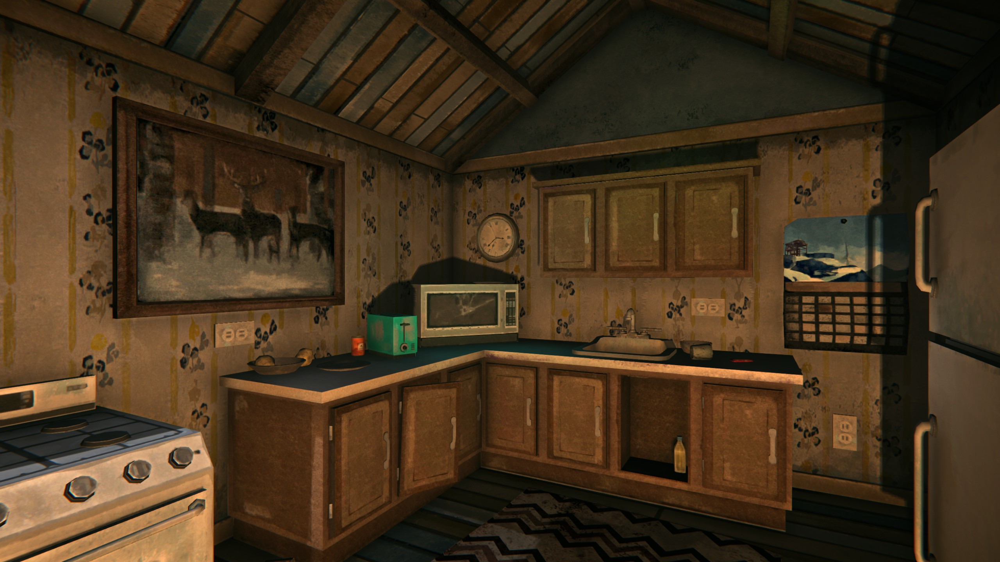
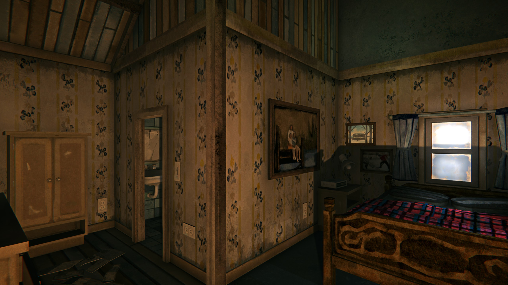
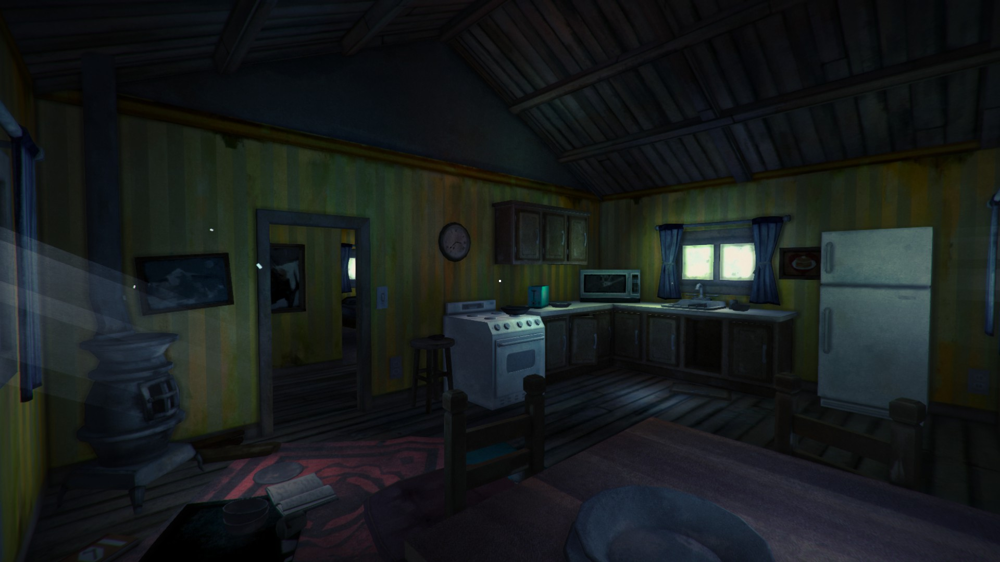
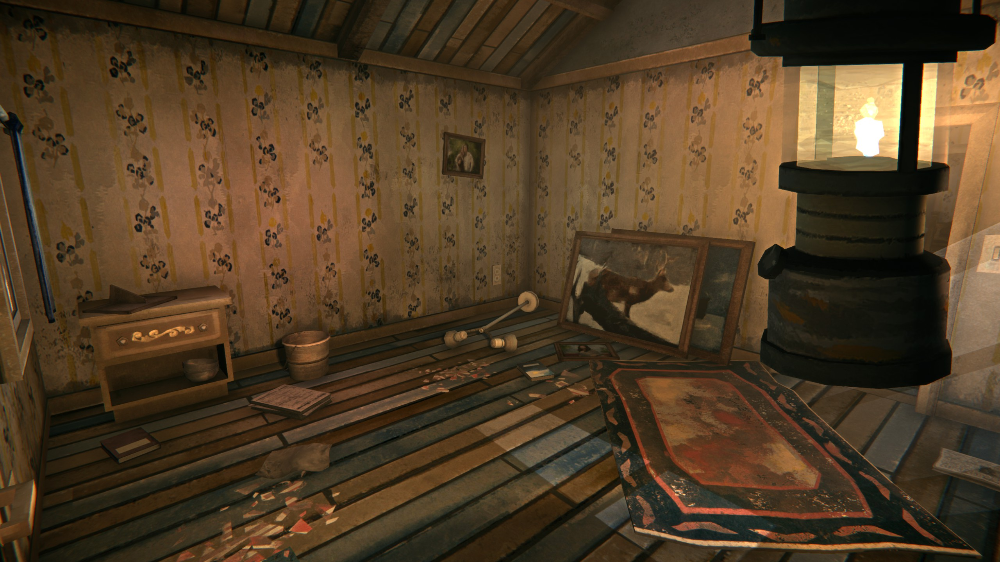
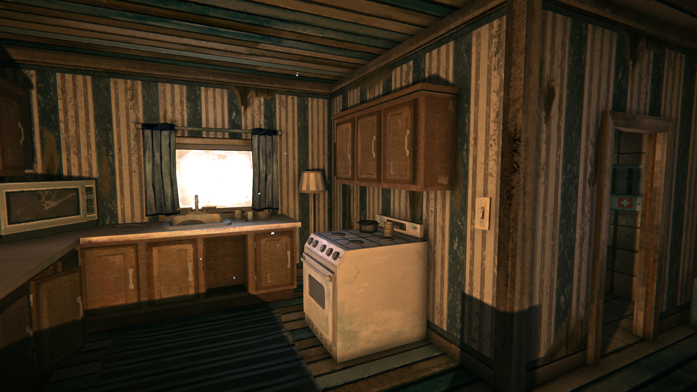
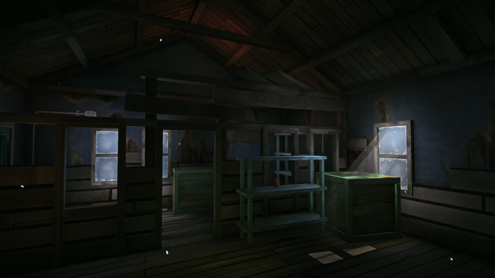

# Milton House

**Categories:** Indoor locations, Locations, Locations in Mountain Town, Residential locations · **Source:** [Fandom](https://thelongdark.fandom.com/wiki/Milton_House)

**Contents**

- [Overview](#overview)
- [1 Story House](#1-story-house)
- [Bank Manager's House](#bank-managers-house)
- [House Type 2](#house-type-2)
- [2 Story House](#2-story-house)
- [Shed](#shed)
- [Grey Mother's House](#grey-mothers-house)

**Milton House**

\[\[File: /  / _Type 1_ /  / _Type 2_ /  / _Type 3_ /  / _Type 4_ /  / _Type 5_ /  / _Grey Mother's_

250px\]\]

_Type 1_

_Type 2_

_Type 3_

_Type 4_

_Type 5_

_Grey Mother's_

**Location**

Region

[Mountain Town](./Mountain%20Town.md)\|-

Location

**General**

Type

Residential\|-

Firebox

_bed\_icon.png_

Has a bed

_Coastal\_House\_1.jpg_

_Coastal\_House\_2\_Kitchen.jpg_

_Coastal\_House\_2\_Den.jpg_

_Coastal\_House\_2\_Bedroom.jpg_

_Milton\_Bank\_Managers\_House.jpg_

_Bank\_managers\_house\_interior.jpg_

_Milton\_House\_2.jpg_

_Bedroom_

_Kitchen_

_Den_

_Milton\_House\_1.jpg_

_Crossroads\_House\_2\_Hallway.jpg_

_Crossroads\_House\_2\_Kitchen.jpg_

_Crossroads\_House\_2\_Bedroom.jpg_

_Crossroads\_House\_Shed.jpg_

_Crossroads\_House\_Shed\_Inside.jpg_

_Milton\_House\_(Grey\_Mother's).png_
