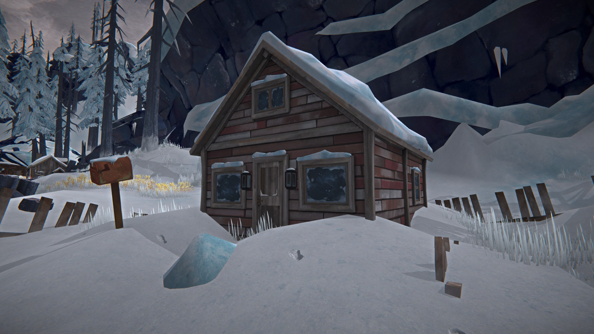
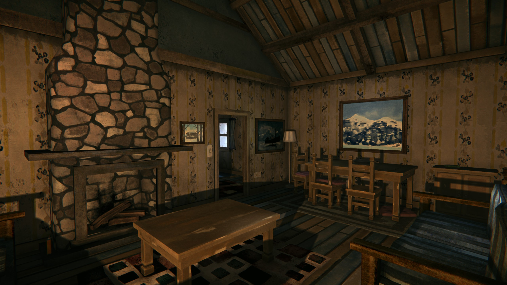
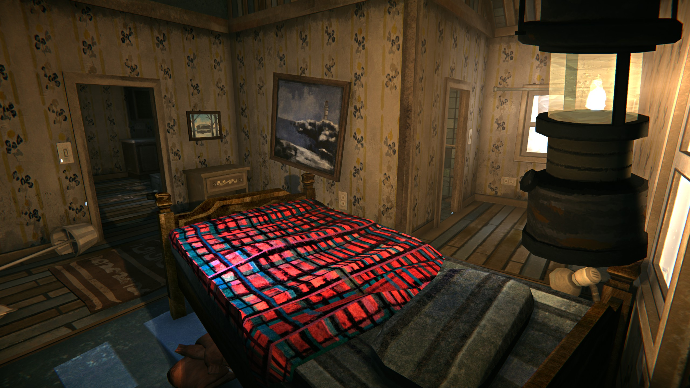
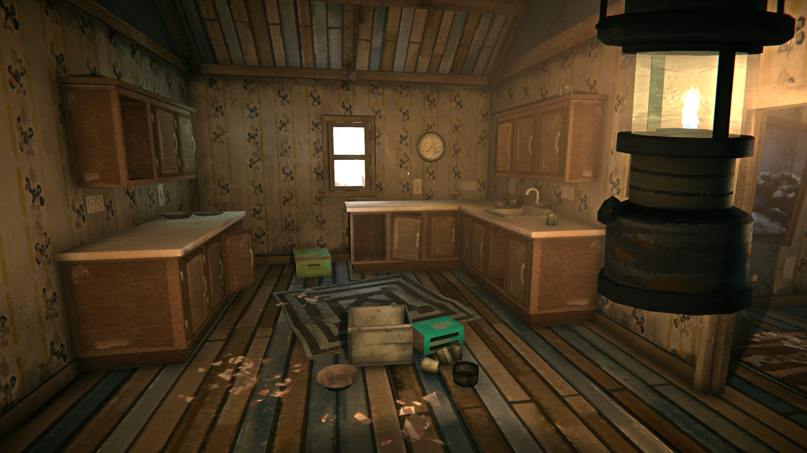

# Milton House

**Categories:** Indoor locations, Locations, Locations in Mountain Town, Residential locations · **Source:** [Fandom](https://thelongdark.fandom.com/wiki/Milton_House)

**Contents**

- [Overview](#overview)
- [1 Story House](#1-story-house)
- [Bank Manager's House](#bank-managers-house)
- [House Type 2](#house-type-2)
- [2 Story House](#2-story-house)
- [Shed](#shed)
- [Grey Mother's House](#grey-mothers-house)

**Milton House**

\[\[File:

250px\]\]

**Location**

Region

[Mountain Town](./Mountain%20Town.md)|-

Location

**General**

Type

Residential|-

Firebox

Has a bed

Has an interior

_For the large house owned by Grey Mother, see [Milton House (Grey Mother's)](./Milton%20House%20%28Grey%20Mother%27s%29.md)._

A **Milton House**is a type of house or shed found throughout the Town of [Milton](./Milton.md) in the [Mountain Town](./Mountain%20Town.md) region. Many of these buildings have the same layout as the [Coastal House](./Coastal%20House.md) and [Crossroads House](./Crossroads%20House.md).

## Overview

Most of the dwellings throughout the Town of Milton are in ruins after decades of neglect, with many either being fully collapsed or boarded up after the once booming coal town went bust. The few that remain accessible are in differing states of disrepair, as many homes show signs of either abandonment from the former residents or were violently ransacked when the [Convicts](./Convicts.md) took over the Town, showing signs of looting after the [First Flare](./First%20Flare.md).

Many of the houses and sheds change location between Survival Mode runs, with some being boarded up on one playthrough but the same house can be accessible on another.

Milton Houses appear as 6 types of buildings:

### 1 Story House

This type of building has only 1 floor, with 2 doors leading to the kitchen or living room. They are composed of:

- A kitchen
- A den with a fireplace
- A bedroom with a [Bed](./Bed.md) and Clothing Drawers
- A bathroom next to the bedroom

The layout for this building has 2 different layouts, but tends to be filled with large amounts of food and [Cooking Pots](./Cooking%20Pot.md).

### Bank Manager's House

This [Bank Manager's House](./Bank%20Manager%27s%20House.md) is different from every other house, containing just 3 rooms and a front door. It is locked in [Episode 1: Do Not Go Gentle](./Episode%201%20-%20Do%20Not%20Go%20Gentle.md) and needs the [Bank Manager's House Key](./Bank%20Manager%27s%20House%20Key.md) to unlock.

### House Type 2

This building type only appears near the main road and is highly vandalized. It has 2 entrances that lead to 4 different rooms:

- A living room area
- A kitchen between the living room and bedroom
- A bedroom
- A bathroom next to the bedroom

### 2 Story House

These homes are much smaller buildings with a single door leading to the front hallway. They have a stairwell that leads the bedroom, with the ground floor containing a kitchen and nearby bathroom. Some of these types of houses in the town are entirely abandoned, with the upper floors sometimes either containing a baby crib or no bed.

### Shed

A few buildings are small tool sheds, with 2 doors for entering. They tend to contain a [Metal Shelf](./Metal%20Shelf.md) often holding a [Metal Container](./Metal%20Container.md) or other tools, [Crates](./Crate.md), [Planks](./Planks.md), and [Reclaimed Wood](./Reclaimed%20Wood.md). One shed is on a hill behind the pond with the ruined house, and has a Bed. 4 can be found in the town, but 2 will always be boarded up.

### Grey Mother's House

