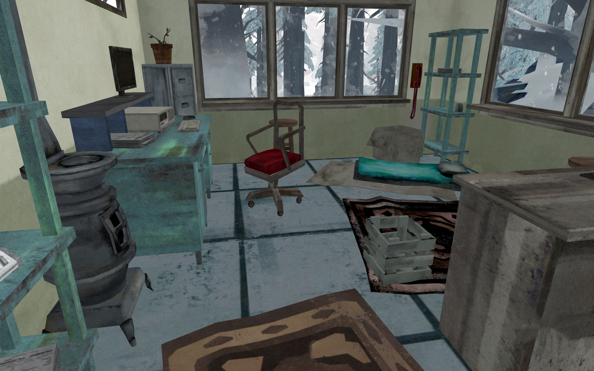
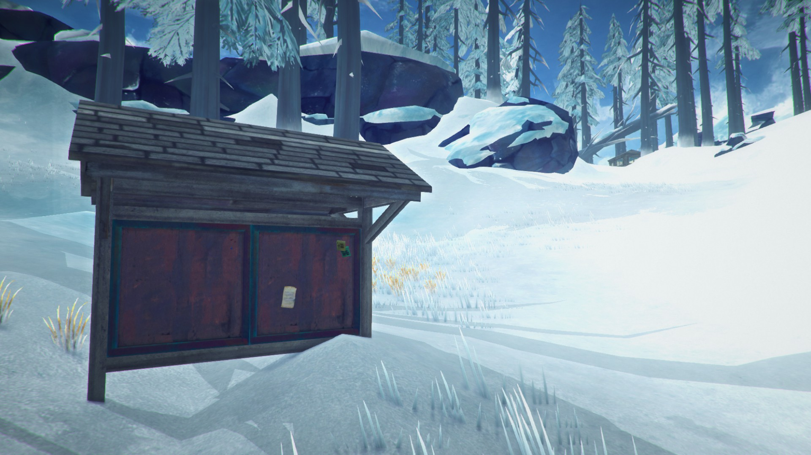

# Milton Park

**Categories:** Locations, Locations in Mountain Town · **Source:** [Fandom](https://thelongdark.fandom.com/wiki/Milton_Park)

**Milton Park**

| Property | Details |
| --- | --- |
|  | [Milton Park Office](../assets/Milton_Park_Office.jpg) |
| **Location** |  |
|  | [Milton Park Location](../assets/Milton_Park_Location.png) |
| Region |  |
| Description | Open Office without a door |
| **General** |  |
| Type |  |
| Firebox |  |
| [Bed icon](../assets/Bed_icon.png) | Has a bed |
| **Wintermute** |  |
| Missions | [Episode 1](./Episode%201%20-%20Do%20Not%20Go%20Gentle.md) |

> “**Due to the unfortunate accident, the Milton & Area Parks Board can no longer condone the use of the climbing area within the park boundaries.**”
>
> — Park Warning Notice

**Milton Park** is a location in the [Mountain Town](./Mountain%20Town.md) region. It can be found by taking a right at the [Orca Gas Station](./Orca%20Gas%20Station.md) south of [Milton](./Milton.md).

## Overview

A noticeboard can be found at the entrance, and there is a park office further up the hill. At the top of the cliff is a [Picnic Area](./Picnic%20Area.md) with a [Rope Climbing](./Rope%20Climbing.md) spot that leads to [Mystery Lake (region)](./Mystery%20Lake%20%28region%29.md). The Park office counts as being outdoors and is warmer than any of the local caves in the region, has a bed, storage, and a [Pot Belly Stove](./Pot%20Belly%20Stove.md) making in the best location in Milton to remove or prevent cabin fever.

## Gallery

[ru:Парк Милтона](https://ru.wikipedia.org/wiki/%D0%9F%D0%B0%D1%80%D0%BA_%D0%9C%D0%B8%D0%BB%D1%82%D0%BE%D0%BD%D0%B0) [es:Parque de milton](https://es.wikipedia.org/wiki/Parque_de_milton)
