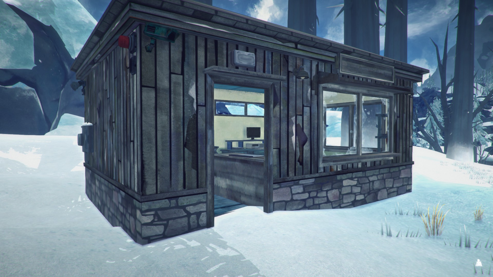
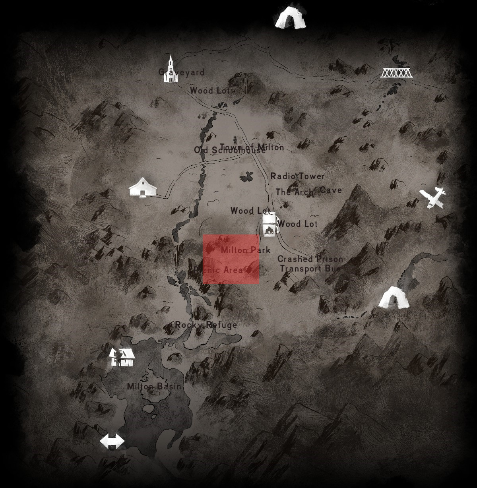

# Milton Park

**Categories:** Locations, Locations in Mountain Town, Residential locations, Sheltered locations · **Source:** [Fandom](https://thelongdark.fandom.com/wiki/Milton_Park)

**Milton Park**

_Milton\_Park\_Office.jpg_

**Location**

_Milton\_Park\_Location.png_

**Region:** [Mountain Town](./Mountain%20Town.md)

**General**

**Type:** Residential

_bed\_icon.png_

Has a bed

Provides some shelter

**Missions:** [Episode 1](./Episode%201%20-%20Do%20Not%20Go%20Gentle.md)

> “**Due to the unfortunate accident, the Milton &amp; Area Parks Board can no longer condone the use of the climbing area within the park boundaries.**”
>
> — Park Warning Notice

**Milton Park** is a location in the [Mountain Town](./Mountain%20Town.md) region. It can be found by taking a right at the [Orca Gas Station](./Orca%20Gas%20Station.md) south of [Milton](./Milton.md).

## Overview

A noticeboard can be found at the entrance, and there is a park office further up the hill. At the top of the cliff is a [Picnic Area](./Picnic%20Area.md) with a [Rope Climbing](./Rope%20Climbing.md) spot that leads to [Mystery Lake (region)](./Mystery%20Lake%20%28region%29.md). The Park office counts as being outdoors and is warmer than any of the local caves in the region, has a bed, storage, and a [Pot Belly Stove](./Pot%20Belly%20Stove.md) making in the best location in Milton to remove or prevent cabin fever.

## Gallery

_Milton\_Park\_inside.jpg_

_Milton\_Park\_Notice\_Board.jpg_
