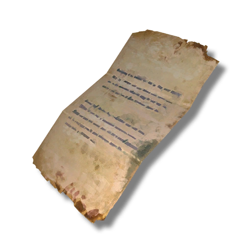

# Milton Post Office Note

<table class="infobox">
<caption>Milton Post Office Note</caption>
<colgroup>
<col style="width: 50%" />
<col style="width: 50%" />
</colgroup>
<tbody>
<tr>
<td colspan="2"><figure>

<figcaption>Milton_Post_Office_Note_icon.png</figcaption>
</figure></td>
</tr>
<tr>
<td>
Wintermute
</td>
<td>
<a href="./Episode%201%20-%20Do%20Not%20Go%20Gentle.md" class="wikilink" title="Episode 1">Episode 1</a>
</td>
</tr>
<tr>
<td colspan="2" class="section">
<strong>Properties</strong>
</td>
</tr>
<tr>
<td>
Item type
</td>
<td>
<a href="./Collectibles.md" class="wikilink" title="Collectibles">Collectibles</a>|-
</td>
</tr>
<tr>
<td>
Stackable
</td>
<td>
No
</td>
</tr>
<tr>
<td>
Examine
</td>
<td>
A scrap of paper found in Milton Post Office.
</td>
</tr>
<tr>
<td colspan="2" class="section">
<strong>Values</strong>
</td>
</tr>
<tr>
<td>
Weight
</td>
<td>
0 kg (0 lbs)
</td>
</tr>
</tbody>
</table>

The following text is transcribed from the note **Milton Post Office Note**, found in the <a href="./Milton%20Post%20Office.md" class="wikilink" title="Milton Post Office">Milton Post Office</a> on a chair behind the counter in <a href="./Episode%201%20-%20Do%20Not%20Go%20Gentle.md" class="wikilink" title="Episode 1: Do Not Go Gentle">Episode 1: Do Not Go Gentle</a>.

## Transcript

The following text is transcribed from **Milton Post Office Note**

Margaret -- we have to stop accepting mail at Milton. We have no way of getting it back to the mainland but we can't tell people that, or they'll know we've been holding on to it all this time. Find some excuse. Whenever you can, encourage people to use email or drone if they can afford it. I'll keep my eyes open for the mail van but I don't hold out high hopes. I imagine Jack probably drove it into a tree again, somewhere way in the back 40. We're likely to never find it back. Damn I should have stopped him from taking the truck while he was on the drink. I'll see what I can do to fix the situation. Hold tight.

## Update history

- UPDATE **1 August 2017 (<a href="./The%20Long%20Dark%20%E2%80%94%20Changelog.md#1.00" class="wikilink" title="Update">Update</a>):**
  - Added to game.

**Lua execution error in Module:Navbox function navbox**

<a href="ru:%D0%97%D0%B0%D0%BF%D0%B8%D1%81%D0%BA%D0%B0_%D0%B8%D0%B7_%D0%BF%D0%BE%D1%87%D1%82%D0%BE%D0%B2%D0%BE%D0%B3%D0%BE_%D0%BE%D1%82%D0%B4%D0%B5%D0%BB%D0%B5%D0%BD%D0%B8%D1%8F_%D0%9C%D0%B8%D0%BB%D1%82%D0%BE%D0%BD%D0%B0" class="wikilink" title="ru:Записка из почтового отделения Милтона">ru:Записка из почтового отделения Милтона</a>

