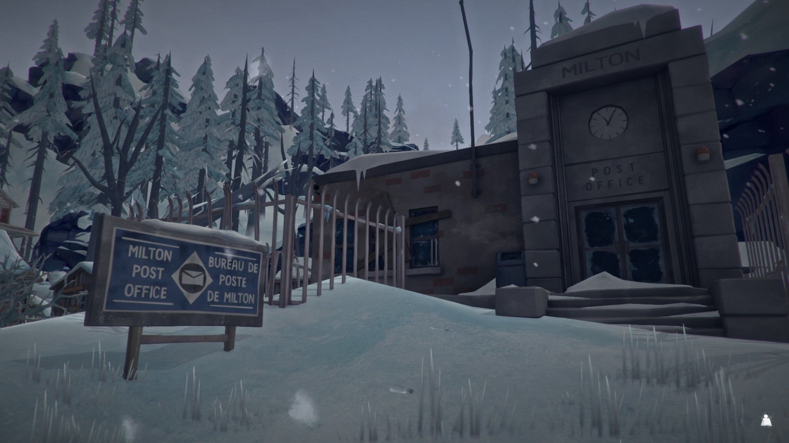
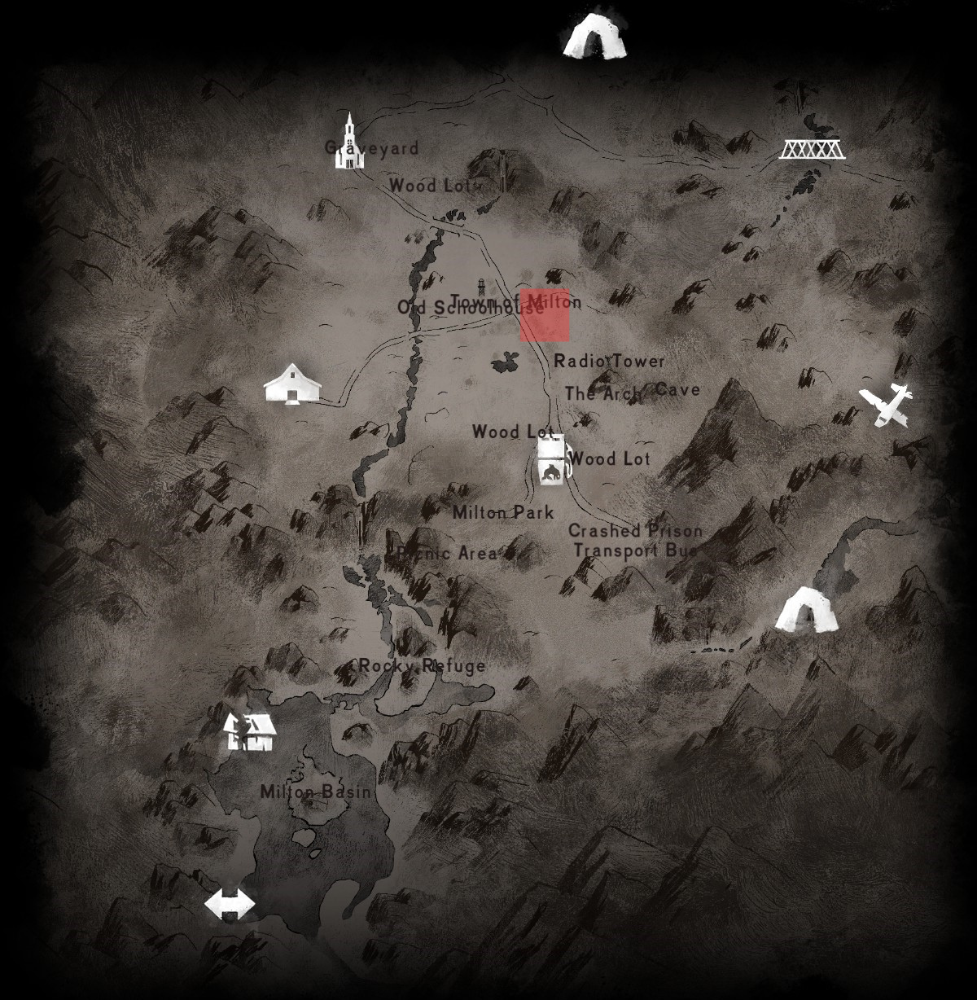

# Milton Post Office

**Milton Post Office**

| Property | Details |
| --- | --- |
|  |  / *Milton\_Post\_Office\_-\_Front.jpg* |
| **Location** |  |
|  |  / *Milton\_Post\_Office\_Location.png* |
| Region | [Mountain Town](./Mountain%20Town.md)\|- |
| Description | A single-room building that was once a post office |
| **General** |  |
| Type | Residential\|- |
