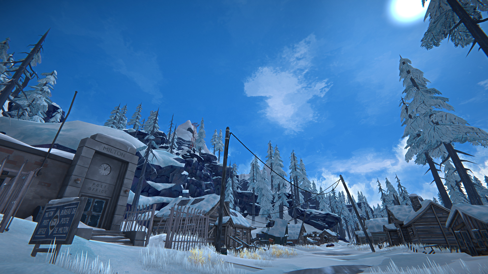
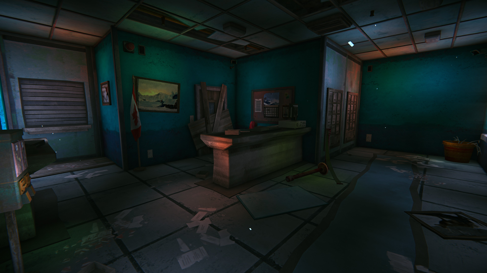
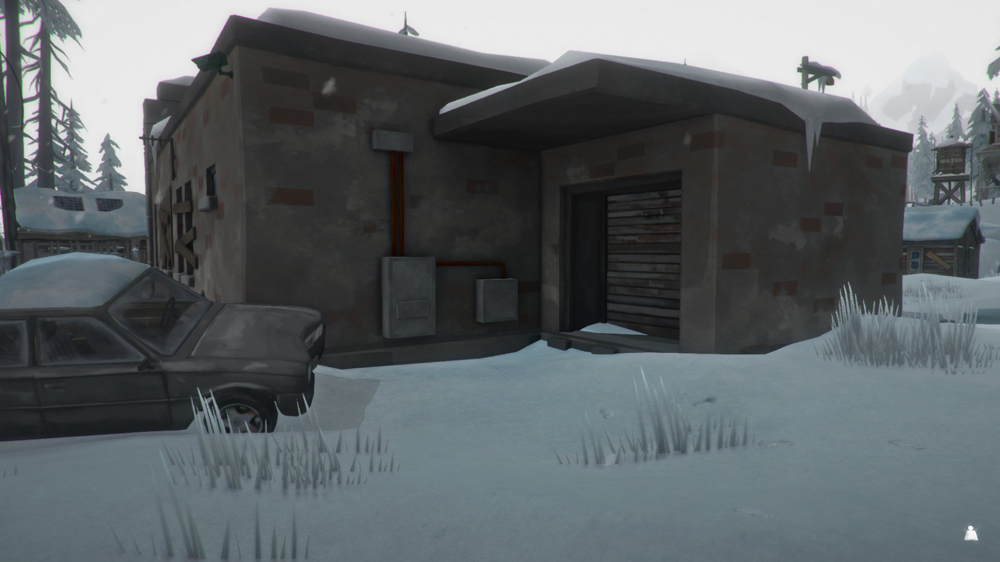
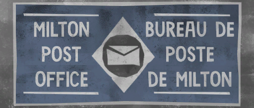

# Milton Post Office

**Categories:** Indoor locations, Locations, Locations in Mountain Town, Residential locations · **Source:** [Fandom](https://thelongdark.fandom.com/wiki/Milton_Post_Office)

**Contents**

- [Overview](#overview)
- [Items](#items)
- [Trivia](#trivia)
- [Gallery](#gallery)

**Milton Post Office**

| Property | Details |
| --- | --- |
|  | [Milton Post Office Front](../assets/Milton_Post_Office_-_Front.jpg) |
| **Location** |  |
|  | [Milton Post Office Location](../assets/Milton_Post_Office_Location.png) |
| Region | [Mountain Town](./Mountain%20Town.md) |
| Location | [Milton](./Milton.md) |
| Description | A single-room building that was once a post office |
| **General** |  |
| Type | Residential |
|  | Has an interior |

The **Milton Post Office** is a location in [Milton](./Milton.md) in [Mountain Town](./Mountain%20Town.md).

## Overview

This post office is the only one on all of Great Bear. It is a small building within close reach of the [Milton Credit Union](./Milton%20Credit%20Union.md), the [Bank Manager's House](./Bank%20Manager%27s%20House.md) and [Milton House (Grey Mother's)](./Milton%20House%20%28Grey%20Mother%27s%29.md). Blue signs at the front and rear of the post office are bilingual - written in both English (_Milton Post Office_) and French (_Bureau de poste de Milton_).

## Items

> “**Margaret -- we have to stop accepting mail at Milton. We have no way of getting it back to the mainland but we can't tell people that, or they'll know we've been holding onto it all this time.**”
>
> — Milton Post Office Collectible

The post office can contain a pair of [Driving Gloves](./Driving%20Gloves.md), a [backpack](./Backpack.md), a [collectible](./Collectibles.md) note entitled _Milton Post Office Collectible_, and several [newsprint](./Newsprint.md) and [stacks of paper](./Stack%20of%20Papers.md). There is also a small chance of a [Research Book](./Research%20Book.md).

Despite there being a back-end of the post office, this part of the building is inaccessible, resulting in the building being very small. It's one of a few locations with a radio that enables players to contact the [Trader](./Trader.md#Radio_Locations).

## Trivia

- Being a government building, in Canada, they must be labeled with both French and English lettering.

## Gallery

