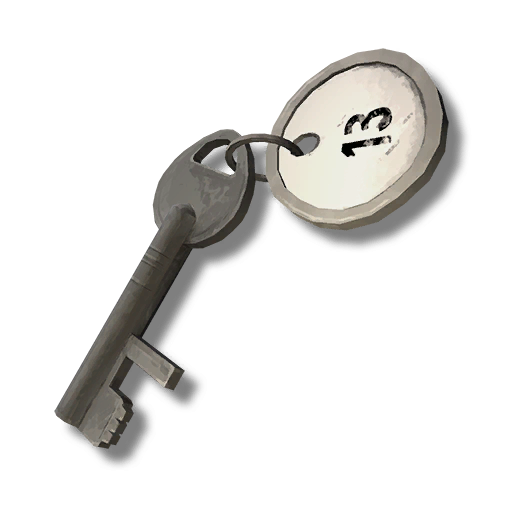

# Milton Safety Deposit Box Keys

<table class="infobox">
<caption>Milton Safety Deposit Box Keys</caption>
<colgroup>
<col style="width: 50%" />
<col style="width: 50%" />
</colgroup>
<tbody>
<tr>
<td colspan="2"><figure>

<figcaption>Bank_Deposit_Box_Key_13_icon.png</figcaption>
</figure></td>
</tr>
<tr>
<td>
Episode
</td>
<td>
<a href="./Episode%201%20-%20Do%20Not%20Go%20Gentle.md" class="wikilink" title="Episode 1">Episode 1</a>|-
</td>
</tr>
<tr>
<td>
Current
</td>
<td>
Milton Safety Deposit Box Keys
</td>
</tr>
<tr>
<td>
Region
</td>
<td>
<a href="./Mountain%20Town.md" class="wikilink" title="Mountain Town">Mountain Town</a>
</td>
</tr>
</tbody>
</table>

**Template:spoiler**

<table>
<colgroup>
<col style="width: 33%" />
<col style="width: 33%" />
<col style="width: 33%" />
</colgroup>
<tbody>
<tr>
<td style="vertical-align: top; font-size: 3em; color: #5d5980; padding-right: 10px">
“
</td>
<td>
Locate and use the keys that unlock various Safety Deposit boxes at the Milton Credit Union.

&#10;

In-game description

</td>
<td style="vertical-align: bottom; font-size: 3em; color: #5d5980; padding-left: 10px">
”
</td>
</tr>
</tbody>
</table>

**Milton Safety Deposit Box Keys** is a side mission in <a href="./Episode%201%20-%20Do%20Not%20Go%20Gentle.md" class="wikilink" title="Episode 1">Episode 1</a>.

## Overview

To start the mission, the player must find any one of three bank deposit box keys scattered around the <a href="./Mountain%20Town.md" class="wikilink" title="Mountain Town">Mountain Town</a> region. Each key unlocks a safety deposit box in the <a href="./Milton%20Credit%20Union.md" class="wikilink" title="Milton Credit Union">Milton Credit Union</a> vault. Finding all three keys and opening all three safety deposit boxes will complete the mission.

## Tasks

- Open bank deposit box \#7
- Open bank deposit box \#13
- Open bank deposit box \#20
- Open Bank deposit box \#15

## Key locations

- *<a href="./Bank%20Deposit%20Box%20Key%207.md" class="wikilink" title="Bank Deposit Box Key #7">Bank Deposit Box Key #7</a>* is located inside a house on the main road between the [Post Office](https://thelongdark.fandom.com/wiki/Milton_Post_Office) and the [Orca Gas Station](https://thelongdark.fandom.com/wiki/Orca_Gas_Station), in a plastic container underneath the bed. The house is across the main road from the <a href="./Bank%20Manager%27s%20House.md" class="wikilink" title="Bank Manager&#39;s House">Bank Manager's House</a>. Note there is another house in between them. Box contains <a href="./Cash.md" class="wikilink" title="cash">cash</a> and 2 <a href="./Flare%20Shell.md" class="wikilink" title="flare shells">flare shells</a>.
- *<a href="./Bank%20Deposit%20Box%20Key%2013.md" class="wikilink" title="Bank Deposit Box Key #13">Bank Deposit Box Key #13</a>* is located on a corpse near the frozen river between <a href="./Orca%20Gas%20Station.md" class="wikilink" title="Orca Gas Station">Orca Gas Station</a> and <a href="./Paradise%20Meadows%20Farm.md" class="wikilink" title="Paradise Meadows Farm">Paradise Meadows Farm</a>. Follow the stream downhill directly behind the gas station. Right before the slight bend, turn left up the slope and the corpse will be directly ahead. The crows circling above the corpse should make locating it easier; If walking downstream, the crows can be seen circling above on the lefthand side of the river. Box contains <a href="./Balaclava.md" class="wikilink" title="balaclava">balaclava</a>, <a href="./Book.md" class="wikilink" title="book">book</a>, <a href="./Ski%20Gloves.md" class="wikilink" title="ski gloves">ski gloves</a> and <a href="./Stack%20of%20Papers.md" class="wikilink" title="stack of papers">stack of papers</a>.
- *<a href="./Bank%20Deposit%20Box%20Key%2020.md" class="wikilink" title="Bank Deposit Box Key #20">Bank Deposit Box Key #20</a>* is located behind <a href="./Orca%20Gas%20Station.md" class="wikilink" title="Orca Gas Station">Orca Gas Station</a> in a blue pickup truck parked on the trail leading to the climbing area. The truck is next to two port-a-potties. Box contains <a href="./Magnifying%20Lens.md" class="wikilink" title="magnifying lens">magnifying lens</a> and 2 <a href="./Cash.md" class="wikilink" title="cash">cash</a>.
- <a href="./Bank%20Deposit%20Box%20Key%2015.md" class="wikilink" title="Bank Deposit Box Key #15">Bank Deposit Box Key #15</a> is located in the farm house. The key can be found next to <a href="./Hobbs.md" class="wikilink" title="Hobbs">Hobbs</a> immediately after the interaction with him, regardless of the outcome chosen. This is the only key that is necessary to progress through the story, as Bank Deposit Box \#15 holds a plot-sensitive item.\

**Lua execution error in Module:Navbox function navbox**

