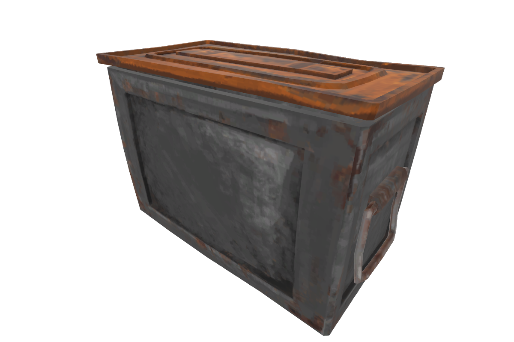

# Milton Supply Caches

**Contents**

- [Official description](#Official_description)
- [Overview](#Overview)
- [Hidden caches](#Hidden_caches)
- [Cave](#Cave)
- [Church](#Church)
- [Destroyed house](#Destroyed_house)
- [Rewards](#Rewards)
- [Trivia](#Trivia)

<table class="infobox">
<caption>Milton Supply Caches</caption>
<colgroup>
<col style="width: 50%" />
<col style="width: 50%" />
</colgroup>
<tbody>
<tr>
<td colspan="2"><figure>

<figcaption>Hidden_Cache.png</figcaption>
</figure></td>
</tr>
<tr>
<td>
Episode
</td>
<td>
<a href="./Episode%201%20-%20Do%20Not%20Go%20Gentle.md" class="wikilink" title="Episode 1">Episode 1</a>|-
</td>
</tr>
<tr>
<td>
Current
</td>
<td>
Milton Supply Caches
</td>
</tr>
<tr>
<td>
Region
</td>
<td>
<a href="./Mountain%20Town.md" class="wikilink" title="Mountain Town">Mountain Town</a>
</td>
</tr>
</tbody>
</table>

**Spoiler Warning:***This page may contain spoilers from the <a href="./Wintermute.md" class="wikilink" title="story">story</a> of The Long Dark.*

**Milton Supply Caches** is a side mission in <a href="./Episode%201%20-%20Do%20Not%20Go%20Gentle.md" class="wikilink" title="Episode 1">Episode 1</a>. To start the quest, the player must find any one of three notes scattered around the town of <a href="./Milton.md" class="wikilink" title="Milton">Milton</a>. Each note will reveal information about a hidden cache of supplies nearby and add a marker to the map. To complete the quest, the player must find all three notes and recover each of their respective supply caches.

## Official description

|  |  |  |
|----|----|----|
| “ | The Collapse taught Milton residents to be ready for the worst. Find the collectibles that point you to cache locations. | ” |

## Overview

To start the mission, the survivor has to find one of the corresponding notes scattered around <a href="./Milton.md" class="wikilink" title="Milton">Milton</a>:

- <a href="./Cave%20Hidden%20Cache%20Note.md" class="wikilink" title="Cave Hidden Cache Note">Cave Hidden Cache Note</a>
- <a href="./Medicine%20in%20my%20backyard.md" class="wikilink" title="Medicine in my backyard">Medicine in my backyard</a>
- <a href="./Milton%20Hidden%20Cache%20Note.md" class="wikilink" title="Milton Hidden Cache Note">Milton Hidden Cache Note</a>

Each found note adds a new task to the mission tracker.

## Hidden caches

### Cave

The mission objective can be started after finding the <a href="./Collectibles.md" class="wikilink" title="Collectible">Collectible</a> <a href="./Cave%20Hidden%20Cache%20Note.md" class="wikilink" title="Cave Hidden Cache Note">Cave Hidden Cache Note</a>, which is located on a sleeping bag within a residential home at the top of the hill southwest of the <a href="./Old%20Schoolhouse.md" class="wikilink" title="Old Schoolhouse">Old Schoolhouse</a>. (Must look at the map to be able to follow instructions!)

The easiest method to get to the cave is to start at <a href="./Milton%20House%20%28Grey%20Mother%27s%29.md" class="wikilink" title="Milton House (Grey Mother&#39;s)">Milton House (Grey Mother's)</a>, and head back towards the <a href="./Radio%20Tower.md" class="wikilink" title="Radio Tower">Radio Tower</a>. Continue past the <a href="./Radio%20Tower.md" class="wikilink" title="Radio Tower">Radio Tower</a> and enter the large cave within the cliff face. The survival cache appears as a pile of blue rocks in the back of the cave, as opposed to a <a href="./Hidden%20Cache.md" class="wikilink" title="Hidden Cache">Hidden Cache</a> container. The survivor can search the rocks to recover the supplies contained within the cache.

### Church

The mission objective can be started after finding the Collectible <a href="./Medicine%20in%20my%20backyard.md" class="wikilink" title="Medicine in my backyard">Medicine in my backyard</a> inside of a car located between the <a href="./Milton%20Post%20Office.md" class="wikilink" title="Milton Post Office">Milton Post Office</a> and <a href="./Orca%20Gas%20Station.md" class="wikilink" title="Orca Gas Station">Orca Gas Station</a>. The car can be located by departing from Grey Mother's House, turning left, and following the road towards <a href="./Orca%20Gas%20Station.md" class="wikilink" title="Orca Gas Station">Orca Gas Station</a>. The note is located inside the last car on the left before leaving the town area.

The easiest method to get to the cache is to start at Grey Mother's House, and right towards <a href="./St.%20Christopher%27s%20Church.md" class="wikilink" title="St. Christopher&#39;s Church">St. Christopher's Church</a>. Once reached, look for a large fallen tree directly behind the church. The survival cache appears as a <a href="./Hidden%20Cache.md" class="wikilink" title="Hidden Cache">Hidden Cache</a> container tucked against the fallen tree. The survivor can search the container to recover the supplies contained within the cache.

### Destroyed house

The mission objective can be started after finding the Collectible <a href="./Milton%20Hidden%20Cache%20Note.md" class="wikilink" title="Milton Hidden Cache Note">Milton Hidden Cache Note</a> inside the chimney of the destroyed <a href="./Old%20Schoolhouse.md" class="wikilink" title="Old Schoolhouse">Old Schoolhouse</a> within <a href="./Milton.md" class="wikilink" title="Milton">Milton</a>.

The easiest method to get to the cache is to start at Grey Mother's House, and head left towards <a href="./Orca%20Gas%20Station.md" class="wikilink" title="Orca Gas Station">Orca Gas Station</a>. The second to last house on the right when leaving town is a destroyed house containing the cache. Once reached, look around outside in the snow under fallen structural beams for a <a href="./Hidden%20Cache.md" class="wikilink" title="Hidden Cache">Hidden Cache</a> container nestled in the snow. The survivor can search the container to recover the supplies contained within the cache.

## Rewards

- Randomized <a href="./Food%20And%20Drink.md" class="wikilink" title="food">food</a>, <a href="./Clothing.md" class="wikilink" title="clothing">clothing</a>, and <a href="./Tools.md" class="wikilink" title="tools">tools</a>

## Trivia

- A cut objective for this mission was the medicine found in the back yard of the Millers, which was given by Grey Mother as a Trust reward. It was replaced by the note Medicine in my backyard in the Redux release of Episode 1.

**Lua execution error in Module:Navbox function navbox**

