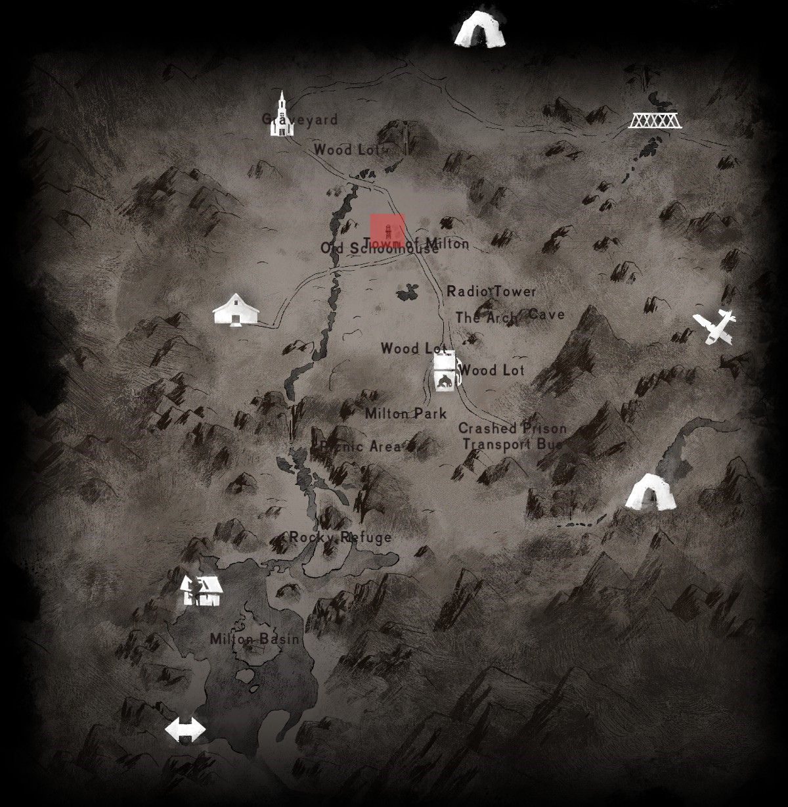

# Milton Water Tower

**Milton Water Tower**

| Property | Details |
| --- | --- |
|  |  / *Ep1\_Water\_Tower.png* |
| **Location** |  |
|  |  / *Milton\_Water\_Tower\_Location.png* |
| Region | [Mountain Town](./Mountain%20Town.md)\|- |
| **General** |  |
|  | Has no shelter\|} / > “**We recommend using bottled water until further notice.**” / > / > — - Public Notice, Great Bear Water Authority / **Milton Water Tower** is a landmark and unmarked location in [Milton](./Milton.md) in the [Mountain Town](./Mountain%20Town.md) region. It appears as a landmark on the [Map](./Map.md), but is not considered a location. / ## Wintermute / Prior to 30 June 2012, it was used by the [Great Bear](./Great%20Bear%20Island.md) Water Authority to help supply water to the town via underground water mains. A note, [Public Notice](./Public%20Notice.md), is found taped to the tower base in Wintermute, and reveals that as a result of seismic activity in the area; an outbreak of [E. coli](Wikipedia:Escherichia_coli) was found in the water supply and the tower was shut down, adding to the list of woes that Milton was already suffering from since the [The Collapse](./The%20Collapse.md). / ## Trivia / The Water Tower was originally between the bridge to Milton and [Milton House (Grey Mother's)](./Milton%20House%20%28Grey%20Mother%27s%29.md) in the V1.00 Predux release of the game. After the Redux re-release of Episode 1, the tower was moved to the center of town between the [Milton Credit Union](./Milton%20Credit%20Union.md) and [Old Schoolhouse](./Old%20Schoolhouse.md). / ## Gallery / \| Column 1 \| Column 2 \| Column 3 \| Column 4 \| / \| --- \| --- \| --- \| --- \| / \|  / *The original location of the Water Tower at the entrance of town in Predux.* \|  / *Another current view of the tower* \|  / *An aerial view of the old water tower location* \|  / *The water tower in art of [Methuselah](./Methuselah.md)* \| / \|  / *The Paradise Lost achievement icon* \|  \|  \|  \| / **Lua execution error in Module:Navbox function navbox** |
| “ | **We recommend using bottled water until further notice.** / - Public Notice, Great Bear Water Authority / ” |
|  / *The original location of the Water Tower at the entrance of town in Predux.* |  / *Another current view of the tower* /  / *An aerial view of the old water tower location* /  / *The water tower in art of [Methuselah](./Methuselah.md)* |
|  / *The Paradise Lost achievement icon* |  |
