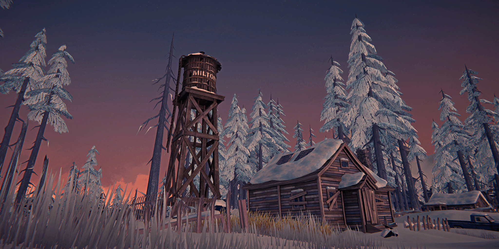

# Milton Water Tower

<table class="infobox">
<caption>Milton Water Tower</caption>
<colgroup>
<col style="width: 50%" />
<col style="width: 50%" />
</colgroup>
<tbody>
<tr>
<td colspan="2"><figure>

<figcaption>Ep1_Water_Tower.png</figcaption>
</figure></td>
</tr>
<tr>
<td colspan="2" class="section">
<strong>Location</strong>
</td>
</tr>
<tr>
<td colspan="2"><figure>
[Missing image: Milton_Water_Tower_Location.png]
<figcaption>Milton_Water_Tower_Location.png</figcaption>
</figure></td>
</tr>
<tr>
<td>
Region
</td>
<td>
<a href="./Mountain%20Town.md" class="wikilink" title="Mountain Town">Mountain Town</a>|-
</td>
</tr>
<tr>
<td colspan="2" class="section">
<strong>General</strong>
</td>
</tr>
<tr>
<td></td>
<td>
Has no shelter|}

<table>
<colgroup>
<col style="width: 33%" />
<col style="width: 33%" />
<col style="width: 33%" />
</colgroup>
<tbody>
<tr>
<td style="vertical-align: top; font-size: 3em; color: #5d5980; padding-right: 10px">
“
</td>
<td>
We recommend using bottled water until further notice.

&#10;

- Public Notice, Great Bear Water Authority

</td>
<td style="vertical-align: bottom; font-size: 3em; color: #5d5980; padding-left: 10px">
”
</td>
</tr>
</tbody>
</table>

<strong>Milton Water Tower</strong> is a landmark and unmarked location in <a href="./Milton.md" class="wikilink" title="Milton">Milton</a> in the <a href="./Mountain%20Town.md" class="wikilink" title="Mountain Town">Mountain Town</a> region. It appears as a landmark on the <a href="./Map.md" class="wikilink" title="Map">Map</a>, but is not considered a location.

<h2 id="Wintermute">Wintermute</h2>

Prior to 30 June 2012, it was used by the <a href="./Great%20Bear%20Island.md" class="wikilink" title="Great Bear">Great Bear</a> Water Authority to help supply water to the town via underground water mains. A note, <a href="./Public%20Notice.md" class="wikilink" title="Public Notice">Public Notice</a>, is found taped to the tower base in Wintermute, and reveals that as a result of seismic activity in the area; an outbreak of <a href="Wikipedia:Escherichia_coli" class="wikilink" title="E. coli">E. coli</a> was found in the water supply and the tower was shut down, adding to the list of woes that Milton was already suffering from since the <a href="./The%20Collapse.md" class="wikilink" title="The Collapse">The Collapse</a>.

<h2 id="Trivia">Trivia</h2>

The Water Tower was originally between the bridge to Milton and <a href="./Milton%20House%20%28Grey%20Mother%27s%29.md" class="wikilink" title="Milton House (Grey Mother&#39;s)">Milton House (Grey Mother's)</a> in the V1.00 Predux release of the game. After the Redux re-release of Episode 1, the tower was moved to the center of town between the <a href="./Milton%20Credit%20Union.md" class="wikilink" title="Milton Credit Union">Milton Credit Union</a> and <a href="./Old%20Schoolhouse.md" class="wikilink" title="Old Schoolhouse">Old Schoolhouse</a>.

<h2 id="Gallery">Gallery</h2>
<table class="gallery">
<colgroup>
<col style="width: 25%" />
<col style="width: 25%" />
<col style="width: 25%" />
<col style="width: 25%" />
</colgroup>
<tbody>
<tr>
<td><figure>
[Missing image: Milton_water_tower.jpg]
<figcaption>The original location of the Water Tower at the entrance of town in Predux.</figcaption>
</figure></td>
<td><figure>
[Missing image: TLD-SS-Milton_(3).jpg]
<figcaption>Another current view of the tower</figcaption>
</figure></td>
<td><figure>
[Missing image: Milton_-_aerial_view.jpg]
<figcaption>An aerial view of the old water tower location</figcaption>
</figure></td>
<td><figure>
[Missing image: Methuselah_Steam_Card.jpg]
<figcaption>The water tower in art of <a href="./Methuselah.md" class="wikilink" title="Methuselah">Methuselah</a></figcaption>
</figure></td>
</tr>
<tr>
<td><figure>

<figcaption>The Paradise Lost achievement icon</figcaption>
</figure></td>
<td></td>
<td></td>
<td></td>
</tr>
</tbody>
</table>

<strong>Lua execution error in Module:Navbox function navbox</strong>
</td>
</tr>
</tbody>
</table>

