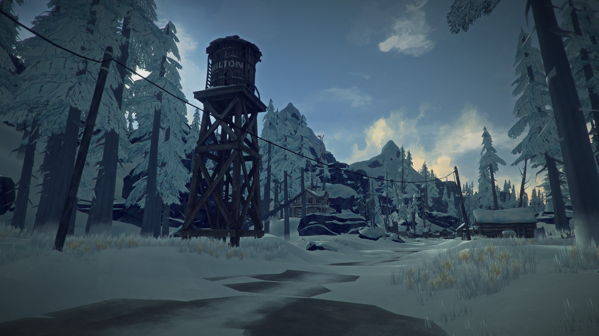
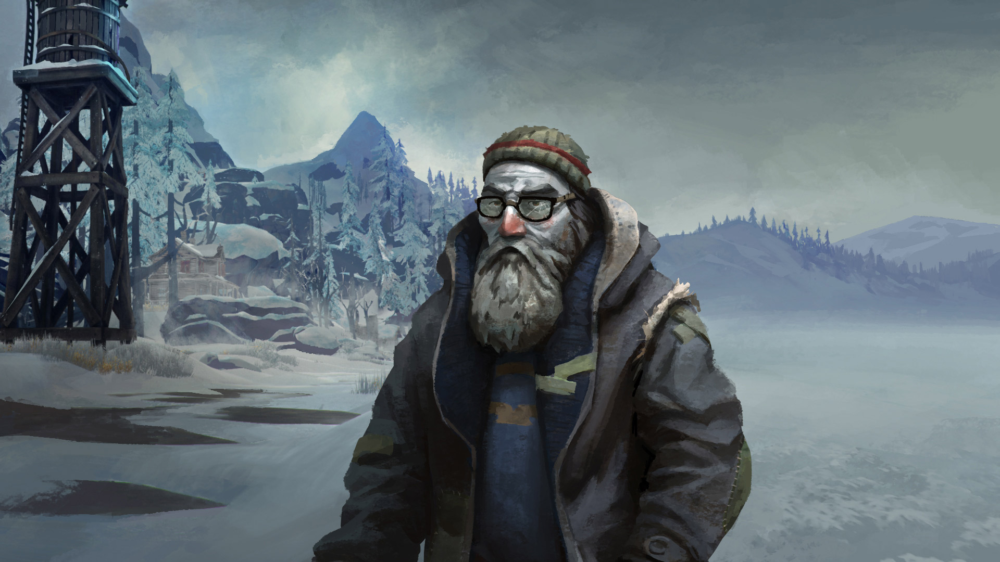

# Milton Water Tower

**Categories:** Locations, Locations in Mountain Town, Outdoor locations · **Source:** [Fandom](https://thelongdark.fandom.com/wiki/Milton_Water_Tower)

**Milton Water Tower**

_Ep1\_Water\_Tower.png_

**Location**

_Milton\_Water\_Tower\_Location.png_

**Region:** [Mountain Town](./Mountain%20Town.md)

**General**

> “**We recommend using bottled water until further notice.**”
>
> — - Public Notice, Great Bear Water Authority

_The original location of the Water Tower at the entrance of town in Predux._

_Another current view of the tower_

_An aerial view of the old water tower location_

_The water tower in art of [Methuselah](./Methuselah.md)_

_The Paradise Lost achievement icon_
