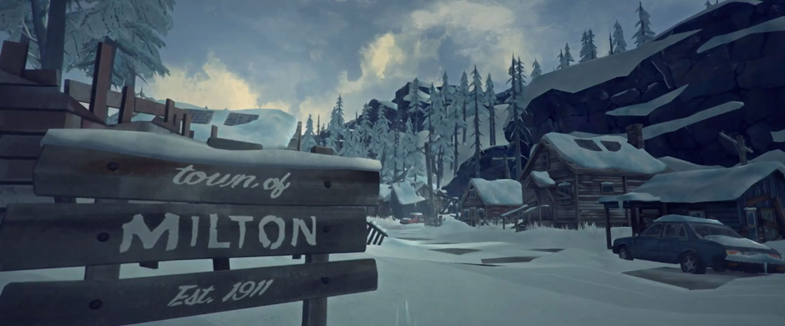
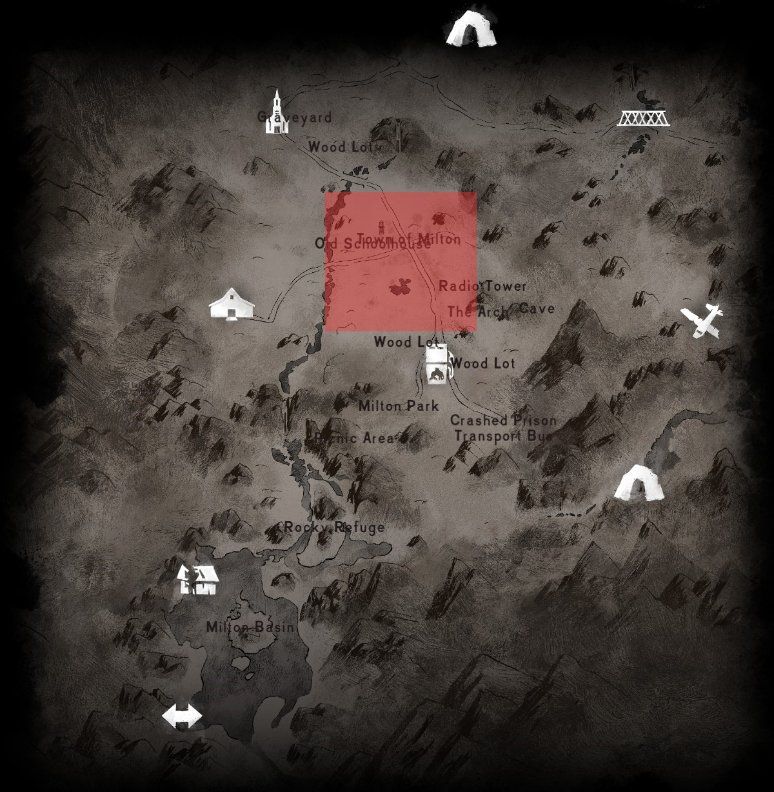
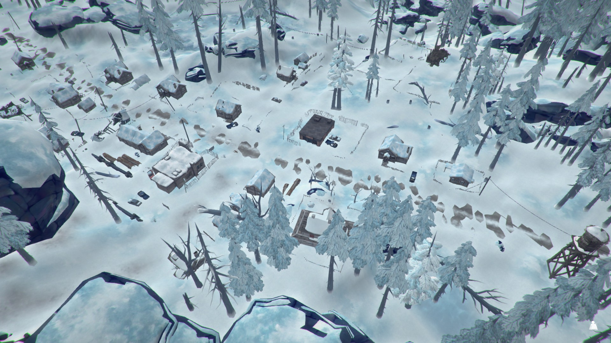
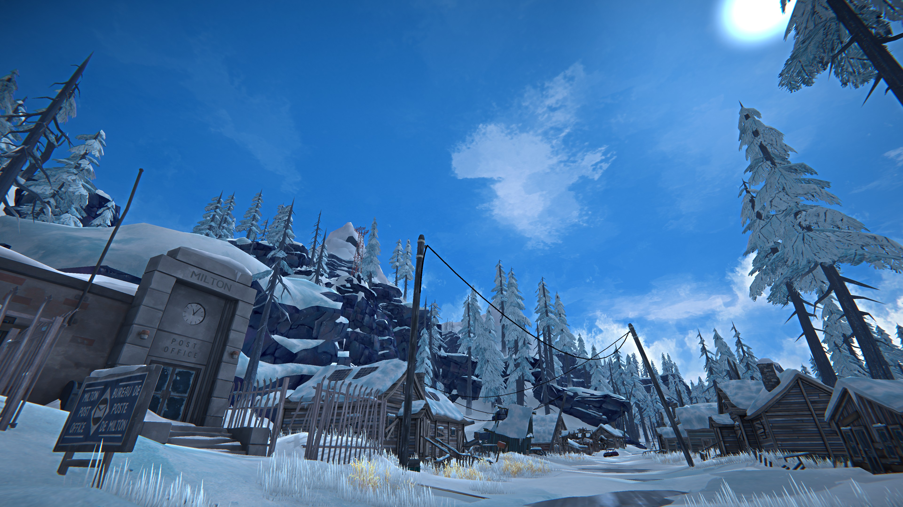
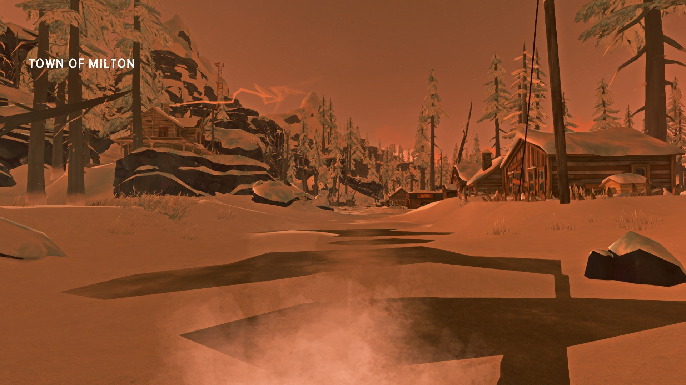
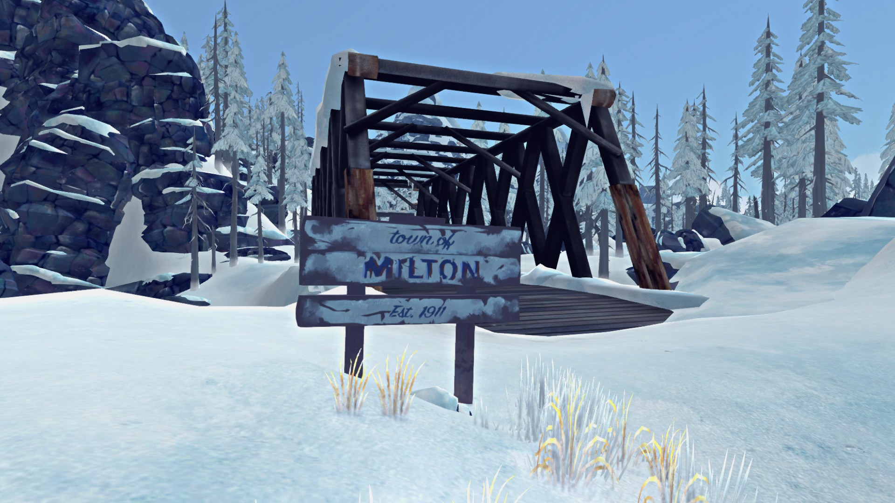

# Milton

**Categories:** Indoor locations, Locations, Locations in Mountain Town, Residential locations, Settlements · **Source:** [Fandom](https://thelongdark.fandom.com/wiki/Milton)

**Contents**

- [History](#history)
- [Notable Locations](#notable-locations)
- [Town of Milton](#town-of-milton)
- [Milton Outskirts](#milton-outskirts)
- [Current and Former Residents](#current-and-former-residents)
- [Gallery](#gallery)
- [References](#references)

**Milton**

_Milton.jpg_

**Location**

_Milton\_Location.png_

**Region:** [Mountain Town](./Mountain%20Town.md)\|-

**Description:** A small town nestled in the mountains

**General**

**Type:** Residential\|-

_bed\_icon.png_

Has a bed

Has an interior\|-

**Characters:** [Grey Mother](./Grey%20Mother.md)

_For the region in which **Milton** is set, see [Mountain Town](./Mountain%20Town.md)._

> “**The end of Milton's story is a sad one. Too many people lost, after already too much suffering.**”
>
> — -Methuselah

**The Town of Milton**is a major location in [Episode 1](./Episode%201%20-%20Do%20Not%20Go%20Gentle.md) of _The Long Dark's_Story Mode. It is a small, largely abandoned town nestled in the mountains of [Great Bear Island](./Great%20Bear%20Island.md). The location name of the game map is "Town of Milton."

## History

Milton was founded in 1911 to support the initially booming coal industry in the surrounding mountains. The town was originally built along a supply route from the coast to the interior of [Great Bear Island](./Great%20Bear%20Island.md), with the road replaced by a paved highway in 1960. The location of the town, halfway between Port Mary and the mountains in the interior of Great Bear, made it a convenient stopping-off point for fuel and supplies for workers in the mining, logging, and milling industries, as well as campers from Mainland [Canada](./The%20Collapse.md).[¹](#fn1)

The town's economy boomed in the 1980s, with the population reaching around 1000 people, but the construction of the [Great Bear Highway](./Great%20Bear%20Highway.md) (Highway 15) meant fewer people travelling through Milton, and ultimately led to the decline of the importance of Milton. In the 2000s the population was little more than 100 or so.[²](#fn2)

Following [The Collapse](./The%20Collapse.md), even fewer travelers or industrial workers visited Great Bear, and eventually the population fell to only a dozen or so - stalwarts and old-timers, with deep roots in Milton. Soon, Milton became a ghost town.[³](#fn3)

## Notable Locations

In addition to several houses within the town, the Mountain Town region contains multiple named locations.

#### Town of Milton

- [Bank Manager's House](./Bank%20Manager%27s%20House.md)
- [Milton House](./Milton%20House.md)
- [Milton House (Grey Mother's)](./Milton%20House%20%28Grey%20Mother%27s%29.md)
- [Milton Credit Union](./Milton%20Credit%20Union.md)
- [Milton Post Office](./Milton%20Post%20Office.md)
- [Milton Water Tower](./Milton%20Water%20Tower.md)
- [Old Schoolhouse](./Old%20Schoolhouse.md)
- [The Arch (Mountain Town location)](./The%20Arch%20%28Mountain%20Town%20location%29.md)

#### Milton Outskirts

- [Spruce Falls Bridge](./Spruce%20Falls%20Bridge.md)
- [St. Christopher's Church](./St.%20Christopher%27s%20Church.md) and [Graveyard](./Graveyard.md)
- [Orca Gas Station](./Orca%20Gas%20Station.md)
  - [Convenience Store](./Convenience%20Store.md)
- [Paradise Meadows Farm](./Paradise%20Meadows%20Farm.md)
- [Crashed Prison Transport Bus](./Crashed%20Prison%20Transport%20Bus.md)
- [Mackenzie's Crashed Plane](./Mackenzie%27s%20Crashed%20Plane.md)
- [Milton Park](./Milton%20Park.md)
- [Trailer (Mountain Town Region)](./Trailer%20%28Mountain%20Town%20Region%29.md)
- 3 x [Wood Lot](./Wood%20Lot.md)

## Current and Former Residents

- [Grey Mother](./Grey%20Mother.md)
- [Martin Barker](./Martin%20Barker.md)
- [Lilith Barker](./Lilith%20Barker.md)
- Father Francis McGill[⁴](#fn4)
- M. Antonides[⁵](#fn5)
- The Millers[⁶](#fn6)
- Margaret[⁷](#fn7)
- Jack[⁸](#fn8)
- Alice[⁹](#fn9)[¹⁰](#fn10)
- John[¹¹](#fn11)
- Molly (dog)[¹²](#fn12)
- N.[¹³](#fn13)
- Henry McDermott[¹⁴](#fn14)

## Gallery

_Aerial view of Milton (Redux)_

_Aerial view of Milton (Before the Redux update)_

_Milton Credit Union and Water Tower_

_Milton Post Office and Radio Tower_

_Milton at dusk_

_The welcoming sign near the bridge entrance to town_

## References

## Notes

---

1. [Story mode](./Wintermute.md) journal entry: What I know: Places: _Town of Milton_[↩︎](#fnref1)
2. 
3. 
4. _Pastor's Note_ collectible[↩︎](#fnref4)
5. _Park Warning Notice_ collectible[↩︎](#fnref5)
6. [Grey Mother](./Grey%20Mother.md) _Cache location_ side-mission[↩︎](#fnref6)
7. _Milton Post Office Collectible_[↩︎](#fnref7)
8. 
9. _Lost in the Storm_ collectible[↩︎](#fnref9)
10. _Neighbour's Note_ collectible[↩︎](#fnref10)
11. 
12. 
13. _Tearful Letter_ collectible[↩︎](#fnref13)
14. Owned a [Distress Pistol](./Distress%20Pistol.md) as part of the cut [Light Up The Night](./Light%20Up%20The%20Night.md) side mission and in the Orca Gas Station Buffer Memory[↩︎](#fnref14)
