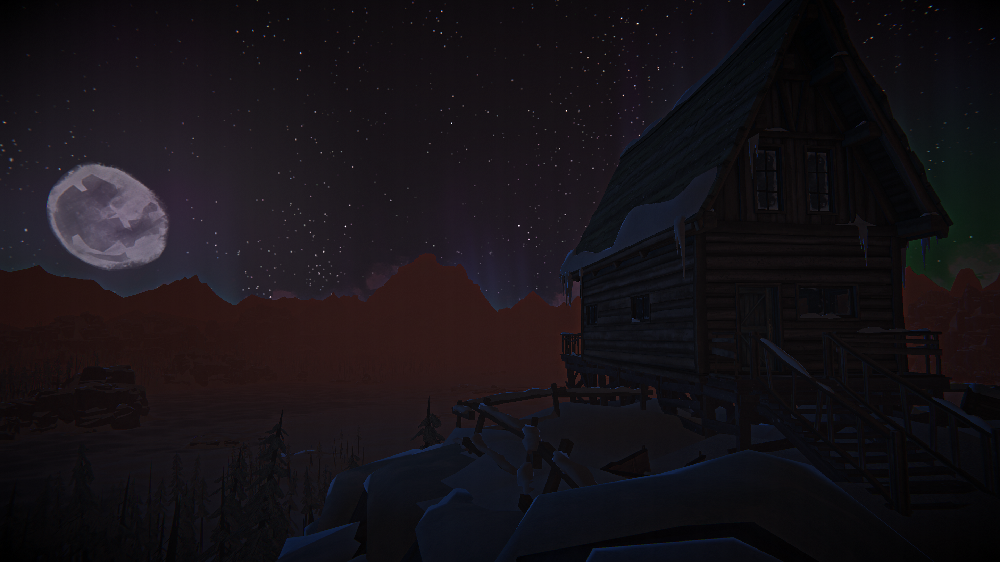
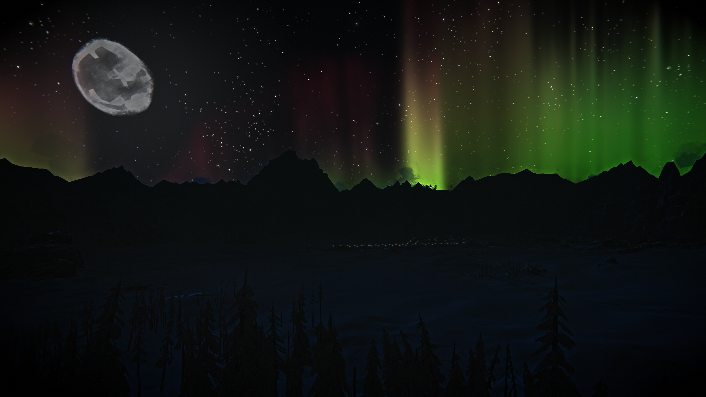

# Mindful Cabin

**Categories:** Indoor locations, Locations, Locations in Forsaken Airfield, Residential locations · **Source:** [Fandom](https://thelongdark.fandom.com/wiki/Mindful_Cabin)

**Mindful Cabin**

[Mindful cabin](../assets/Mindful_cabin.jpg)

**Location**

[Mindful Cabin Location](../assets/Mindful_Cabin_Location.png)

**Region:** [Forsaken Airfield](./Forsaken%20Airfield.md)

**Description:** A cabin overlooking

**General**

**Type:** Residential

[Bed icon](../assets/Bed_icon.png)

Has a bed

[Forge icon green](../assets/Forge_icon_green.png)

[Workbench icon green](../assets/Workbench_icon_green.png)

Has an interior **Mindful Cabin** is located in the north-west part of the [Forsaken Airfield](./Forsaken%20Airfield.md), at the end of the road.

## Overview

The cottage itself has one main room, with a [pot belly stove](./Pot%20Belly%20Stove.md), and a [bed](./Bed.md) that can be found in the loft. It does not have a loading screen upon entering. From the cottage's balcony, it is possible to see the runway of the airfield as well as the rescue helicopter crashed at [Final Approach](./Final%20Approach.md).

Notable loot includes the potential spawning of a [magnifying lens](./Magnifying%20Lens.md) and [cooking pot](./Cooking%20Pot.md), as well as a [knife](./Hunting%20Knife.md) on the balcony, canned food, [mukluks](./Mukluks.md) or [trail boots](./Trail%20Boots.md). It's even possible to gather some water from the tank placed under the kitchen sink. A hidden loot container labeled "[Loose Boards](./Loose%20Boards.md)" can be found under the stairs, right behind the shelf with the potted plant. It often contains a [revolver](./Revolver.md), as well as a [note someone left behind.](./A%20Note%20Left%20Behind.md)

Much like its counterpart in the region, the [Island Cottage](./Island%20Cottage.md), there are no electrical devices within the cabin, meaning that it will not immediately be obvious that an [Aurora](./Aurora.md) or [Glimmer Fog](./Glimmer%20Fog.md) event is active, should the player awaken from sleep after passing time. Luckily the many large windows and wide open views should allow the player to spot the potentially dangerous phenomena before venturing far.

## Safehouse

Although Mindful Cabin is similar inside to Island Cottage, it is generally regarded as inferior for a safehouse compared to the latter. This is mainly because Mindful Cabin is far from [Shoulder Lake](./Shoulder%20Lake.md), making fishing difficult, and it has limited hunting opportunities nearby. Even the [Rope Climbing](./Rope%20Climbing.md) section that can be used to get up to the area is the longest rope climb in the game, with no rests along the climb to the top and requiring a [Cup of Coffee](./Cup%20of%20Coffee.md) or [Emergency Stim](./Emergency%20Stim.md) to safely reach the top.

## Gallery

