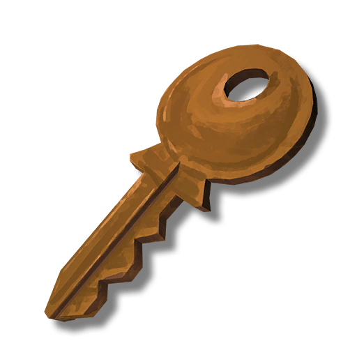

# Mine Gate Key

<table class="infobox">
<caption>Mine Gate Key</caption>
<colgroup>
<col style="width: 50%" />
<col style="width: 50%" />
</colgroup>
<tbody>
<tr>
<td colspan="2"><figure>

<figcaption>Mine_Gate_Key_icon.png</figcaption>
</figure></td>
</tr>
<tr>
<td>
Release
</td>
<td>
<a href="./The%20Long%20Dark%20%E2%80%94%20Changelog.md#2.25" class="wikilink" title="5 December 2023">5 December 2023</a>
</td>
</tr>
<tr>
<td colspan="2" class="section">
<strong>Properties</strong>
</td>
</tr>
<tr>
<td>
Item type
</td>
<td>
<a href="./Collectibles.md" class="wikilink" title="Collectibles">Collectibles</a>|-
</td>
</tr>
<tr>
<td>
Stackable
</td>
<td>
No
</td>
</tr>
<tr>
<td>
Examine
</td>
<td>
A key useful for accessing deeper areas of the mine.
</td>
</tr>
<tr>
<td colspan="2" class="section">
<strong>Values</strong>
</td>
</tr>
<tr>
<td>
Weight
</td>
<td>
0 kg (0 lbs)
</td>
</tr>
<tr>
<td colspan="2" class="section">
<strong>Advanced data</strong>
</td>
</tr>
<tr>
<td>
Item key
</td>
<td>
GAMEPLAY_Ep4MineGateKey
</td>
</tr>
</tbody>
</table>

The **Mine Gate Key** is a <a href="./Collectibles.md" class="wikilink" title="Collectibles">Collectibles</a> found on level 3 of the <a href="./Last%20Prospect.md" class="wikilink" title="Last Prospect">Last Prospect</a> mine in <a href="./Episode%204%20-%20Fury%2C%20Then%20Silence.md" class="wikilink" title="Episode 4: Fury, then Silence">Episode 4: Fury, then Silence</a> in <a href="./Wintermute.md" class="wikilink" title="Wintermute">Wintermute</a>.

## Wintermute

It is found in the mission <a href="./The%20Detonators.md" class="wikilink" title="The Detonators">The Detonators</a> and is found on Level 3 of the <a href="./Last%20Prospect.md" class="wikilink" title="Last Prospect">Last Prospect</a> mine. It is used to open a door to the elevator that goes to level 2.

## Survival Mode

It is also the name of a key found at the bottom of the <a href="./Langston%20Mine.md" class="wikilink" title="Langston Mine">Langston Mine</a> in <a href="./Survival%20Mode.md" class="wikilink" title="Survival Mode">Survival Mode</a>. It can be acquired while following the <a href="./Buried%20Echoes.md" class="wikilink" title="Buried Echoes">Buried Echoes</a> Tale by opening a locked gate with <a href="./Bolt%20Cutters.md" class="wikilink" title="Bolt Cutters">Bolt Cutters</a>. This key is needed to access the locked mountain mine entrance located near the top of the <a href="./Concentrator.md" class="wikilink" title="Concentrator">Concentrator</a>.

## Update history

- UPDATE **6 October 2021 (<a href="./The%20Long%20Dark%20%E2%80%94%20Changelog.md#1.95" class="wikilink" title="Update">Update</a>):**
  - Added to game in Episode 4.
- UPDATE **5 December 2023 (<a href="./The%20Long%20Dark%20%E2%80%94%20Changelog.md#2.25" class="wikilink" title="Update">Update</a>):**
  - Added to Survival Mode.

**Lua execution error in Module:Navbox function navboxLua execution error in Module:Navbox function navbox**

<a href="ru:%D0%9A%D0%BB%D1%8E%D1%87_%D0%BE%D1%82_%D0%B3%D0%BB%D0%B0%D0%B2%D0%BD%D1%8B%D1%85_%D0%B2%D0%BE%D1%80%D0%BE%D1%82" class="wikilink" title="ru:Ключ от главных ворот">ru:Ключ от главных ворот</a>

