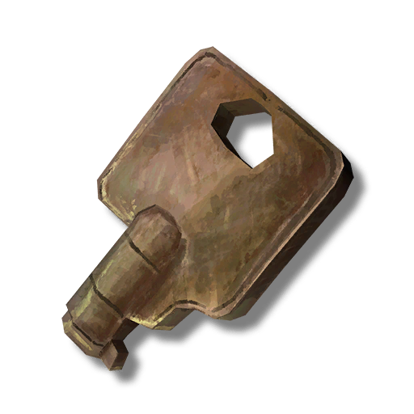

# Mine Lockbox Key

<table class="infobox">
<caption>Mine Lockbox Key</caption>
<colgroup>
<col style="width: 50%" />
<col style="width: 50%" />
</colgroup>
<tbody>
<tr>
<td colspan="2"><figure>

<figcaption>Mine_Lockbox_Key_icon.png</figcaption>
</figure></td>
</tr>
<tr>
<td>
Release
</td>
<td>
<a href="./The%20Long%20Dark%20%E2%80%94%20Changelog.md#2.25" class="wikilink" title="5 December 2023">5 December 2023</a>
</td>
</tr>
<tr>
<td>
Wintermute
</td>
<td>
No
</td>
</tr>
<tr>
<td colspan="2" class="section">
<strong>Properties</strong>
</td>
</tr>
<tr>
<td>
Item type
</td>
<td>
<a href="./Collectibles.md" class="wikilink" title="Collectibles">Collectibles</a>|-
</td>
</tr>
<tr>
<td>
Stackable
</td>
<td>
No
</td>
</tr>
<tr>
<td>
Examine
</td>
<td>
A key to a Lockbox in the Langston Mine.
</td>
</tr>
<tr>
<td colspan="2" class="section">
<strong>Values</strong>
</td>
</tr>
<tr>
<td>
Weight
</td>
<td>
0 kg (0 lbs)
</td>
</tr>
<tr>
<td colspan="2" class="section">
<strong>Advanced data</strong>
</td>
</tr>
<tr>
<td>
Item key
</td>
<td>
GAMEPLAY_LangstonMineLockboxKey1
</td>
</tr>
</tbody>
</table>

The **Mine Lockbox Key** is a <a href="./Collectibles.md" class="wikilink" title="Collectible">Collectible</a> found on Level 1 of the <a href="./Langston%20Mine.md" class="wikilink" title="Langston Mine">Langston Mine</a> in <a href="./Survival%20Mode.md" class="wikilink" title="Survival Mode">Survival Mode</a> on a <a href="./Frozen%20Corpse.md" class="wikilink" title="Frozen Corpse">Frozen Corpse</a>. You will need to navigate through toxic gas to reach it, and this pathway requires a <a href="./Respirator.md" class="wikilink" title="Respirator">Respirator</a> and at least 3 <a href="./Canister.md" class="wikilink" title="Canisters">Canisters</a> to safely retrieve the key and return to a breathable area, otherwise you will die from <a href="./Suffocation.md" class="wikilink" title="Suffocation">Suffocation</a>.

It unlocks a lockbox inside a cabin on the same level that has multiple stored items, including a <a href="./Gold%20Nugget.md" class="wikilink" title="Gold Nugget">Gold Nugget</a>.

## Update history

- UPDATE **5 December 2023 (<a href="./The%20Long%20Dark%20%E2%80%94%20Changelog.md#2.25" class="wikilink" title="Update">Update</a>):**
  - Added to game.

**Lua execution error in Module:Navbox function navbox**

