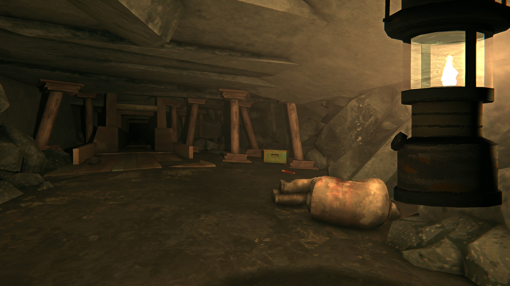
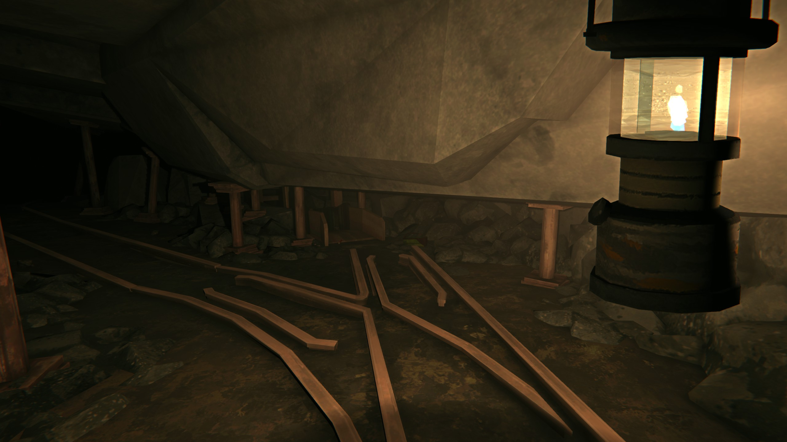
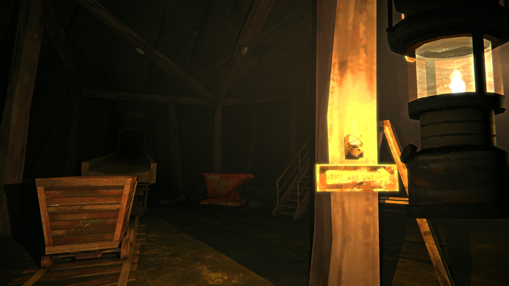
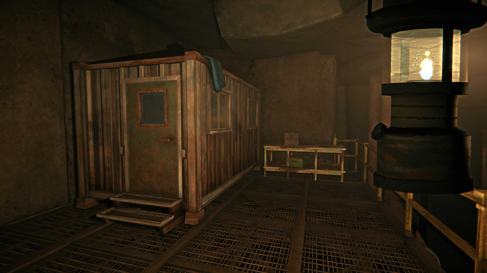
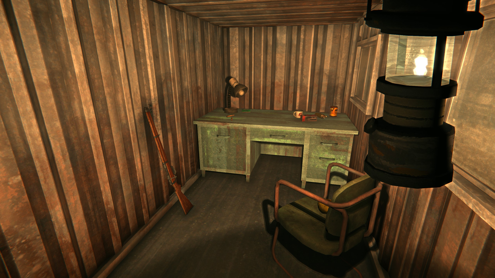

# Mine Office Key

**Categories:** Collectibles, Pages with update history · **Source:** [Fandom](https://thelongdark.fandom.com/wiki/Mine_Office_Key)

**Contents**

- [Overview](#overview)
- [Location](#location)
- [Trailer](#trailer)
- [Update history](#update-history)

**Mine Office Key**

| Property | Details |
| --- | --- |
|  | [Mine Office Key icon](../assets/Mine_Office_Key_icon.png) |
| Release | [5 December 2023](./The%20Long%20Dark%20%E2%80%94%20Changelog.md#2.25) |
| Wintermute | No |
| **Properties** |  |
| Item type | [Collectibles](./Collectibles.md)\|- |
| Stackable | No |
| Examine | An admin key from Langston Mine's bad old days. |
| **Values** |  |
| Weight | 0 kg (0 lbs) |
| **Advanced data** |  |
| Item key | GAMEPLAY\_LangstonMineKey1 |

The **Mine Office Key** is a unique key found only in [Survival Mode](./Survival%20Mode.md), specifically in the [Langston Mine](./Langston%20Mine.md) in the [Zone of Contamination](./Zone%20of%20Contamination.md).

## Overview

### Location

It can be found on a corpse in the mine. Starting from the bottom floor of the [Headframe Building](./Headframe%20Building.md) elevator, take a left through the toxic gas, past a toxic open pit, past another gas cloud, and the player will find themselves crouching and approaching a wooden coal chute under a very low ceiling. A curled up corpse will contain the key, and will be next to a [Metal Container](./Metal%20Container.md).

### Trailer

The key unlocks a mine trailer on a catwalk located in the center of the 3rd level where a (non-accessible) yellow coal chute from the 2nd level ends. A [Lantern](./Lantern.md) is in the center of this room for reference, and an [Insulated Flask](./Insulated%20Flask.md) tends to spawn on a table on the catwalk.

Loot:

- [Hunting Rifle](./Hunting%20Rifle.md) (unloaded)
- 7 [Rifle Firearm](./Rifle%20Firearm.md)
- [Firearm Cleaning Kit](./Firearm%20Cleaning%20Kit.md)
- [Frontier Shooting Guide](./Frontier%20Shooting%20Guide.md)
- [Wool Ear Wrap](./Wool%20Ear%20Wrap.md)
- [Cup of Coffee](./Cup%20of%20Coffee.md)
- [Tin of Coffee](./Tin%20of%20Coffee.md)

## Update history

- UPDATE **5 December 2023 ([Update](./The%20Long%20Dark%20%E2%80%94%20Changelog.md#2.25)):**
  - Added to game.
