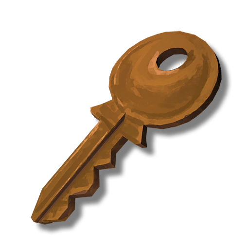

# Mine Office Key

**Contents**

- [Overview](#Overview)
- [Location](#Location)
- [Trailer](#Trailer)
- [Update history](#Update_history)

<table class="infobox">
<caption>Mine Office Key</caption>
<colgroup>
<col style="width: 50%" />
<col style="width: 50%" />
</colgroup>
<tbody>
<tr>
<td colspan="2"><figure>

<figcaption>Mine_Office_Key_icon.png</figcaption>
</figure></td>
</tr>
<tr>
<td>
Release
</td>
<td>
<a href="./The%20Long%20Dark%20%E2%80%94%20Changelog.md#2.25" class="wikilink" title="5 December 2023">5 December 2023</a>
</td>
</tr>
<tr>
<td>
Wintermute
</td>
<td>
No
</td>
</tr>
<tr>
<td colspan="2" class="section">
<strong>Properties</strong>
</td>
</tr>
<tr>
<td>
Item type
</td>
<td>
<a href="./Collectibles.md" class="wikilink" title="Collectibles">Collectibles</a>|-
</td>
</tr>
<tr>
<td>
Stackable
</td>
<td>
No
</td>
</tr>
<tr>
<td>
Examine
</td>
<td>
An admin key from Langston Mine's bad old days.
</td>
</tr>
<tr>
<td colspan="2" class="section">
<strong>Values</strong>
</td>
</tr>
<tr>
<td>
Weight
</td>
<td>
0 kg (0 lbs)
</td>
</tr>
<tr>
<td colspan="2" class="section">
<strong>Advanced data</strong>
</td>
</tr>
<tr>
<td>
Item key
</td>
<td>
GAMEPLAY_LangstonMineKey1
</td>
</tr>
</tbody>
</table>

The **Mine Office Key** is a unique key found only in <a href="./Survival%20Mode.md" class="wikilink" title="Survival Mode">Survival Mode</a>, specifically in the <a href="./Langston%20Mine.md" class="wikilink" title="Langston Mine">Langston Mine</a> in the <a href="./Zone%20of%20Contamination.md" class="wikilink" title="Zone of Contamination">Zone of Contamination</a>.

## Overview

### Location

It can be found on a corpse in the mine. Starting from the bottom floor of the <a href="./Headframe%20Building.md" class="wikilink" title="Headframe Building">Headframe Building</a> elevator, take a left through the toxic gas, past a toxic open pit, past another gas cloud, and the player will find themselves crouching and approaching a wooden coal chute under a very low ceiling. A curled up corpse will contain the key, and will be next to a <a href="./Metal%20Container.md" class="wikilink" title="Metal Container">Metal Container</a>.

<table class="gallery">
<colgroup>
<col style="width: 50%" />
<col style="width: 50%" />
</colgroup>
<tbody>
<tr>
<td><figure>
[Missing image: Mine_Office_Key_location.jpg]
<figcaption>The corpse with the key</figcaption>
</figure></td>
<td><figure>
[Missing image: Mine_Office_Key_location_2.jpg]
<figcaption>The other end of the chute for reference</figcaption>
</figure></td>
</tr>
</tbody>
</table>

### Trailer

The key unlocks a mine trailer on a catwalk located in the center of the 3rd level where a (non-accessible) yellow coal chute from the 2nd level ends. A <a href="./Lantern.md" class="wikilink" title="Lantern">Lantern</a> is in the center of this room for reference, and an <a href="./Insulated%20Flask.md" class="wikilink" title="Insulated Flask">Insulated Flask</a> tends to spawn on a table on the catwalk.

Loot:

- <a href="./Hunting%20Rifle.md" class="wikilink" title="Hunting Rifle">Hunting Rifle</a> (unloaded)
- 7 <a href="./Rifle%20Firearm.md" class="wikilink" title="Rifle Firearm">Rifle Firearm</a>
- <a href="./Firearm%20Cleaning%20Kit.md" class="wikilink" title="Firearm Cleaning Kit">Firearm Cleaning Kit</a>
- <a href="./Frontier%20Shooting%20Guide.md" class="wikilink" title="Frontier Shooting Guide">Frontier Shooting Guide</a>
- <a href="./Wool%20Ear%20Wrap.md" class="wikilink" title="Wool Ear Wrap">Wool Ear Wrap</a>
- <a href="./Cup%20of%20Coffee.md" class="wikilink" title="Cup of Coffee">Cup of Coffee</a>
- <a href="./Tin%20of%20Coffee.md" class="wikilink" title="Tin of Coffee">Tin of Coffee</a>

<table class="gallery">
<colgroup>
<col style="width: 33%" />
<col style="width: 33%" />
<col style="width: 33%" />
</colgroup>
<tbody>
<tr>
<td><figure>
[Missing image: Mine_Office_Key_trailer_2.jpg]
<figcaption>The chute exit from Level 2</figcaption>
</figure></td>
<td><figure>
[Missing image: Mine_Office_Key_trailer.jpg]
<figcaption>The trailer</figcaption>
</figure></td>
<td><figure>
[Missing image: Mine_Office_Key_trailer_3.jpg]
<figcaption>The inside of the trailer</figcaption>
</figure></td>
</tr>
</tbody>
</table>

## Update history

- UPDATE **5 December 2023 (<a href="./The%20Long%20Dark%20%E2%80%94%20Changelog.md#2.25" class="wikilink" title="Update">Update</a>):**
  - Added to game.

**Lua execution error in Module:Navbox function navbox**

<a href="ru:%D0%9A%D0%BB%D1%8E%D1%87_%D0%BE%D1%82_%D0%BA%D0%B0%D0%B1%D0%B8%D0%BD%D0%B5%D1%82%D0%B0_%D0%B0%D0%B4%D0%BC%D0%B8%D0%BD%D0%B8%D1%81%D1%82%D1%80%D0%B0%D1%82%D0%BE%D1%80%D0%B0_%D1%88%D0%B0%D1%85%D1%82%D1%8B" class="wikilink" title="ru:Ключ от кабинета администратора шахты">ru:Ключ от кабинета администратора шахты</a>

