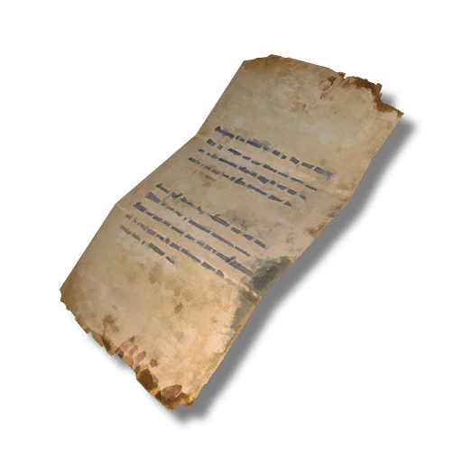

# Mine Safety Notice

**Categories:** Collectibles, Pages with update history · **Source:** [Fandom](https://thelongdark.fandom.com/wiki/Mine_Safety_Notice)

**Mine Safety Notice**

_Mine\_Safety\_Notice\_icon.png_

**Release:** [6 October 2021](./The%20Long%20Dark%20%E2%80%94%20Changelog.md#1.95)

**Wintermute:** [Episode 4](./Episode%204%20-%20Fury%2C%20Then%20Silence.md)

**Properties**

**Item type:** [Collectibles](./Collectibles.md)

**Stackable:** No

**Examine:** A posted notice with details on mine operations.

**Values**

**Weight:** 0.00 kg (0 lbs)

**Actions**

**Backpack:** Examine

**On ground:** Take It, Read Text, Leave It

**Mine Safety Notice** is a [Collectible](./Collectibles.md) found in [Episode 4](./Episode%204%20-%20Fury%2C%20Then%20Silence.md) of the [Wintermute](./Wintermute.md) story. It is located next to the first elevator inside the [Last Prospect](./Last%20Prospect.md) Mine.

## Transcript

_The following text is transcribed from **Mine Safety Notice**_

WARNING!

Due to recent funding shortfalls, we've had to carry out additional blasting on Level 2 sooner than expected.

We're aware this may impact air quality containment controls on lower levels.

We only ask that you follow posted guidelines when working in areas of the facility that may be impacted by any noxious vapors.

## Update history

- UPDATE **6 October 2021 ([Update](./The%20Long%20Dark%20%E2%80%94%20Changelog.md#1.95)):**
  - Added to game.
