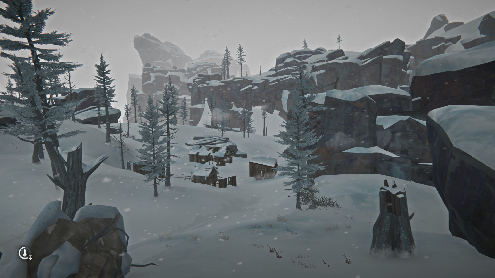
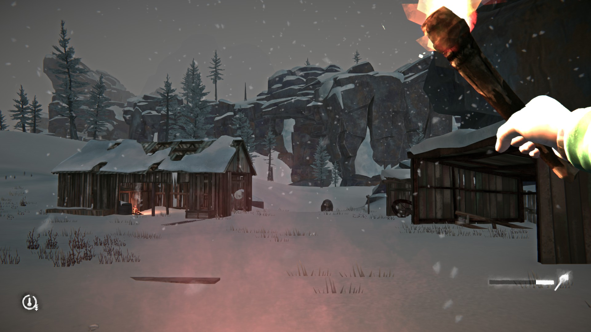
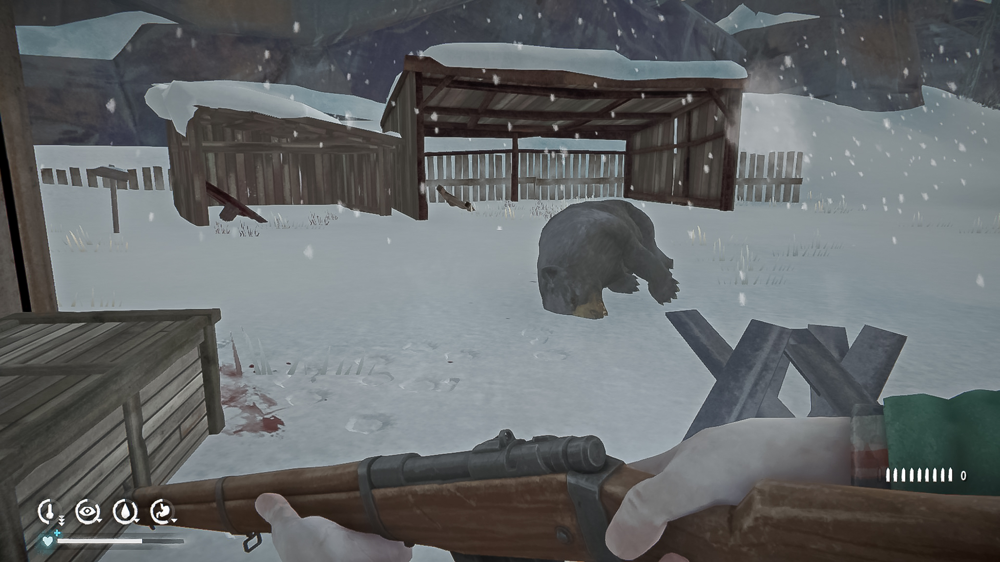
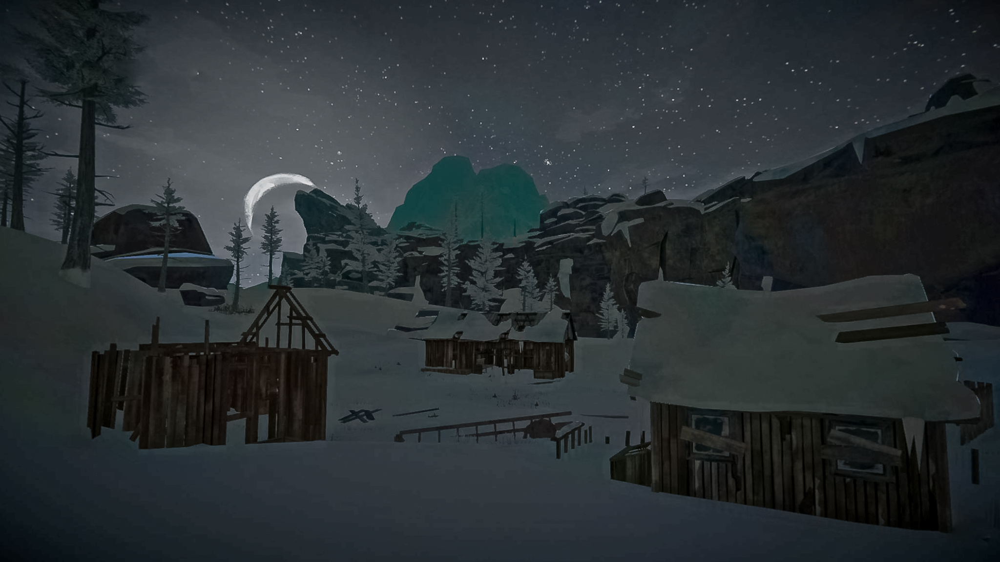
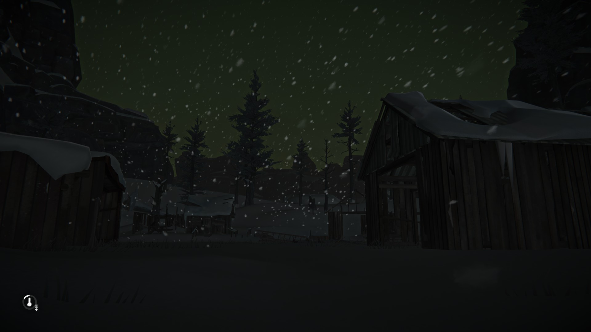
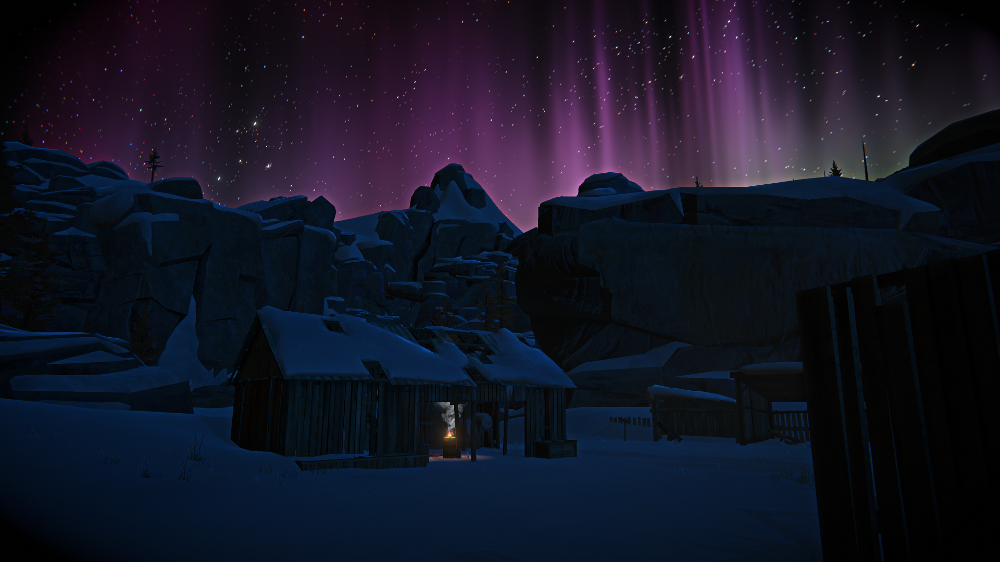
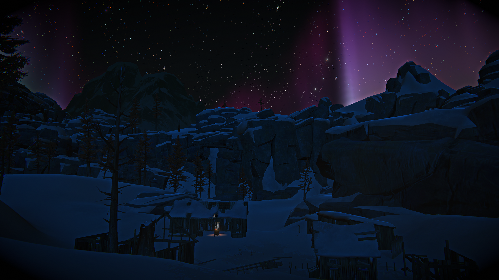

# Miner's Folly

**Categories:** Indoor locations, Industrial locations, Locations, Locations in Ash Canyon, Locations with a workbench · **Source:** [Fandom](https://thelongdark.fandom.com/wiki/Miner's_Folly)

**Contents**

- [Access to the Area](#access-to-the-area)
- [Overview](#overview)
- [Resources](#resources)
- [Nearby unnamed locations](#nearby-unnamed-locations)
- [Gallery](#gallery)

**Miner's Folly**

**Location**

**Region:** [Ash Canyon](./Ash%20Canyon.md)

**General**

**Type:** Industrial

Has a workbench

## Access to the Area

Initially, there are only three access points to this area:

1. Climbing to the plateau just below the [Mining Camp](./Mining%20Camp.md) (three [rope climbs](./Rope%20Climbing.md) required), and then crossing the north part of the map from west to east through many bridges, finally having to go through a choke point with a [bear](./Bear.md). Probably the longest and most dangerous path.
2. The safer path, climbing to [High Meadow](./High%20Meadow.md) from the plateau with the [Climber's Cave](./Climber%27s%20Cave.md) (two [rope climbs](./Rope%20Climbing.md)), cross a couple of bridges and that's it, no choke point, no bear.
3. The faster path, walking to the north until you reach the cave next to [Long Falls](./Long%20Falls.md), go through the cave (one [rope climb](./Rope%20Climbing.md) inside), then go through the choke point with the bear.

Once the area is visited another access can be opened, if the player deploys a [rope](./Mountaineering%20Rope.md) from [Homesteader's Respite](./Homesteader%27s%20Respite.md), but to get there, another pretty long rope climb (with one ledge) is in the way. Once the rope is deployed, the resulting path would have two [rope climbs](./Rope%20Climbing.md) (one very long) but with an indoors shelter ([Homesteader's Respite](./Homesteader%27s%20Respite.md)) in between the two, and no chokepoint with bear, making it quite safe.

It is possible to reach [Homesteader's Respite](./Homesteader%27s%20Respite.md) from [Bitter Marsh](./Bitter%20Marsh.md) without a rope by walking up a nearby slope and sticking to the cliff-face, then dropping onto the ledge below. This path is the fastest for reaching Miner's Folly, however it clearly isn't a path Hinterland intended for players to take, and the steep angle may cause multiple sprains, which will require treatment before climbing the long rope to [Fire Overlook](./Fire%20Overlook.md).

## Overview

A [Work Bench](./Work%20Bench.md), [First Aid cabinet](./First%20Aid%20Kit.md), [Woodworking Tools](./Woodworking%20Tools.md) as well as a [Fire Barrel](./Fire%20Barrel.md) are available in the main ruined barn, which is partly open to the elements and predators. Reclaimed wood and a few other miscellaneous supplies may be found scattered around the site or in containers. Fixed containers include a coal bin and a backpack.

There is also a small cabin that provides shelter and can be used as a [Safe House](./Safehouse.md). It has a [bed](./Bed.md) and some containers, along with [books](./Book.md), [food](./Food%20And%20Drink.md) (a guaranteed food can and soda and some random food as well), [clothing](./Clothing.md) (pants seem to be guaranteed under the bunkbed, with [Work Pants](./Work%20Pants.md) and [Combat Pants](./Combat%20Pants.md) being the most common), and curtains (one of the few sources of [cloth](./Cloth.md) in Ash Canyon). It might sometimes contain a [hatchet](./Hatchet.md) or a [hacksaw](./Hacksaw.md). The [Mining Log Page](./Mining%20Log%20Page.md) can be found on the table.

On the outside of the cabin, next to the door, will be pinned the [Memento Note](./Mementos.md) and Key that give access to the [Angler's Den](./Angler%27s%20Den.md) lockbox (containing several fresh fish).

There may be [deer](./Deer.md) around to hunt, but when hunting or crafting at the work bench, it's a good idea to be aware of the [bear](./Bear.md) that lives in the nearby cave tunnel and wanders the area. The plateau may also be home to a [moose](./Moose.md) and up to 3 [wolves](./Wolf.md), making the area significantly more dangerous.

Although technically a separate location, the [Foreman's Retreat](./Foreman%27s%20Retreat.md) is located close-by up on the ridge.

## Resources

- Up to 5 [Ptarmigan](./Ptarmigan.md) will land near [Foreman's Retreat](./Foreman%27s%20Retreat.md).
- Up to 17 [Sticks](./Stick.md) will spawn after a blizzard. No branches or limbs will spawn.
- Five [Birch Saplings](./Green%20Birch%20Sapling.md) spawn next to the Ptarmigans at Foreman's Retreat.
- [Rose Hip](./Rose%20Hip.md) is abundant in and around Miner's Folly.
- A guaranteed [Bear](./Bear.md) spawn in the nearby cave.
- A chance of a [Deer](./Deer.md) Spawn in the area.
- A [Moose](./Moose.md) can spawn in the same area as the deer, sometimes at the same time.
- A [Wolf](./Wolf.md) pack can spawn around the shack that contains the Workbench. • To be confirmed, but while the Bear, Moose and Deer can spawn alongside each other, it seems like the Bear and the Wolf pack are mutually exclusive.
- 5-8 [Reclaimed Wood](./Reclaimed%20Wood.md) will spawn around the open shack where the Workbench is, under the smaller overhang open structures as well as near the Cabin where the Memento Note is pinned.

## Nearby unnamed locations

- There is a open walkthrough cave with a stick bed and possibly some minor loot in the rocks next to [Foreman's Retreat](./Foreman%27s%20Retreat.md).
  - This cave can spawn a plastic container next to the stick bed which contains one of the region's two [Polaroids](./Polaroids.md). This is not a fixed spawn.
- A Rope bridge leads from [Miner's Folly](./Miner%27s%20Folly.md) south-east (down and right on in-game map) towards a cave with a container and eventually to [High Meadow](./High%20Meadow.md).
  - When crossing, pay attention to the ground and wooden supports on both edges of the bridge as up to 80 [Cardboard Matches](./Cardboard%20Matches.md) spawn there, 20 on the northern side on the wood platform, 40 on the southern side just lazing on the ground and 20 on the southern side on nearby rocks (on the right side). This spot may be very important to check on Interloper, as sources of fire are scarce.

## Gallery

