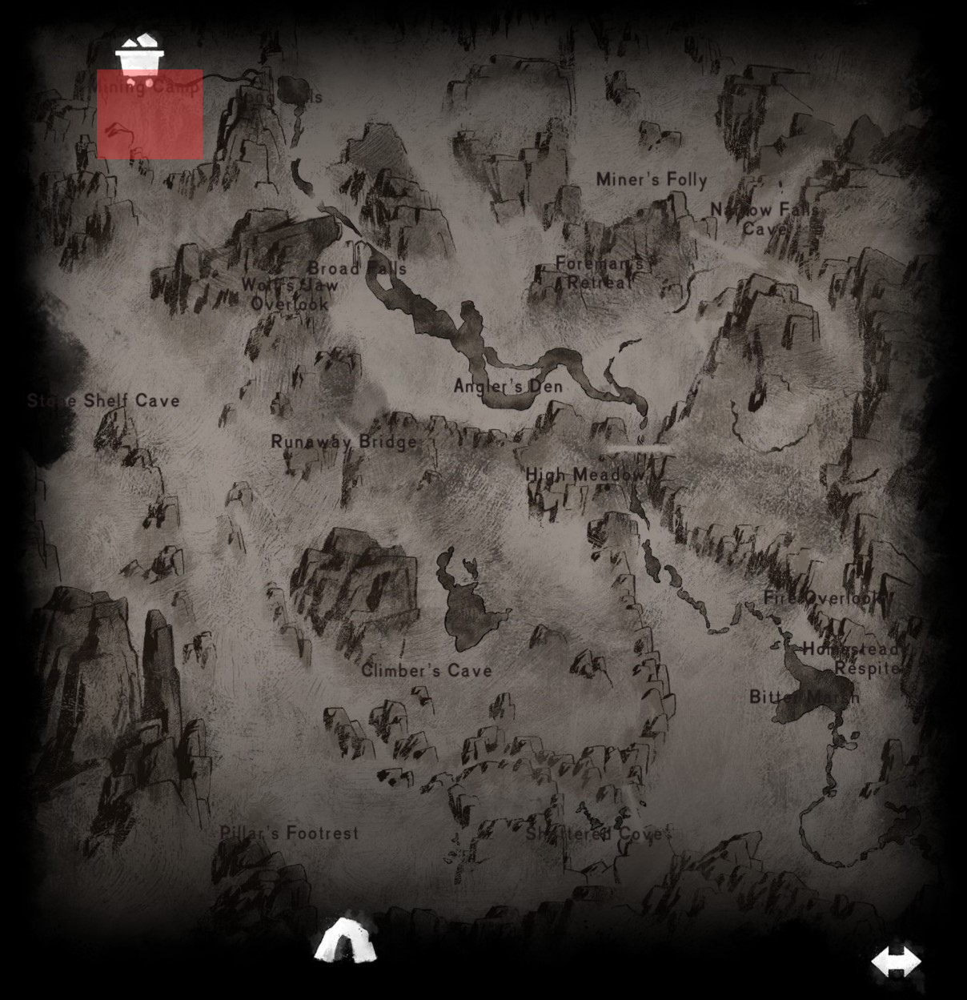

# Mining Camp

**Mining Camp**

| Property | Details |
| --- | --- |
|  |  / *20201209233317\_1.jpg* |
| **Location** |  |
|  |  / *Mining\_Camp\_Location.png* |
| Region | [Ash Canyon](./Ash%20Canyon.md)\|- |
| Description | A derelict mining camp connecting to the [Gold Mine](./Gold%20Mine.md) |
| **General** |  |
| Type | Industrial\|- |
