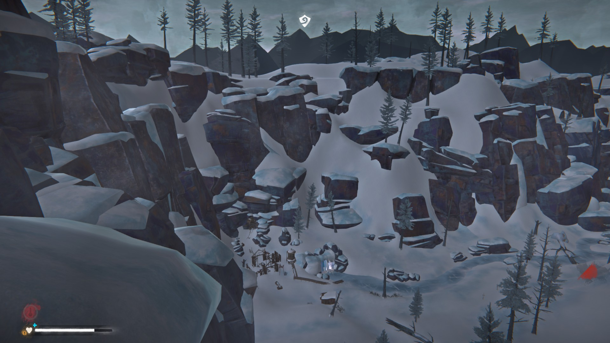
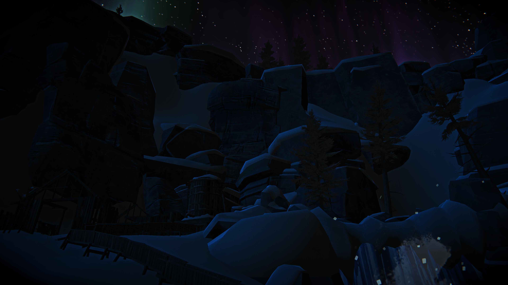
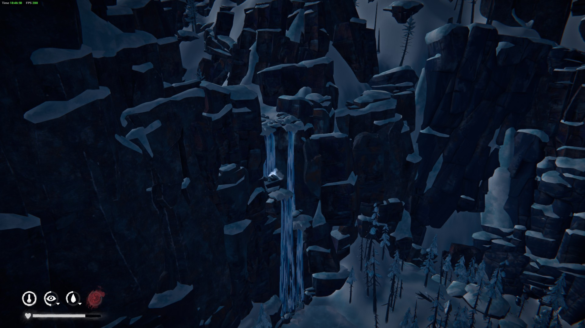
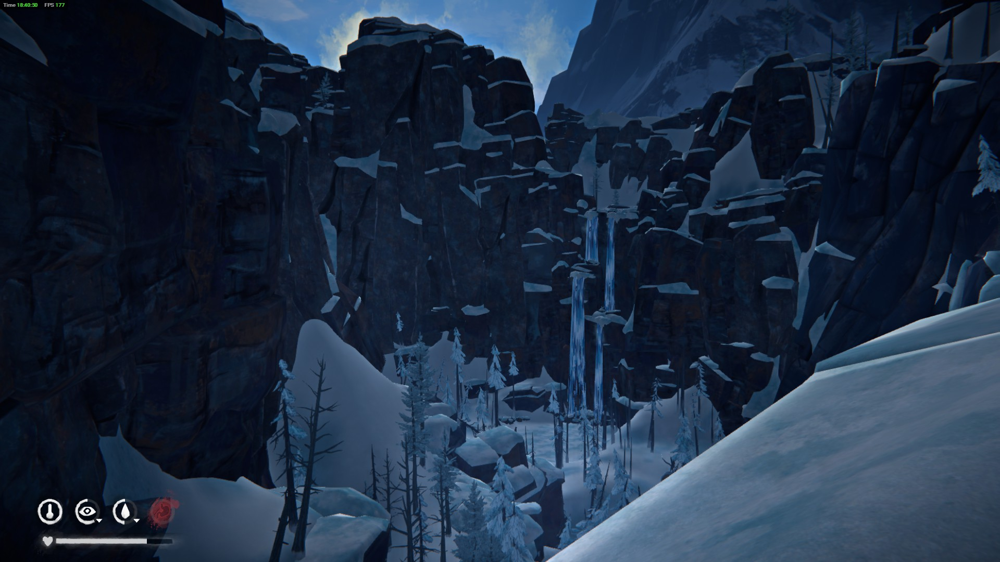

# Mining Camp

**Categories:** Industrial locations, Locations, Locations in Ash Canyon, Sheltered locations · **Source:** [Fandom](https://thelongdark.fandom.com/wiki/Mining_Camp)

**Contents**

- [Overview](#overview)
- [Navigation](#navigation)
- [Loot](#loot)
- [Gallery](#gallery)

**Mining Camp**

[20201209233317 1](../assets/20201209233317_1.jpg)

**Location**

[Mining Camp Location](../assets/Mining_Camp_Location.png)

**Region:** [Ash Canyon](./Ash%20Canyon.md)

**Description:** A derelict mining camp connecting to the [Gold Mine](./Gold%20Mine.md)

**General**

**Type:** Industrial

## Overview

The Mining Camp is a location in the northwest corner of [Ash Canyon](./Ash%20Canyon.md). It is the only location that allows access to the [Gold Mine](./Gold%20Mine.md), where you can find the [Technical Backpack](./Technical%20Backpack.md) and [crampons](./Crampons.md). Little shelter is available and the site contains little of value--only some [Reclaimed Wood](./Reclaimed%20Wood.md) and [coal](./Coal.md).

A plastic container &amp; large hatch can be found within the camp, and sometimes a [flashlight](./Flashlight.md) can spawn wedged between two rocks by the [Gold Mine](./Gold%20Mine.md) entrance. There is also a [corpse](./Corpse.md) which can spawn by the nearby waterfall alongside a [Revolver](./Revolver.md).

## Navigation

Before going into the Mining camp, you will need a [mountaineering rope](./Mountaineering%20Rope.md), you can get this from the many rope climbs taken to get to the plateau overlooking the Mining camp or any of the mountaineering rope scattered around the area. On the plateau overlooking the Mining camp there is a wooden pulley system on the edge of the cliff. Right next to this is a rock that you can deploy a mountaineering rope onto and then climb down from there. Note there is a ledge about half way down the [rope climb](./Rope%20Climbing.md), this may not be as important going down, but will be when climbing out of the **Mining Camp.**

## Loot

- When walking from the mine exit keep to the left stones, there may be a flashlight leaned against a crack in them (very near the mine).
- The first building when following the tracks from the mine, has a cupboard with randomized loot in the corner.
- There may be a plastic container near the water trough (gold mining riffles) at the creek.
- Follow the creek till the waterfall to find a searchable corpse, sometimes a [Revolver](./Revolver.md) spawns near it.

## Gallery

