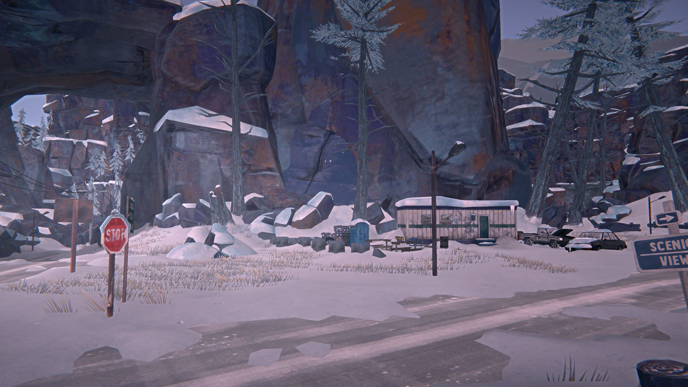
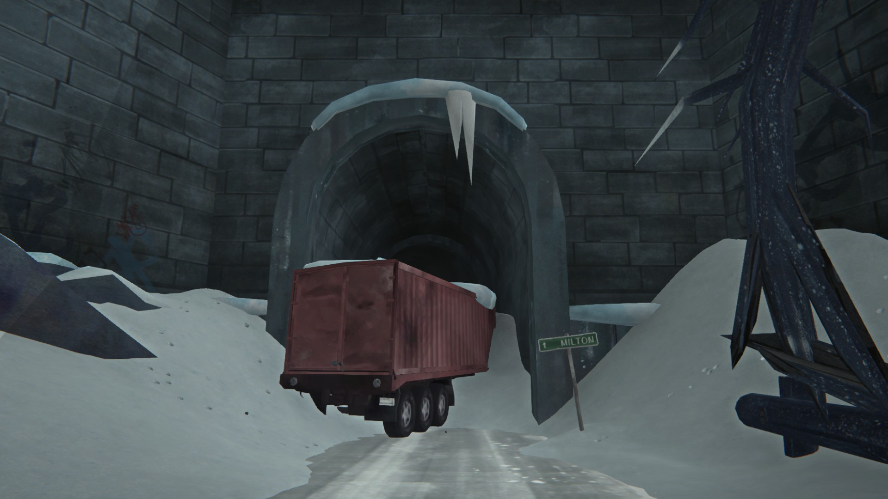

# Mirthless Fork

**Categories:** Indoor locations, Locations, Locations in Keeper's Pass South, Locations with a workbench · **Source:** [Fandom](https://thelongdark.fandom.com/wiki/Mirthless_Fork)

**Mirthless Fork**

_20211212180713\_1.jpg_

**Location**

_Mirthless\_Fork\_Location.png_

**Region:** [Keeper's Pass South](./Keeper%27s%20Pass%20South.md)

**Firebox:** [Fire Barrel](./Fire%20Barrel.md)

_bed\_icon.png_

Has a bed

_workbench\_icon\_green.png_

Has a workbench

## Gallery

_Trailerkeeper\_1.jpg_

_The collapsed tunnel to [Milton](./Milton.md)_
