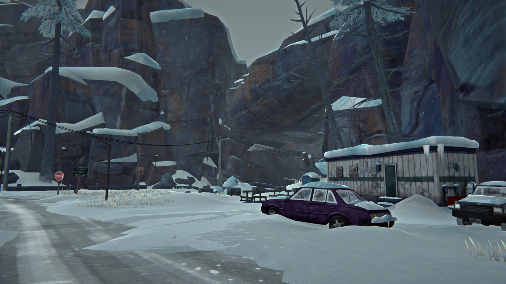
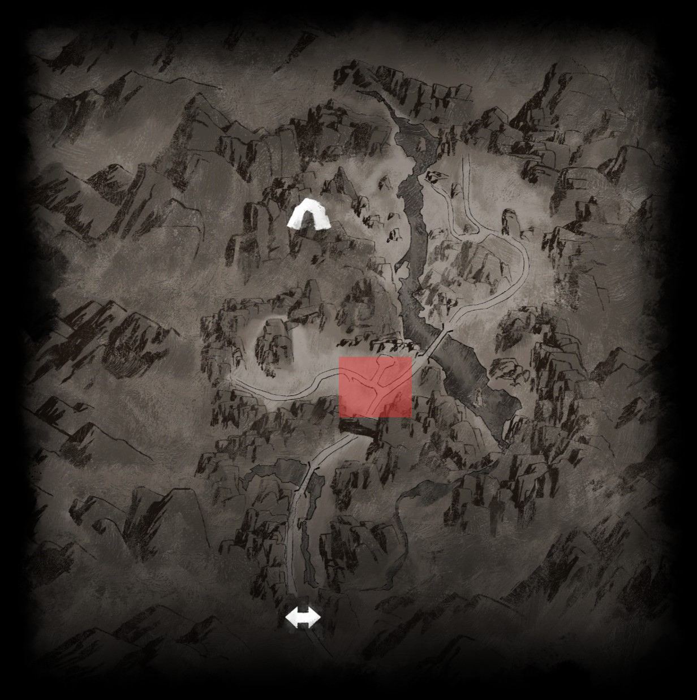

# Mirthless Fork

**Mirthless Fork**

| Property | Details |
| --- | --- |
|  |  / *20211212180713\_1.jpg* |
| **Location** |  |
|  |  / *Mirthless\_Fork\_Location.png* |
| Region | [Keeper's Pass South](./Keeper%27s%20Pass%20South.md)\|- |
| Firebox | [Fire Barrel](./Fire%20Barrel.md) |
|  / *bed\_icon.png* | Has a bed |
|  / *workbench\_icon\_green.png* | Has a workbench\|- |
