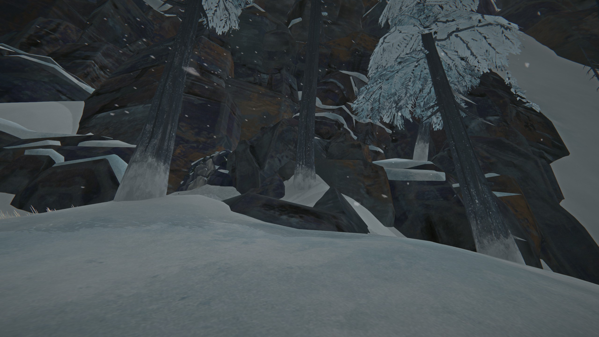
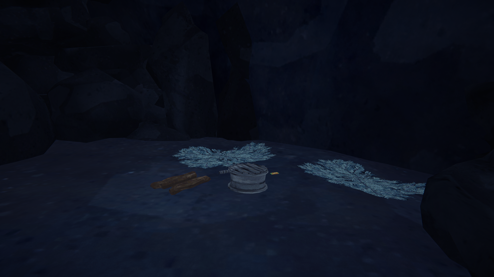
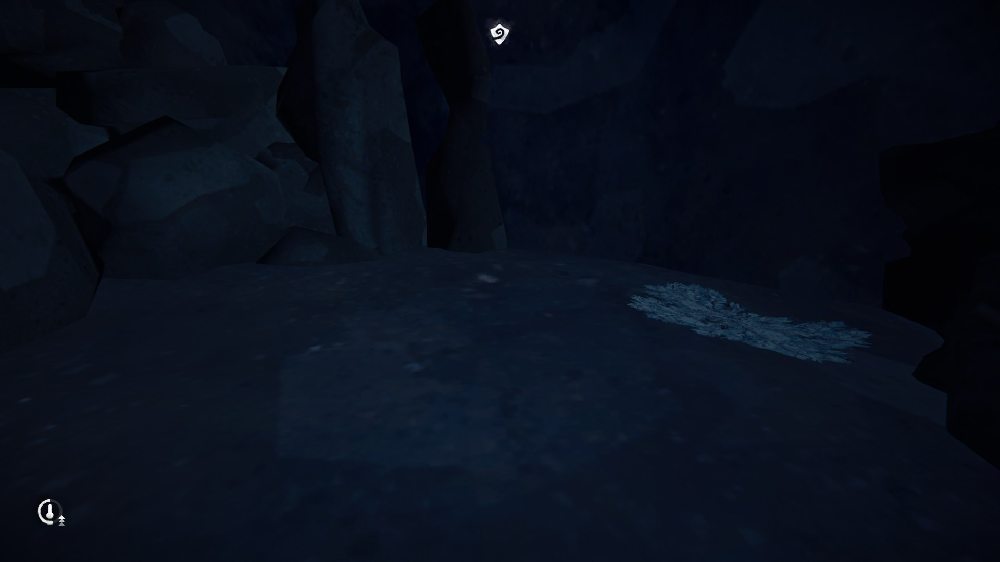

# Miserable Haunt

**Categories:** Caves, Locations, Locations in Sundered Pass, Sheltered locations · **Source:** [Fandom](https://thelongdark.fandom.com/wiki/Miserable_Haunt)

**Miserable Haunt**

_Miserable\_Haunt.jpg_

**Location**

_Miserable\_Haunt\_Location.png_

**Region:** [Sundered Pass](./Sundered%20Pass.md)\|-

**Description:** A cave in the southwestern most section of the map

**General**

**Type:** Cave\|-

_The rock climb leading to the cave_

_Miserable Haunt interior with two beds and a rim grill_

_The other possible interior of Miserable Haunt_
