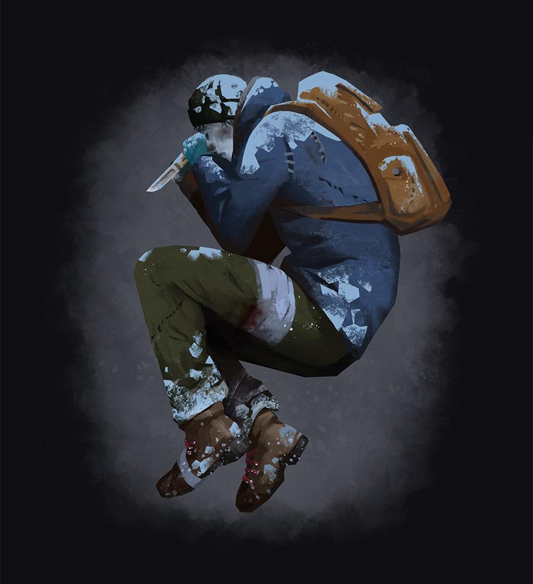

# Misery

**Categories:** Pages with update history · **Source:** [Fandom](https://thelongdark.fandom.com/wiki/Misery)

**Contents**

- [Overview](#overview)
- [Misery Settings](#misery-settings)
- [5 Stages of Misery](#5-stages-of-misery)
- [Trivia](#trivia)
- [Achievements](#achievements)
- [Game History](#game-history)

> **Cited text**
>
> — In-game Description

**Misery** is 5th and most challenging [Survival Mode](./Survival%20Mode.md) Experience in _[The Long Dark](./The%20Long%20Dark.md)_. Misery was added on June 24th, 2024 as part of the Part 5 update of the [Tales from the Far Territory](./Tales%20from%20the%20Far%20Territory.md) expansion. It is the standard "impossible" difficulty, being almost on the same level of difficulty as [Interloper](./Interloper.md), but with more handicaps to make survival even harder.

## Overview

Misery features an extremely cold world with limited loot, abundant hostile wildlife and unique and permanent [Afflictions](./Afflictions.md) that appear after surviving long enough. Misery was developed by [Hinterland Studio](./Hinterland%20Studio%20Inc..md) to instill a sense of apocalyptic hopelessness and to recreate a punishing game mode akin to the initial release of Interloper in 2016. This mode was made specifically to keep players from surviving for very long.

Misery is an extremely hard difficulty mode, even for the most hardcore of _The Long Dark_ players. The average life expectancy is around 20-40 days.

## Misery Settings

- No [Feats](./Feats.md) are permitted (Feat progress is allowed)
- [Cheat Death](./Cheat%20Death.md) is disabled.
- Fixed Starting Conditions:
  - [Pleasant Valley](./Pleasant%20Valley.md): outside [Draft Dodger's Cabin](./Draft%20Dodger%27s%20Cabin.md) (the cabin is always destroyed), at the bottom of the rope climb near [Skeeter's Ridge](./Skeeter%27s%20Ridge.md).
  - [Weather](./Weather.md): Light Snowfall.
  - Wind: Random.
  - Time: 11:00 AM.
  - Clothes: [Plaid Shirt](./Plaid%20Shirt.md) or [Hoodie](./Hoodie.md), [Jeans](./Jeans.md), [Thermal Underwear](./Thermal%20Underwear.md), [Sports Socks](./Sports%20Socks.md), [Leather Shoes](./Leather%20Shoes.md) or [Running Shoes](./Running%20Shoes.md).
  - Equipment: 1x [Recycled Can](./Recycled%20Can.md).

- Six permanent Afflictions which are applied over time.
  - 5 Stages of Misery: periodically applies permanent semi-random Misery Afflictions, beginning with [Diminished Form](./Diminished%20Form.md) and ending with [Broken Body](./Broken%20Body.md).
- Game world ambient temperatures are already pushed to the coldest setting.
  - **Late-Game Interloper Temperature as Starting Temperature**: temperature drops 20°C by day 3 (on Interloper this happens by day 50). Temperatures are consistently -20°C to -65°C outdoors, with many indoors areas below zero without upgraded clothes.
- Settings similar to, but even harder than Interloper mode.
  - Most items cannot spawn ([firearms](./Hunting%20Rifle.md)/[survival bow](./Survival%20Bow.md), [hatchet](./Hatchet.md)/[hunting knife](./Hunting%20Knife.md), [high quality clothes](./Expedition%20Parka.md)/[food](./Military-Grade%20MRE.md)) with ~90% of containers empty. Survival Bow, arrows and [animal skin clothing](./Wolfskin%20Coat.md) may be crafted but requires [forging](./Forge.md).
- Interloper level [Cabin Fever](./Cabin%20Fever.md), [Scurvy](./Scurvy.md), and [Intestinal Parasites](./Intestinal%20Parasites.md) settings.
- Wolves are extremely abundant (similar to Stalker settings).
- No option to disable [Cougar](./Cougar.md) or [Scurvy](./Scurvy.md).
  - Scurvy: Vitamin-C drain rate is Interloper levels (25 days of Vitamin-C).
  - **Cougar grace period is 5-7 days.**
  - The option to enable or disable the [Trader](./Trader.md) is present (though the Trader offers less loot than on Interloper settings).
- Fatigue Drain: High.
- Predator Spawn: Very High.
- Struggle Progress: Very Low.
- [Beachcombing](./Beachcombing.md) Modifier: 0.5 (half the normal loot than Interloper)

## 5 Stages of Misery

Over time at fixed intervals, the survivor will be [Afflicted](./Afflictions.md) with the 5 Stages of Misery, permanent conditions unique to Misery Mode making survival increasingly challenging.

Stage 1 and 5 are always [Diminished Form](./Diminished%20Form.md) and [Broken Body](./Broken%20Body.md) respectively, with stages 2-4 randomized between: [Haunted Mind](./Haunted%20Mind.md), [Frigid Bones](./Frigid%20Bones.md), [Rheumatic Joints](./Rheumatic%20Joints.md), and [Sour Stomach](./Sour%20Stomach.md).

Note that [Research Books](./Research%20Book.md) can still be studied even with these Afflictions.

- Stage 1: Hardship
  - 1 day survived: [Diminished Form](./Diminished%20Form.md)
- Stage 2: Sorrow
  - 6 days survived: Random New Misery Affliction
- Stage 3: Despair
  - 16 days survived: Random New Misery Affliction
- Stage 4: Torment
  - 31 days survived: Two Remaining New Misery Afflictions
- Stage 5: Ruin
  - 46 days survived: [Broken Body](./Broken%20Body.md)

## Trivia

- Hinterland designed Misery as an _"apocalyptic challenge even for the really hardcore players"_ who are able to survive for hundreds of days on Interloper mode.
- Misery is a combination of Stalker and Interloper settings (the hardest of both), with additional tweaks to increase difficulty.
- Misery shares similarities with the community-made Custom sandbox mode "No One Gets Out Alive" aka "NOGOA" (Code: 8sHM-/z8P-Dz+3-QZym-XQIC) and the official [Challenge](./Challenge.md) mode [As The Dead Sleep](./As%20the%20Dead%20Sleep.md), but is considerably harder than both.
- During the Misery Mode beta, "Diminished Form" was named "Weak Constitution" with the [Status](./Survival%20Overlay.md) icon for [Broken Ribs](./Broken%20Ribs.md). Its text read: _"Weak Constitution: Caused by Misery. Weak Constitution Placeholder Description -Reduced stamina bar -Reduced carry capacity -Struggle wolf flee less likely to occur"_
- During the Misery Mode beta, all Misery Mode affliction prevented the reading of Research Books: _"You're not healthy enough to focus on research"_, similar to non-Misery afflictions. This was removed before release.

## Achievements

-  [Broken Body (Achievement)](./Broken%20Body%20%28Achievement%29.md)

## Game History

- UPDATE **24 June 2024 ([Update](./The%20Long%20Dark%20%E2%80%94%20Changelog.md#2.28)):**
  - Added to game.
