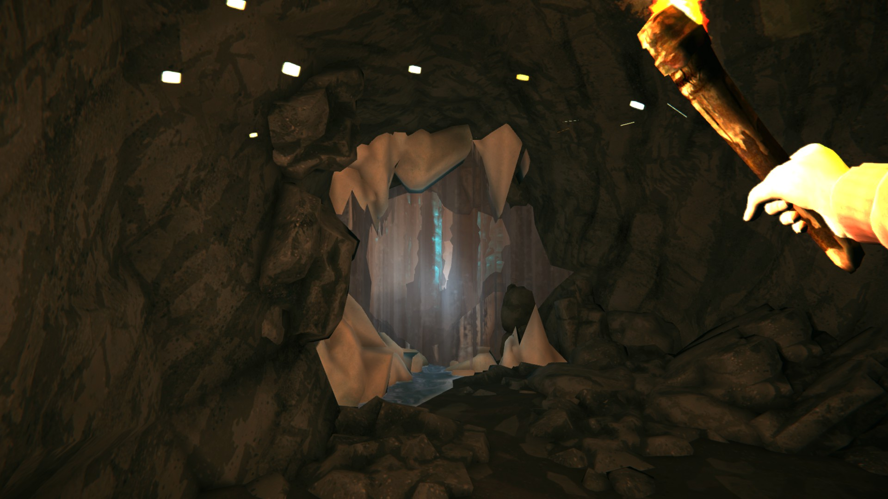
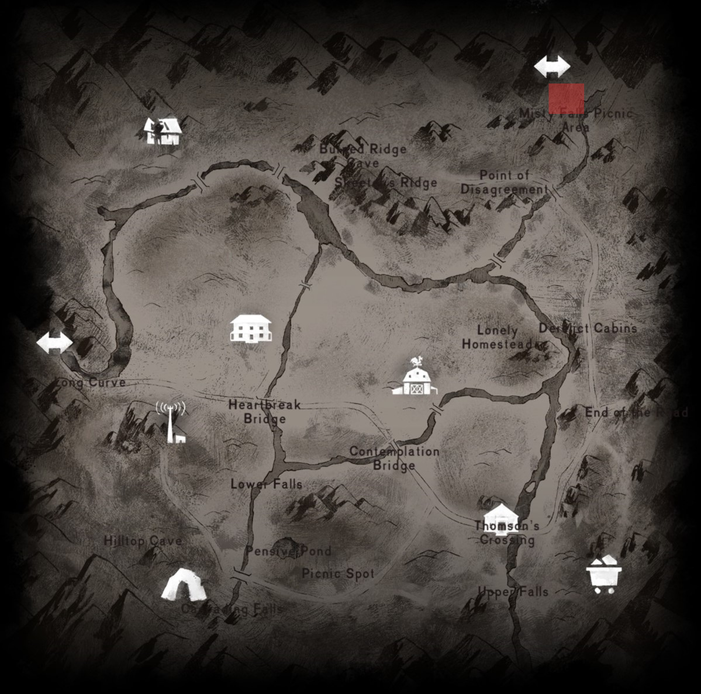

# Misty Falls Cave

**Misty Falls Cave**

| Property | Details |
| --- | --- |
|  |  / *Misty\_Falls\_Picnic\_Area\_Cave.jpg* |
| **Location** |  |
|  |  / *Misty\_Falls\_Cave\_Location.png* |
| Region | [Pleasant Valley](./Pleasant%20Valley.md)\|- |
| Description | A large cave with a decent amount of loot |
| **General** |  |
| Type | Outdoors\|- |
