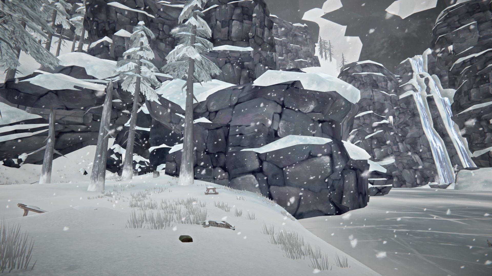
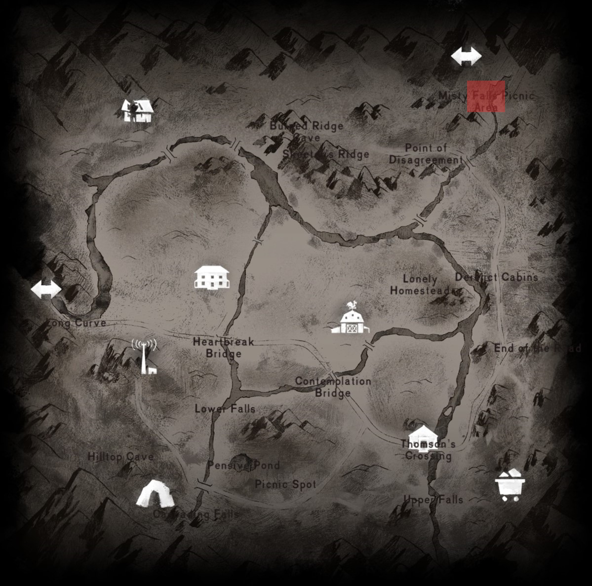

# Misty Falls Picnic Area

**Categories:** Locations, Locations in Pleasant Valley, Outdoor locations, Sheltered locations, Waterfalls · **Source:** [Fandom](https://thelongdark.fandom.com/wiki/Misty_Falls_Picnic_Area)

**Misty Falls Picnic Area**

\[\[File: /  / _Exterior_ /  / _Interior_

250px\]\]

_Exterior_

_Interior_

**Location**

_Misty\_Falls\_Picnic\_Area\_Location.png_

Region

[Pleasant Valley](./Pleasant%20Valley.md)

Location

**Description:** A recreational area with a cave

**General**

**Type:** Outdoors
