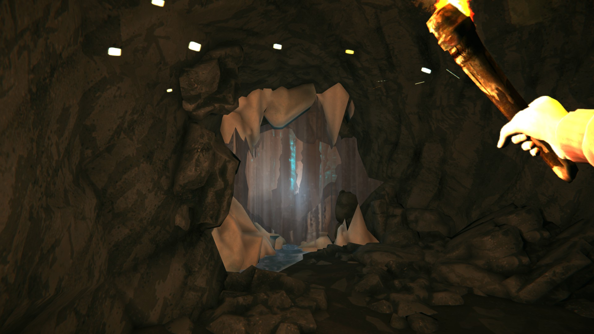
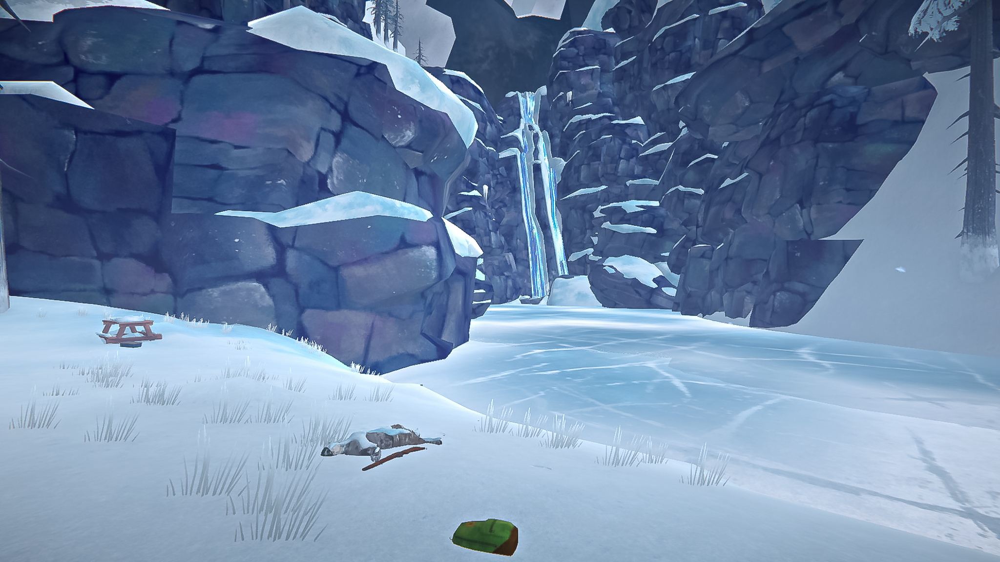
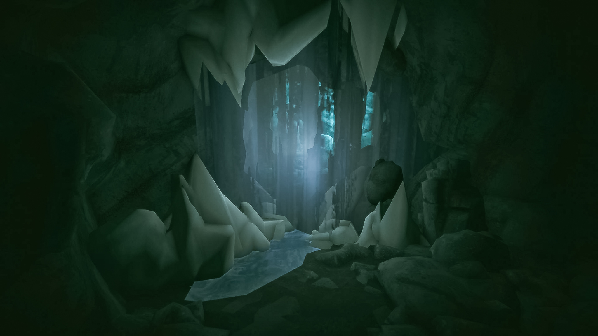

# Misty Falls Picnic Area

**Categories:** Locations, Locations in Pleasant Valley, Outdoor locations, Sheltered locations, Waterfalls · **Source:** [Fandom](https://thelongdark.fandom.com/wiki/Misty_Falls_Picnic_Area)

**Misty Falls Picnic Area**

\[\[File:

250px\]\]

**Location**

Region

[Pleasant Valley](./Pleasant%20Valley.md)|-

Location

Description

A recreational area with a cave

**General**

Type

Outdoors|-

## Overview

Misty Falls Picnic Area is located in the most north-eastern side of the region.

The picnic area is just downstream of a waterfall, presumably called Misty Falls. It can be easily identified by the picnic benches next to the river.

A [frozen corpse](./Frozen%20Corpse.md), with a backpack and a container with some possible loot, as well as a [Hunting Rifle](./Hunting%20Rifle.md) may be lying next to the river. Some [reishi mushrooms](./Reishi%20Mushroom.md) and [rabbits](./Rabbit.md) can be found in and around the area and there are virtually no predators around.

## Explorable Cave

An explorable nameless cave sits just next to the picnic area. It has notable loot inside, including a second hunting rifle or [revolver](./Revolver.md), which can be accessed going through an inside waterfall, as well as a [survival bow](./Survival%20Bow.md) along with some [arrows](./Simple%20Arrow.md) can be found inside.

For a detailed description of the cave, visit [its own section](./Misty%20Falls%20Cave.md).

## Gallery

