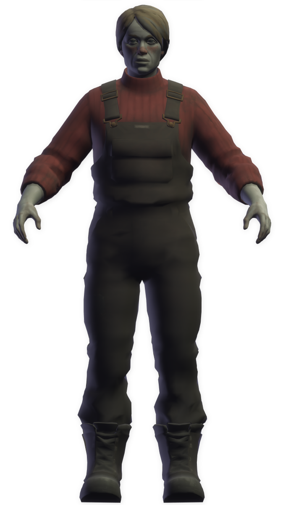

# Molly

**Contents**

- [Overview](#Overview)
- [Background](#Background)
- [Episode 3](#Episode_3)
- [Trauma](#Trauma)
- [Fallen Star and Coming Storm](#Fallen_Star_and_Coming_Storm)
- [Aftermath](#Aftermath)
- [Episode 4](#Episode_4)
- [Trivia](#Trivia)
- [Gallery](#Gallery)
- [Update History](#Update_History)

<table class="infobox">
<caption>Molly</caption>
<colgroup>
<col style="width: 50%" />
<col style="width: 50%" />
</colgroup>
<tbody>
<tr>
<td colspan="2"><figure>

<figcaption>Molly.png</figcaption>
</figure></td>
</tr>
<tr>
<td>
Release
</td>
<td>
<a href="./The%20Long%20Dark%20%E2%80%94%20Changelog.md#1.60" class="wikilink" title="Crossroads Elegy (v1.60)">Crossroads Elegy (v1.60)</a>
</td>
</tr>
<tr>
<td>
Date
</td>
<td>
22 October 2019
</td>
</tr>
<tr>
<td>
Wintermute
</td>
<td>
<a href="./Episode%203%20-%20Crossroads%20Elegy.md" class="wikilink" title="Episode 3: Crossroads Elegy">Episode 3: Crossroads Elegy</a>
</td>
</tr>
<tr>
<td>
Mission
</td>
<td>
<strong>•</strong> <a href="./Trauma.md" class="wikilink" title="Trauma">Trauma</a> 
<strong>•</strong> <a href="./Fallen%20Star.md" class="wikilink" title="Fallen Star">Fallen Star</a> 
<strong>•</strong> <a href="./Aftermath.md" class="wikilink" title="Aftermath">Aftermath</a>
</td>
</tr>
<tr>
<td>
Location(s)
</td>
<td>
<a href="./Pleasant%20Valley%20Farmstead.md" class="wikilink" title="Pleasant Valley Farmstead">Pleasant Valley Farmstead</a>
</td>
</tr>
<tr>
<td colspan="2" class="section">
<strong>Biographical Information</strong>
</td>
</tr>
<tr>
<td>
Age
</td>
<td>
40's
</td>
</tr>
<tr>
<td>
Status
</td>
<td>
Alive
</td>
</tr>
<tr>
<td>
Relatives
</td>
<td>
<a href="./Molly%27s%20Husband.md" class="wikilink" title="Molly&#39;s Husband">Molly's Husband</a> (deceased)
</td>
</tr>
<tr>
<td>
Occupation
</td>
<td>
Farmer
</td>
</tr>
<tr>
<td colspan="2" class="section">
<strong>Physical Information</strong>
</td>
</tr>
<tr>
<td>
Hair
</td>
<td>
Light Blonde
</td>
</tr>
<tr>
<td>
Eyes
</td>
<td>
Ice Blue
</td>
</tr>
<tr>
<td colspan="2" class="section">
<strong>Game Information</strong>
</td>
</tr>
<tr>
<td>
Equipment
</td>
<td>
<strong>•</strong> <a href="./Hunting%20Rifle.md" class="wikilink" title="Hunting rifle">Hunting rifle</a> 
<strong>•</strong> <a href="./Survival%20Bow.md" class="wikilink" title="Survival bow">Survival bow</a>
</td>
</tr>
<tr>
<td>
Voiced by
</td>
<td>
Jennifer Kitchen
</td>
</tr>
</tbody>
</table>

<table>
<colgroup>
<col style="width: 33%" />
<col style="width: 33%" />
<col style="width: 33%" />
</colgroup>
<tbody>
<tr>
<td style="vertical-align: top; font-size: 3em; color: #5d5980; padding-right: 10px">
“
</td>
<td>
Years on a working farm in a remote corner of Great Bear Island have left their mark on Molly. She’s plain-spoken, often blunt -- she sees the world for what it is. There are no illusions inhabiting Molly’s life and she likes it that way. 
 
Other than the farm and regular subsistence hunting, simple pleasures -- tea and the wanderings of her own imagination -- keep Molly occupied.

&#10;

In-game description

</td>
<td style="vertical-align: bottom; font-size: 3em; color: #5d5980; padding-left: 10px">
”
</td>
</tr>
</tbody>
</table>

{\| style="margin:auto" \| style="vertical-align:top; font-size:3em; color:#5d5980; padding-right:10px" \|“ \| "There's different ways to hurt someone. Some ways heals. Other ways never do."

Molly speaking to <a href="./Astrid%20Greenwood.md" class="wikilink" title="Astrid">Astrid</a> about her past

\| style="vertical-align:bottom; font-size:3em; color:#5d5980; padding-left:10px" \|” \|} **Molly** is the first non-player character encountered in <a href="./Episode%203%20-%20Crossroads%20Elegy.md" class="wikilink" title="Episode 3">Episode 3</a> of the <a href="./Wintermute.md" class="wikilink" title="story">story</a>. She lives in the <a href="./Pleasant%20Valley%20Farmstead.md" class="wikilink" title="Pleasant Valley Farmstead">Pleasant Valley Farmstead</a>.

## Overview

<a href="./Episode%203%20-%20Crossroads%20Elegy.md" class="wikilink" title="Episode 3">Episode 3</a> begins with a cutscene of from Molly's point of view, where she finds <a href="./Astrid%20Greenwood.md" class="wikilink" title="Astrid">Astrid</a> almost dead in the snow. Molly carries Astrid back to her home, the Pleasant Valley Farmstead. Molly leaves to go hunting, and returns with meat some time later. After a tense conversation with Astrid, Molly storms out but does not return again. She later calls Astrid on the telephone to ask for help fighting off <a href="./Timberwolf.md" class="wikilink" title="timberwolves">timberwolves</a> that have cornered her and again later to offer assistance and briefly discuss a personal secret. A prisoner Molly killed is located outside <a href="./Signal%20Hill.md" class="wikilink" title="Signal Hill">Signal Hill</a>.

## Background

Much about Molly's background is unknown besides that she has seemingly been on Great Bear island for most of her life and resents the fact that she hasn't done more with her life. A cattleman's daughter and a farmer's wife, Molly has recently lost <a href="./Molly%27s%20Husband.md" class="wikilink" title="her husband">her husband</a> to wolves, although Molly admits she allowed it to happen. Afterwards she stored the body in her basement for unknown reasons.

The bitter tone Molly uses when discussing her husband and her apparent lack of remorse may allude to possible domestic abuse going on before hand. Molly explains to Astrid over the phone at one point that "I let myself feel small so that he could feel like somebody. I gave up everything for him, and to him I didn't even exist. I let him make me small. Less than nothing." Eventually, Molly grew the desire to kill her husband, but never had the courage to do so, until the wolves arrived one day and gave her her chance. Even with a rifle in her hand, she chose to do nothing, and the wolves killed her husband. This freed her from her husband's influence but left her with a dim outlook on the world.

## Episode 3

### <a href="./Trauma.md" class="wikilink" title="Trauma">Trauma</a>

Molly eventually finds Astrid in the snow after the <a href="./First%20Flare.md" class="wikilink" title="First Flare">First Flare</a> and nurses her back to health, though locks her inside her home to prevent her from leaving. After Astrid finds the body of Molly's husband and escapes Molly's Farmhouse, she keeps here distance from Astrid, spying on her from the hills while also hunting the male Convicts scattered across the Valley .

### <a href="./Fallen%20Star.md" class="wikilink" title="Fallen Star">Fallen Star</a> and <a href="./Coming%20Storm.md" class="wikilink" title="Coming Storm">Coming Storm</a>

Molly begins calling Astrid occasionally over the Valley's phone party lines. She intially questions why Astrid chooses to help the <a href="./Crash%20Survivor.md" class="wikilink" title="Crash Survivors">Crash Survivors</a> despite gaining no recognition for her actions, before switching each subsequent phone call over to discussing her husband. After awhile, she leaves Astrid alone as she searches for more survivors.

### <a href="./Aftermath.md" class="wikilink" title="Aftermath">Aftermath</a>

As Astrid is ready to leave Pleasant Valley, Molly calls Astrid to tell her about the radio transmitter at <a href="./Signal%20Hill.md" class="wikilink" title="Signal Hill">Signal Hill</a> that she could use to contact Perseverance Mills, before hanging up. Astrid goes there and eventually makes contact with Perseverance Mills.

Molly is last heard on the phone from the radio tower at Signal Hill, fully confessing her hatred for her husband and believing that she and Astrid are in the same boat, now liberated from their husbands and men's oppression in general. This attitude may be the reason why Molly is hunting down the group of male prisoners that escaped from the <a href="./Crashed%20Prison%20Transport%20Bus.md" class="wikilink" title="Crashed Prison Transport Bus">Crashed Prison Transport Bus</a> as she now fully committed to her misandrist mindset regarding men in general, saying that "it feels good to finally be on this side of the hunt" and "They're all going to pay now, Astrid."

Molly ends her phone call by asking Astrid if Mackenzie is "One of the good ones". Astrid says that he is, and that while things are complicated between the two of them, she would be upset to find an arrow in his back. Molly ends the phone call by saying "Then I hope to never meet him" while wishing Astrid good luck on her journey to <a href="./Perseverance%20Mills.md" class="wikilink" title="Perseverance Mills">Perseverance Mills</a>, hoping that Astrid finds some peace for herself. Astrid in turn hopes that Molly will also find peace within herself.

Molly is briefly seen in the ending cutscene for the Episode, but is not seen again for the rest of Wintermute.

## Episode 4

At the beginning of Episode 4 while dragging Mackenzie across the snow, <a href="./Heller.md" class="wikilink" title="Heller">Heller</a> and <a href="./Vachon.md" class="wikilink" title="Vachon">Vachon</a> discuss a dead convict (<a href="./Prison%20Transport%20Manifest.md" class="wikilink" title="Leclerc">Leclerc</a>) found with an arrow in his chest, which was most likely hinting at Molly's work.

## Trivia

Molly and Astrid's phone calls may have briefly connected to the <a href="./Hunting%20Lodge.md" class="wikilink" title="Hunting Lodge&#39;s">Hunting Lodge's</a> <a href="./Phone%20Box.md" class="wikilink" title="Phone Box">Phone Box</a> in Episode 2, explaining the ringing phone.

## Gallery

<table class="gallery">
<colgroup>
<col style="width: 25%" />
<col style="width: 25%" />
<col style="width: 25%" />
<col style="width: 25%" />
</colgroup>
<tbody>
<tr>
<td><figure>
[Missing image: Astrid_in_snow.jpg]
<figcaption>Molly finding Astrid in the snow</figcaption>
</figure></td>
<td><figure>
[Missing image: Molly_cinematic.jpg]
<figcaption>Molly introduces herself to Astrid</figcaption>
</figure></td>
<td><figure>
[Missing image: Molly's_Husband.jpg]
<figcaption>Molly's dead husband in the basement</figcaption>
</figure></td>
<td><figure>

<figcaption>A photo of Molly and her husband</figcaption>
</figure></td>
</tr>
<tr>
<td><figure>

<figcaption>Missions_story_ep3_Trauma.png</figcaption>
</figure></td>
<td></td>
<td></td>
<td></td>
</tr>
</tbody>
</table>

## Update History

- UPDATE **22 October 2019 (<a href="./The%20Long%20Dark%20%E2%80%94%20Changelog.md#1.60" class="wikilink" title="Update">Update</a>):**
  - Added to game.

**Lua execution error in Module:Navbox function navbox**

<a href="fr:Molly" class="wikilink" title="fr:Molly">fr:Molly</a> <a href="ru:%D0%9C%D0%BE%D0%BB%D0%BB%D0%B8" class="wikilink" title="ru:Молли">ru:Молли</a>

