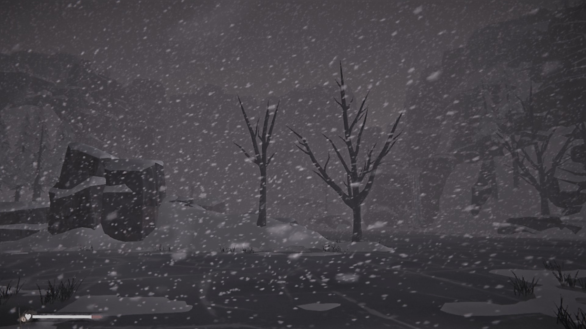

# Monolith Lake

**Categories:** Lakes, Locations, Locations in Hushed River Valley, Outdoor locations · **Source:** [Fandom](https://thelongdark.fandom.com/wiki/Monolith_Lake)

**Monolith Lake**

| Property | Details |
| --- | --- |
|  | [Monolith Lake from Peak Cave](../assets/Monolith_Lake_from_Peak_Cave.png) |
| **Location** |  |
|  | [Monolith Lake Location](../assets/Monolith_Lake_Location.png) |
| Region | [Hushed River Valley](./Hushed%20River%20Valley.md) |
| Location | Northeastern corner of the region. |
| Description | A large lake. |
| **General** |  |
| Type | Outdoors |
|  | Has no shelter |

**Monolith Lake** is a large lake located to the north-east of the [Hushed River Valley](./Hushed%20River%20Valley.md) in _[The Long Dark](./The%20Long%20Dark.md)_.

## Overview

Many waterfalls can be found near the lake, including [Watchful Falls](./Watchful%20Falls.md), [Banner Falls](./Banner%20Falls.md), and [Quarrelling Falls](./Quarrelling%20Falls.md). [Lake Cave](./Lake%20Cave.md) near Watchful Falls is the only natural shelter immediately adjacent to the lake, however there are two caves located not far away: [Peak Cave](./Peak%20Cave.md) up the hill to the east, and [Pensive Vista](./Pensive%20Vista.md) a short walk to the south. A [Moose](./Moose.md) may spawn on Monolith Lake near Watchful Falls, and there is an area with rabbits nearby. A [Frozen Corpse](./Frozen%20Corpse.md), [Cat Tails](./Cat%20Tail.md), and a [Hidden Cache](./Hidden%20Cache.md) can spawn around the lake. Southeast of the lake, [Reishi Mushrooms](./Reishi%20Mushroom.md) may be found along a hill. Going even further up leads to a higher elevation useful for mapping, as well as [Peak Cave](./Peak%20Cave.md), which may contain some useful loot.

The lake is notable for being the only location in the region with water that's deep enough for [Ice Fishing](./Ice%20Fishing.md).

## Gallery

