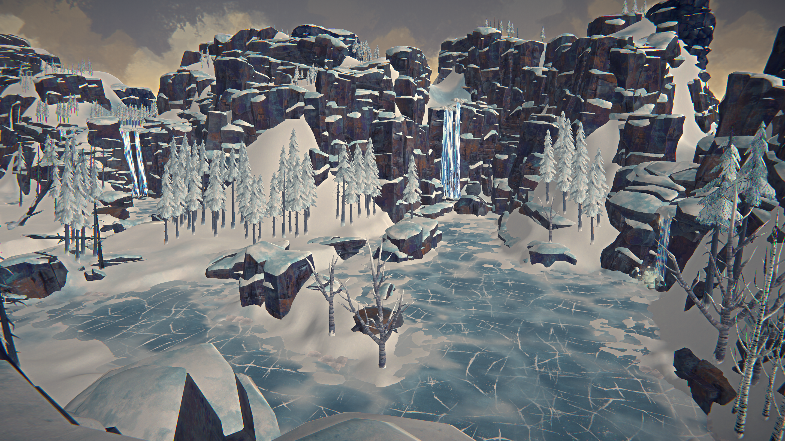

# Monolith Lake

**Monolith Lake**

| Property | Details |
| --- | --- |
|  |  / *Monolith\_Lake\_from\_Peak\_Cave.png* |
| **Location** |  |
|  |  / *Monolith\_Lake\_Location.png* |
| Region | [Hushed River Valley](./Hushed%20River%20Valley.md)\|- |
| Description | A large lake. |
| **General** |  |
| Type | Outdoors\|- |
