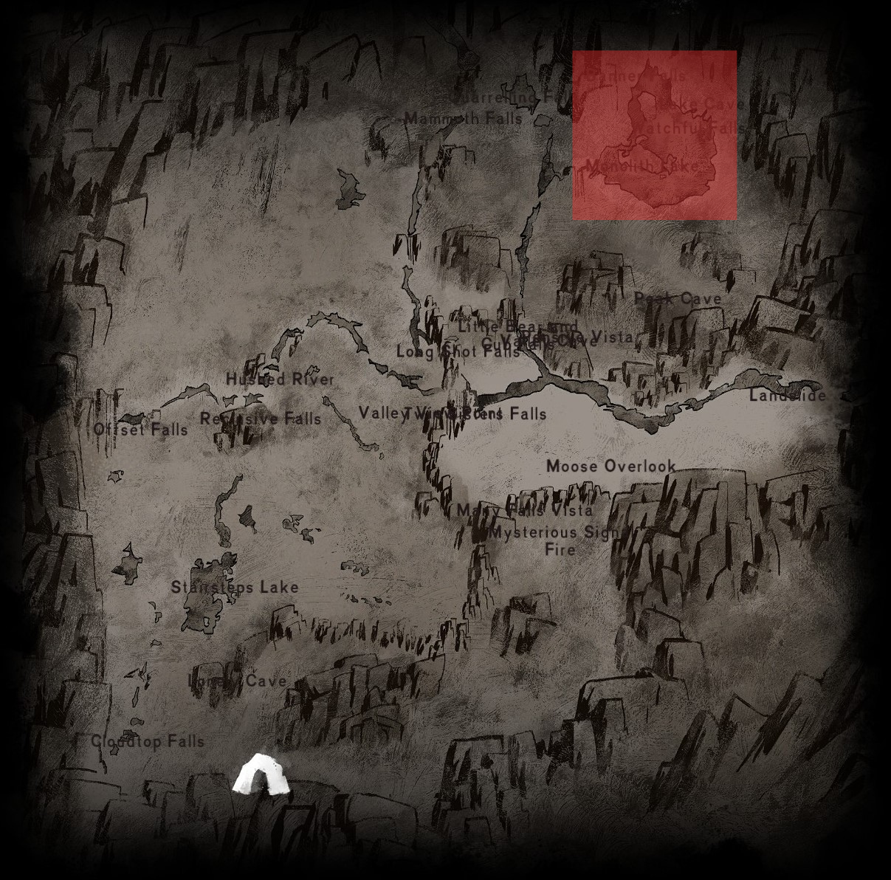

# Monolith Lake

**Categories:** Lakes, Locations, Locations in Hushed River Valley, Outdoor locations · **Source:** [Fandom](https://thelongdark.fandom.com/wiki/Monolith_Lake)

**Monolith Lake**

_Monolith\_Lake\_from\_Peak\_Cave.png_

**Location**

_Monolith\_Lake\_Location.png_

**Region:** [Hushed River Valley](./Hushed%20River%20Valley.md)\|-

**Description:** A large lake.

**General**

**Type:** Outdoors\|-
