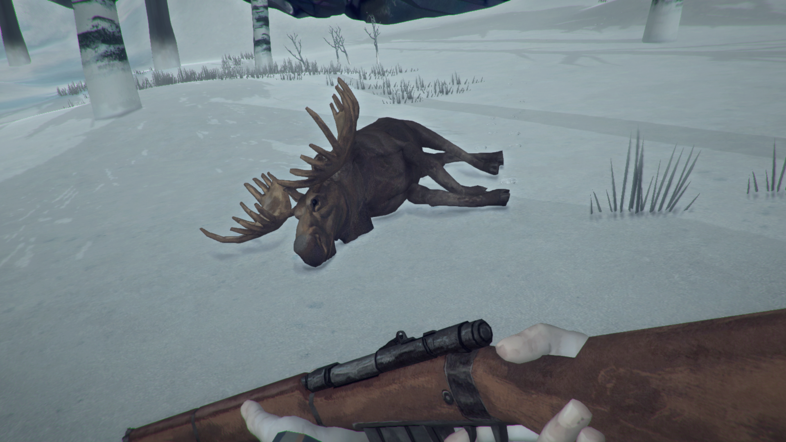

# Moose Carcass

**Categories:** Interactable Objects, Story items · **Source:** [Fandom](https://thelongdark.fandom.com/wiki/Moose_Carcass)

**Moose Carcass**

| Property | Details |
| --- | --- |
|  |  / _Moose\_Carcass.jpg_ |
| **General** |  |
| Item Type | Item |

|  | Item / Quantity / Rarity |
|  / _Moose\_Meat\_(Raw)\_icon.png_ | [Moose Meat (Raw)](./Moose%20Meat%20%28Raw%29.md) / 30 - 45 / Always[¹](#fn1) |
|  / _Moose\_Quarter\_icon.png_ | [Moose Quarter](./Moose%20Quarter.md) / 6 - 9 / Always[²](#fn2) |
|  / _Fresh\_Moose\_Hide\_icon.png_ | [Fresh Moose Hide](./Fresh%20Moose%20Hide.md) / 1 / Always |
| \[Missing image: Gut\_icon.png\] / _Gut\_icon.png_ | [Fresh Gut](./Fresh%20Gut.md) / 12 / Always |
|  |  |
|  / _Ravaged_ |  / _Frozen_ /  / _Fresh Kill_ /  / _Moose\_carcass.png_ |

## Notes

---

1. If carcass is harvested[↩︎](#fnref1)
2. If carcass is quartered.[↩︎](#fnref2)
