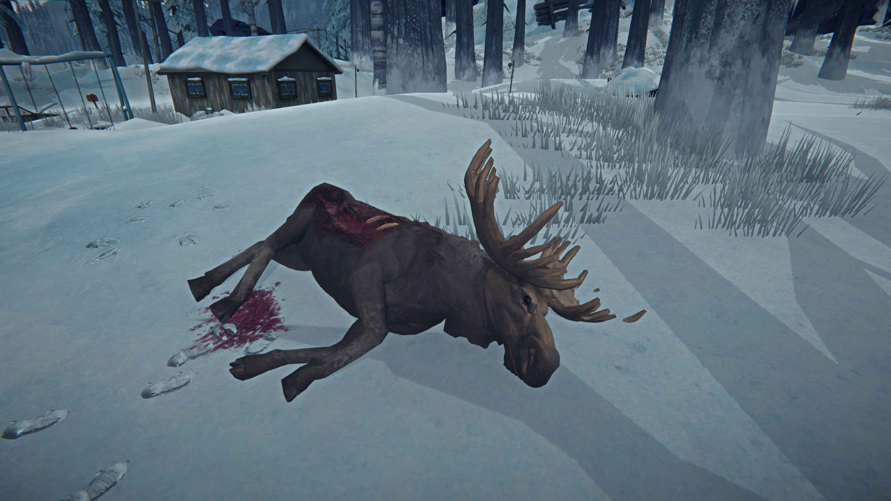

# Moose Carcass

**Categories:** Interactable Objects, Story items · **Source:** [Fandom](https://thelongdark.fandom.com/wiki/Moose_Carcass)

**Moose Carcass**

[Moose Carcass](../assets/Moose_Carcass.jpg)

**General**

**Item Type:** Item

**Wintermute:** Yes A **Moose Carcass** is a harvestable "object" found after [Hunting](./Hunting.md) a [Moose](./Moose.md). [Crows](./Crow.md) will fly around a Moose Carcass and always drop 5 [Crow Feathers](./Crow%20Feather.md) around the carcass at a time. Moose are massive creatures, and their carcasses can be used as makeshift cover to provide a [Wind Shield](./Survival%20Overlay.md#Windshield_and_Scent) when harvesting them, a distinction also shared with a [Black Bear Carcass](./Black%20Bear%20Carcass.md).

<!-- #Drops -->
​

<!-- #drops -->
## Drops

A Moose Carcass may be harvested for 30.00-45.00 kg of raw meat, 1 [Fresh Moose Hide](./Fresh%20Moose%20Hide.md) and 12 guts. Moose hides can be cured to craft [Moose-Hide Satchel](./Moose-Hide%20Satchel.md) or [Moose-Hide Cloak](./Moose-Hide%20Cloak.md).

|  | Item | Quantity | Rarity |
| --- | --- | --- | --- |
| [Moose Meat (Raw) icon](../assets/Moose_Meat_%28Raw%29_icon.png) | [Moose Meat (Raw)](./Moose%20Meat%20%28Raw%29.md) | 30 - 45 | Always[¹](#fn1) |
| [Moose Quarter icon](../assets/Moose_Quarter_icon.png) | [Moose Quarter](./Moose%20Quarter.md) | 6 - 9 | Always[²](#fn2) |
| [Fresh Moose Hide icon](../assets/Fresh_Moose_Hide_icon.png) | [Fresh Moose Hide](./Fresh%20Moose%20Hide.md) | 1 | Always |
| [Missing image: Gut\_icon.png] _Gut\_icon.png_ | [Fresh Gut](./Fresh%20Gut.md) | 12 | Always |

<!-- #preplaced_locations -->
​

<!-- #Preplaced_Locations -->
​

<!-- #Preplaced_locations -->
​

<!-- #preplaced-locations -->
## Preplaced Locations

A moose carcass can spawn near [Pensive Vista](./Pensive%20Vista.md) in the [Hushed River Valley](./Hushed%20River%20Valley.md). Other than that, finding a moose carcass requires the player to kill a moose.

<!-- #Gallery -->
​

<!-- #gallery -->
## Gallery

<!-- #footnotes -->
​

<!-- #notes -->
## Notes

---

1. If carcass is harvested[↩︎](#fnref1)
2. If carcass is quartered.[↩︎](#fnref2)
