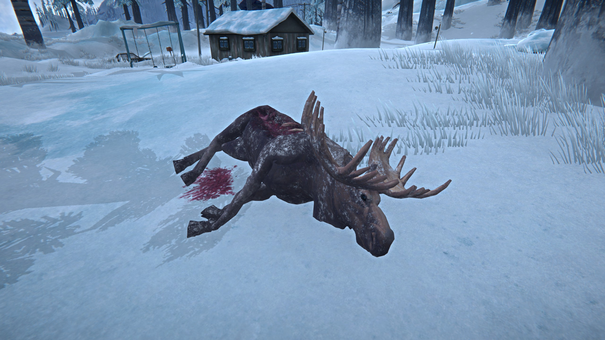

# Moose Carcass

**Moose Carcass**

| Property | Details |
| --- | --- |
|  |  / *Moose\_Carcass.jpg* |
| **General** |  |
| Item Type | Item |
| Wintermute | Yes\|} A **Moose Carcass** is a harvestable "object" found after [Hunting](./Hunting.md) a [Moose](./Moose.md). [Crows](./Crow.md) will fly around a Moose Carcass and always drop 5 [Crow Feathers](./Crow%20Feather.md) around the carcass at a time. / Moose are massive creatures, and their carcasses can be used as makeshift cover to provide a [Wind Shield](./Survival%20Overlay.md#Windshield_and_Scent) when harvesting them, a distinction also shared with a [Black Bear Carcass](./Black%20Bear%20Carcass.md). / ## Drops / A Moose Carcass may be harvested for 30.00-45.00 kg of raw meat, 1 [Fresh Moose Hide](./Fresh%20Moose%20Hide.md) and 12 guts. Moose hides can be cured to craft [Moose-Hide Satchel](./Moose-Hide%20Satchel.md) or [Moose-Hide Cloak](./Moose-Hide%20Cloak.md). / \|  \| Item \| Quantity \| Rarity \| / \| --- \| --- \| --- \| --- \| / \|  / *Moose\_Meat\_(Raw)\_icon.png* \| [Moose Meat (Raw)](./Moose%20Meat%20%28Raw%29.md) \| 30 - 45 \| Always[¹](#fn1) \| / \|  / *Moose\_Quarter\_icon.png* \| [Moose Quarter](./Moose%20Quarter.md) \| 6 - 9 \| Always[²](#fn2) \| / \|  / *Fresh\_Moose\_Hide\_icon.png* \| [Fresh Moose Hide](./Fresh%20Moose%20Hide.md) \| 1 \| Always \| / \| \[Missing image: Gut\_icon.png\] / *Gut\_icon.png* \| [Fresh Gut](./Fresh%20Gut.md) \| 12 \| Always \| / \|  \|  \|  \|  \| / ## Preplaced Locations / A moose carcass can spawn near [Pensive Vista](./Pensive%20Vista.md) in the [Hushed River Valley](./Hushed%20River%20Valley.md). Other than that, finding a moose carcass requires the player to kill a moose. / ## Gallery / \| Column 1 \| Column 2 \| Column 3 \| Column 4 \| / \| --- \| --- \| --- \| --- \| / \|  / *Ravaged* \|  / *Frozen* \|  / *Fresh Kill* \|  / *Moose\_carcass.png* \| / **Lua execution error in Module:Navbox function navbox** [ru:Туша лося](ru:%D0%A2%D1%83%D1%88%D0%B0_%D0%BB%D0%BE%D1%81%D1%8F) |
|  | Item / Quantity / Rarity |
|  / *Moose\_Meat\_(Raw)\_icon.png* | [Moose Meat (Raw)](./Moose%20Meat%20%28Raw%29.md) / 30 - 45 / Always[¹](#fn1) |
|  / *Moose\_Quarter\_icon.png* | [Moose Quarter](./Moose%20Quarter.md) / 6 - 9 / Always[²](#fn2) |
|  / *Fresh\_Moose\_Hide\_icon.png* | [Fresh Moose Hide](./Fresh%20Moose%20Hide.md) / 1 / Always |
| \[Missing image: Gut\_icon.png\] / *Gut\_icon.png* | [Fresh Gut](./Fresh%20Gut.md) / 12 / Always |
|  |  |
|  / *Ravaged* |  / *Frozen* /  / *Fresh Kill* /  / *Moose\_carcass.png* |

## Notes

---

1. If carcass is harvested[↩︎](#fnref1)
2. If carcass is quartered.[↩︎](#fnref2)
