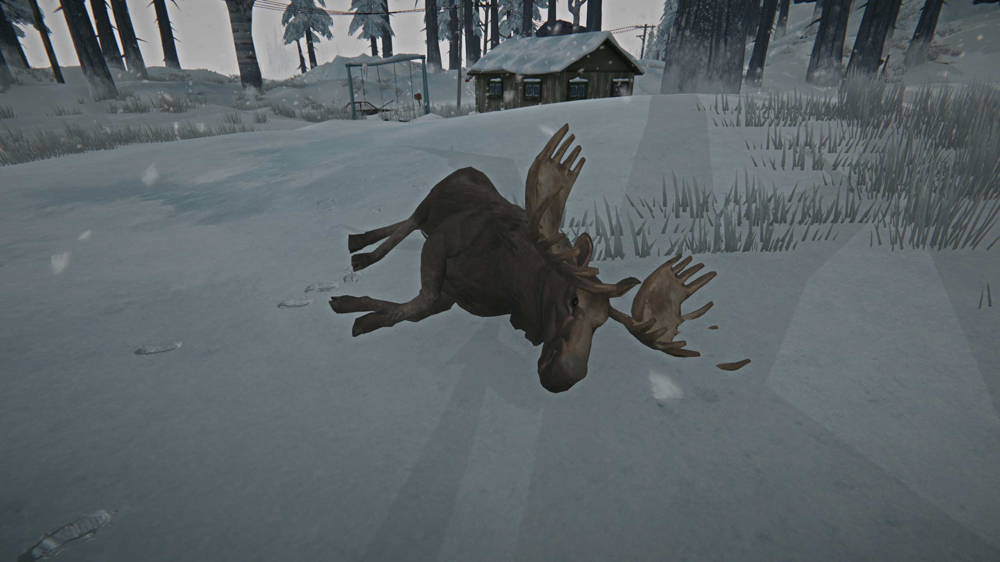

# Moose Carcass

**Categories:** Interactable Objects, Story items · **Source:** [Fandom](https://thelongdark.fandom.com/wiki/Moose_Carcass)

**Moose Carcass**

_Moose\_Carcass.jpg_

**General**

**Item Type:** Item

## Notes

---

1. If carcass is harvested[↩︎](#fnref1)
2. If carcass is quartered.[↩︎](#fnref2)
