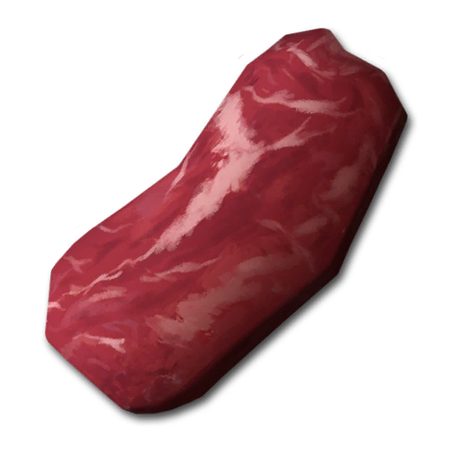

# Moose Meat \(Raw\)

**Categories:** Food And Drink, Pages with update history · **Source:** [Fandom](https://thelongdark.fandom.com/wiki/Moose_Meat_%28Raw%29)

**Contents**

- [Overview](#overview)
- [Products](#products)
- [Gallery](#gallery)
- [Update history](#update-history)

**Moose Meat**

[Moose Meat (Raw) icon](../assets/Moose_Meat_%28Raw%29_icon.png)

**Release:** [7 December 2017](./The%20Long%20Dark%20%E2%80%94%20Changelog.md#1.16)

**Wintermute:** No

**Properties**

**Item type:** [Food And Drink](./Food%20And%20Drink.md)

**Stackable:** No

**Examine:** Moose meat. Musty, gamey, and lean.

**Values**

**Calories:** 900 kcal

**Hydration:** 0%

**Weight:** 1.00 kg (2.2 lbs)

**Advanced data**

**Item key:** GAMEPLAY\_RawMeatMoose

_For the cooked version, see [Moose Meat (Cooked)](./Moose%20Meat%20%28Cooked%29.md)._

**Moose Meat** is a raw [food](./Food%20And%20Drink.md) item in _The Long Dark_.

## Overview

Moose Meat is harvested from [Moose](./Moose.md) carcasses, which contain between 30.0 and 45.0 kg of raw meat. Consuming raw meat carries a high chance of contracting [Food Poisoning](./Food%20Poisoning.md).

- At 0% condition food disappears if inside of a container, but not outside of containers or in the player's inventory.
- Meat decays slower outdoors than indoors.
- Moose Meat is very energy dense for its weight.

Often considered the best meat in _The Long Dark_, moose meat carries no risk of [Intestinal Parasites](./Intestinal%20Parasites.md), has the highest energy density (900 cal/kg) of all meat (along with [Bear Meat (Raw)](./Bear%20Meat%20%28Raw%29.md)), and the slowest [Decay](./Decay.md) of all meat items but is much harder to obtain in general.

## Products

| Item | Skills | Materials |
| --- | --- | --- |
| [Moose Meat (Cooked)](./Moose%20Meat%20%28Cooked%29.md) | None | - 1.00 kg × [Moose Meat (Raw)](./Moose%20Meat%20%28Raw%29.md) |

## Gallery

## Update history

- UPDATE **7 December 2017 ([Update](./The%20Long%20Dark%20%E2%80%94%20Changelog.md#1.16)):**
  - Added to game.
