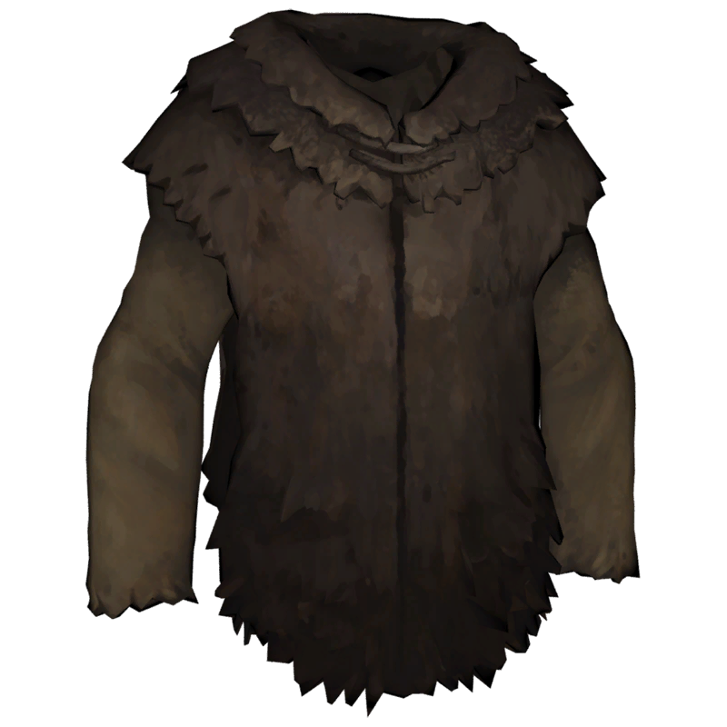
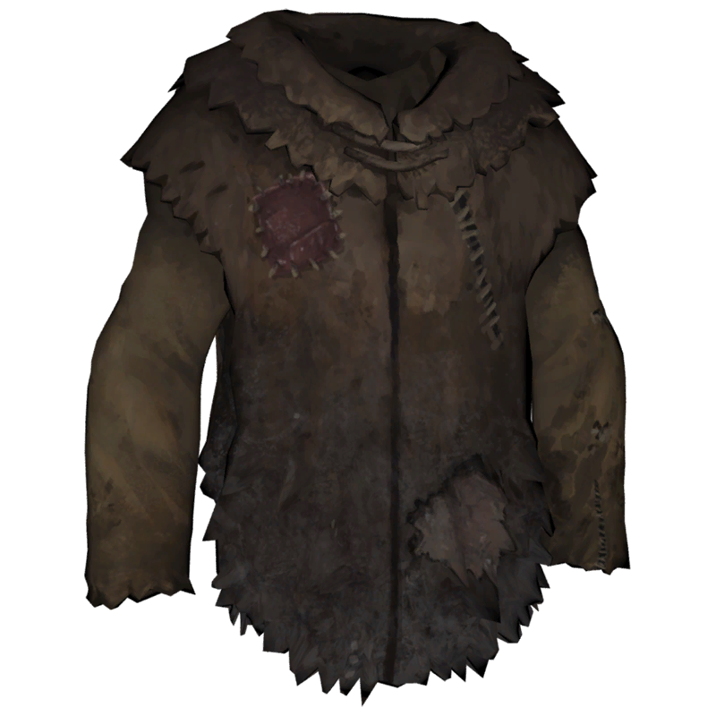

# Moose\-Hide Cloak

**Categories:** Clothing, Craftable clothing, Pages with update history · **Source:** [Fandom](https://thelongdark.fandom.com/wiki/Moose-Hide_Cloak)

**Contents**

- [Overview](#overview)
- [Crafting](#crafting)
- [Repair](#repair)
- [Gallery](#gallery)
- [Update history](#update-history)

**Moose-Hide Cloak**

_Moose-Hide\_Cloak\_icon.png_

**General**

**Item Type:** Clothing

**Clothing Slot:** Outer torso

**Statistics**

**Weight:** 4.00 kg(8.8 lbs)

**Warmth bonus:** 3.5 °C(6.3 °F)

**Windproof bonus:** 4.0 °C(7.2 °F)

**Waterproof bonus:** 90%

**Protection:** 20%

**Mobility:** -10%

**Harvest:** 1 × [Cured Moose Hide](./Cured%20Moose%20Hide.md) / 120 minutes

**Repair:** 1 × [Cured Moose Hide](./Cured%20Moose%20Hide.md), / 2 × [Cured Gut](./Cured%20Gut.md) / 120 minutes / 60% condition

> “**Cloak crafted from Moose hide. Heavy, but offers significant protection from unfriendly wildlife, and is highly waterproof. A rare trophy."**”
>
> — In-game description

The **Moose-Hide Cloak** is a type of [clothing](./Clothing.md) in _The Long Dark_.

## Overview

Moose-Hide Cloaks are crafted torso wear with extremely high waterproof and the second highest protection of any item, right behind the [Ballistic Vest](./Ballistic%20Vest.md), but offer less warmth than the [Expedition Parka](./Expedition%20Parka.md), [Wolfskin Coat](./Wolfskin%20Coat.md) and [Bearskin Coat](./Bearskin%20Coat.md). Moose Hide Cloaks require [Cured Moose Hide](./Cured%20Moose%20Hide.md) to craft and repair, making them difficult to produce and maintain.

## Crafting

**Moose-Hide Cloak**

| Property | Details |
| --- | --- |
|  | - |
|  | - |
|  | 1000 minutes (16 hour 40 minutes) |
| **Requirements** |  |
| Facility | **Template:iconlink** |
| Tool | **Template:iconlink** |
| **Materials** |  |
| **Template:iconlink plain** |  |
| Item | [Cured Moose Hide](./Cured%20Moose%20Hide.md) |
| Quantity | 1 |
| **Template:iconlink plain** |  |
|  | [Cured Gut](./Cured%20Gut.md) |
|  | 4 |

## Repair

Moose Hides can be difficult to acquire due to the rarity and danger of moose, as well as requiring 10 days to [cure](./Curing.md); this makes repairing Moose-Hide Cloaks challenging. Instead, existing cloaks may be [harvested](./Harvesting.md) (yielding 1 cured moose hide) and then re-crafted into a new cloak. This process takes 16.67 hours longer than repairing and is more expensive with [Cured Guts](./Cured%20Gut.md): but allows repeated use of the same hide.

- 

Note: Crafting Moose-Hide Cloaks costs durability of the used tool (e.g. [hunting knife](./Hunting%20Knife.md)), though this is usually less resource-intensive than to kill another [moose](./Moose.md).

## Gallery

_Clothing model icon_

_Clothing model icon damaged_

## Update history

- UPDATE **7 December 2017 ([Update](./The%20Long%20Dark%20%E2%80%94%20Changelog.md#1.16)):**
  - Added to game.
