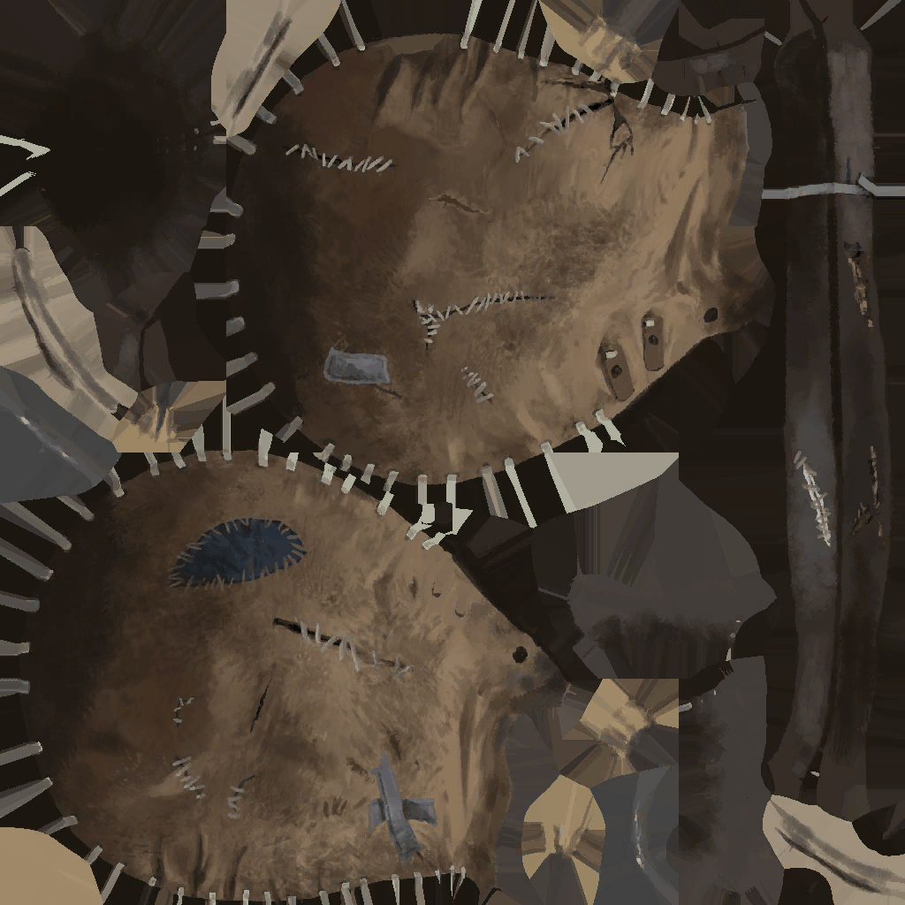

# Moose\-Hide Satchel

**Contents**

- [Overview](#Overview)
- [Tips](#Tips)
- [Crafting](#Crafting)
- [Obtaining](#Obtaining)
- [Gallery](#Gallery)
- [Update history](#Update_history)

<table class="infobox">
<caption>Moose-Hide Satchel</caption>
<colgroup>
<col style="width: 50%" />
<col style="width: 50%" />
</colgroup>
<tbody>
<tr>
<td colspan="2"><figure>

<figcaption>Moose-Hide_Satchel_icon.png</figcaption>
</figure></td>
</tr>
<tr>
<td colspan="2" class="section">
<strong>General</strong>
</td>
</tr>
<tr>
<td>
Item Type
</td>
<td>
Clothing|-
</td>
</tr>
<tr>
<td>
Clothing Slot
</td>
<td>
Accessory
</td>
</tr>
<tr>
<td colspan="2" class="section">
<strong>Statistics</strong>
</td>
</tr>
<tr>
<td>
Weight
</td>
<td>
0.25 kg(0.55 lbs)
</td>
</tr>
<tr>
<td>
Warmth bonus
</td>
<td>
0.0 °C(0 °F)
</td>
</tr>
<tr>
<td>
Windproof bonus
</td>
<td>
0.0 °C(0 °F)
</td>
</tr>
<tr>
<td>
Waterproof bonus
</td>
<td>
0%
</td>
</tr>
<tr>
<td>
Protection
</td>
<td>
0%
</td>
</tr>
<tr>
<td>
Mobility
</td>
<td>
0%
</td>
</tr>
<tr>
<td>
Harvest
</td>
<td>
1 x <a href="./Cured%20Leather.md" class="wikilink" title="Cured Leather">Cured Leather</a> 
10 minutes
</td>
</tr>
<tr>
<td>
Repair
</td>
<td>
1 x <a href="./Cured%20Leather.md" class="wikilink" title="Cured Leather">Cured Leather</a> 
22.5 minutes 
75% condition
</td>
</tr>
</tbody>
</table>

<table>
<colgroup>
<col style="width: 33%" />
<col style="width: 33%" />
<col style="width: 33%" />
</colgroup>
<tbody>
<tr>
<td style="vertical-align: top; font-size: 3em; color: #5d5980; padding-right: 10px">
“
</td>
<td>
A simple Moose-hide satchel. Lightens the load for a weary traveller.

&#10;

- In-game description

</td>
<td style="vertical-align: bottom; font-size: 3em; color: #5d5980; padding-left: 10px">
”
</td>
</tr>
</tbody>
</table>

**Moose-Hide Satchel** is a type of accessory <a href="./Clothing.md" class="wikilink" title="Clothing">Clothing</a> in *The Long Dark*.

## Overview

The Moose-hide Satchel is a clothing item that when worn in either accessory slot, grants a bonus 5kg of <a href="./Encumbrance.md" class="wikilink" title="carry capacity">carry capacity</a> (11lbs). Only one satchel can be worn at a time. The satchel provides no other bonuses, such as <a href="./Warmth.md" class="wikilink" title="Warmth">Warmth</a> or <a href="./Clothing.md#Windproof" class="wikilink" title="windproofing">windproofing</a>.

Like other clothing, the satchel is vulnerable to damage from <a href="./Struggle.md" class="wikilink" title="Struggle">Struggle</a> and <a href="./Weather.md" class="wikilink" title="blizzards">blizzards</a>, though it is sturdy and relatively easy to repair.

## Tips

- The Satchel's carry capacity bonus stacks with the <a href="./Technical%20Backpack.md" class="wikilink" title="Technical Backpack">Technical Backpack</a> and <a href="./Well%20Fed.md" class="wikilink" title="Well Fed">Well Fed</a> benefit.
- The Satchel is repaired with <a href="./Cured%20Leather.md" class="wikilink" title="Cured Leather">Cured Leather</a>, not a <a href="./Cured%20Moose%20Hide.md" class="wikilink" title="Cured Moose Hide">Cured Moose Hide</a>.
- Wearing a Moose-hide Satchel as an outer accessory (right) and any inner accessory like <a href="./Wool%20Ear%20Wrap.md" class="wikilink" title="Wool Ear Wrap">Wool Ear Wrap</a> or <a href="./Improvised%20Insulation.md" class="wikilink" title="Improvised Insulation">Improvised Insulation</a> in the inner (left) will protect the accessory - until the satchel is destroyed - from both wildlife and adverse weather like snow. Moose-Hide Satchels are far more durable than other accessories, and often survive wildlife attacks if initially above 50% condition.

## Crafting

<table class="infobox">
<caption>Moose-Hide Satchel</caption>
<tbody>
<tr>
<td colspan="2">
-
</td>
</tr>
<tr>
<td colspan="2">
-
</td>
</tr>
<tr>
<td colspan="2">
960 minutes (16 hour 0 minutes)
</td>
</tr>
<tr>
<td colspan="2" class="section">
<strong>Requirements</strong>
</td>
</tr>
<tr>
<td>
Facility
</td>
<td>
<strong>Template:iconlink</strong>
</td>
</tr>
<tr>
<td>
Tool
</td>
<td>
<strong>Template:iconlink</strong>
</td>
</tr>
<tr>
<td colspan="2" class="section">
<strong>Materials</strong>
</td>
</tr>
<tr>
<td colspan="2" class="section">
<strong>Template:iconlink plain</strong>
</td>
</tr>
<tr>
<td>
Item
</td>
<td>
<a href="./Cured%20Moose%20Hide.md" class="wikilink" title="Cured Moose Hide">Cured Moose Hide</a>
</td>
</tr>
<tr>
<td>
Quantity
</td>
<td>
1
</td>
</tr>
<tr>
<td colspan="2" class="section">
<strong>Template:iconlink plain</strong>
</td>
</tr>
<tr>
<td colspan="2">
<a href="./Cured%20Gut.md" class="wikilink" title="Cured Gut">Cured Gut</a>
</td>
</tr>
<tr>
<td colspan="2">
2
</td>
</tr>
</tbody>
</table>

## Obtaining

**<a href="./Survival%20Mode.md" class="wikilink" title="Survival Mode">Survival Mode</a>**

- At the <a href="./Mysterious%20Signal%20Fire.md" class="wikilink" title="Mysterious Signal Fire">Mysterious Signal Fire</a> in the <a href="./Hushed%20River%20Valley.md" class="wikilink" title="Hushed River Valley">Hushed River Valley</a> (except on Interloper difficulty).
- Crafted at a <a href="./Work%20Bench.md" class="wikilink" title="Work Bench">Work Bench</a> for 1 Cured Moose Hide and 2 <a href="./Cured%20Gut.md" class="wikilink" title="Cured Gut">Cured Gut</a>.

**<a href="./Wintermute.md" class="wikilink" title="Wintermute">Wintermute</a>**

- Episode 3: a moose-hide satchel appears in <a href="./Misty%20Falls%20Cave.md" class="wikilink" title="Misty Falls Cave">Misty Falls Cave</a> as a reward for the *The Lost Cave *portion of the <a href="./Tall%20Tales.md" class="wikilink" title="Tall Tales">Tall Tales</a> side quest. The satchel cannot be found in this location in Survival Mode. 
- Episode 4: Found in the bunker revealed by the <a href="./Blackrock%20Rumours.md" class="wikilink" title="Blackrock Rumours">Blackrock Rumours</a> mission suspicious person side quest.
- Cannot be crafted in Episodes 1-4, despite possible <a href="./Moose.md" class="wikilink" title="Moose">Moose</a> spawn.

## Gallery

<table class="gallery">
<colgroup>
<col style="width: 50%" />
<col style="width: 50%" />
</colgroup>
<tbody>
<tr>
<td><figure>

<figcaption>Clothing model icon</figcaption>
</figure></td>
<td><figure>

<figcaption>a texture for the damaged Moose-Hide Satchel</figcaption>
</figure></td>
</tr>
</tbody>
</table>

## Update history

- HOTFIX **20 March 2018 (<a href="./The%20Long%20Dark%20%E2%80%94%20Changelog.md#1.27" class="wikilink" title="Update">Update</a>):**
  - \[Survival Mode\] Fixed issue where the Moose Hide Satchel was not showing the correct bonus when the game was set to display Imperial Units.

<!-- -->

- UPDATE **7 December 2017 (<a href="./The%20Long%20Dark%20%E2%80%94%20Changelog.md#1.16" class="wikilink" title="Update">Update</a>):**
  - Added the Moose-Hide Satchel gear item.

**Lua execution error in Module:Navbox function navbox** <a href="ru:%D0%A1%D1%83%D0%BC%D0%BA%D0%B0_%D0%B8%D0%B7_%D0%BB%D0%BE%D1%81%D0%B8%D0%BD%D0%BE%D0%B9_%D1%88%D0%BA%D1%83%D1%80%D1%8B" class="wikilink" title="ru:Сумка из лосиной шкуры">ru:Сумка из лосиной шкуры</a> <a href="es:Zurr%C3%B3n_de_pellejo_de_alce" class="wikilink" title="es:Zurrón de pellejo de alce">es:Zurrón de pellejo de alce</a>

