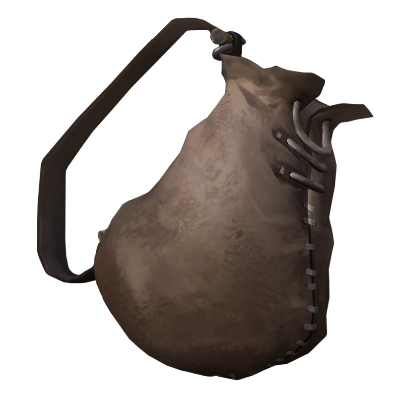

# Moose\-Hide Satchel

**Categories:** Clothing, Craftable clothing, Pages with update history · **Source:** [Fandom](https://thelongdark.fandom.com/wiki/Moose-Hide_Satchel)

**Contents**

- [Overview](#overview)
- [Tips](#tips)
- [Crafting](#crafting)
- [Obtaining](#obtaining)
- [Gallery](#gallery)
- [Update history](#update-history)

**Moose-Hide Satchel**

[Moose Hide Satchel icon](../assets/Moose-Hide_Satchel_icon.png)

**General**

**Item Type:** Clothing

**Clothing Slot:** Accessory

**Statistics**

**Weight:** [Weight icon](../assets/Weight_icon.png)0.25 kg(0.55 lbs)

**Warmth bonus:** [Temp icon](../assets/Temp_icon.png)0.0 °C(0 °F)

**Windproof bonus:** [Windproofness icon](../assets/Windproofness_icon.png)0.0 °C(0 °F)

**Waterproof bonus:** [Waterproofness icon](../assets/Waterproofness_icon.png)0%

**Protection:** [Protection icon](../assets/Protection_icon.png)0%

**Mobility:** [Mobility icon](../assets/Mobility_icon.png)0%

**Harvest:** 1 x [Cured Leather](./Cured%20Leather.md) 10 minutes

**Repair:** 1 x [Cured Leather](./Cured%20Leather.md) 22.5 minutes 75% condition

> “**A simple Moose-hide satchel. Lightens the load for a weary traveller.**”
>
> — - In-game description

**Moose-Hide Satchel** is a type of accessory [Clothing](./Clothing.md) in _The Long Dark_.

## Overview

The Moose-hide Satchel is a clothing item that when worn in either accessory slot, grants a bonus 5kg of [carry capacity](./Encumbrance.md) (11lbs). Only one satchel can be worn at a time. The satchel provides no other bonuses, such as [Warmth](./Warmth.md) or [windproofing](./Clothing.md#Windproof).

Like other clothing, the satchel is vulnerable to damage from [Struggle](./Struggle.md) and [blizzards](./Weather.md), though it is sturdy and relatively easy to repair.

## Tips

- The Satchel's carry capacity bonus stacks with the [Technical Backpack](./Technical%20Backpack.md) and [Well Fed](./Well%20Fed.md) benefit.
- The Satchel is repaired with [Cured Leather](./Cured%20Leather.md), not a [Cured Moose Hide](./Cured%20Moose%20Hide.md).
- Wearing a Moose-hide Satchel as an outer accessory (right) and any inner accessory like [Wool Ear Wrap](./Wool%20Ear%20Wrap.md) or [Improvised Insulation](./Improvised%20Insulation.md) in the inner (left) will protect the accessory - until the satchel is destroyed - from both wildlife and adverse weather like snow. Moose-Hide Satchels are far more durable than other accessories, and often survive wildlife attacks if initially above 50% condition.

## Crafting

**Moose-Hide Satchel**

960 minutes (16 hour 0 minutes)

[Cured Gut](./Cured%20Gut.md)

2

**Requirements**

**Item:** [Cured Moose Hide](./Cured%20Moose%20Hide.md)

**Quantity:** 1

## Obtaining

**[Survival Mode](./Survival%20Mode.md)**

- At the [Mysterious Signal Fire](./Mysterious%20Signal%20Fire.md) in the [Hushed River Valley](./Hushed%20River%20Valley.md) (except on Interloper difficulty).
- Crafted at a [Work Bench](./Work%20Bench.md) for 1 Cured Moose Hide and 2 [Cured Gut](./Cured%20Gut.md).

**[Wintermute](./Wintermute.md)**

- Episode 3: a moose-hide satchel appears in [Misty Falls Cave](./Misty%20Falls%20Cave.md) as a reward for the _The Lost Cave _portion of the [Tall Tales](./Tall%20Tales.md) side quest. The satchel cannot be found in this location in Survival Mode.
- Episode 4: Found in the bunker revealed by the [Blackrock Rumours](./Blackrock%20Rumours.md) mission suspicious person side quest.
- Cannot be crafted in Episodes 1-4, despite possible [Moose](./Moose.md) spawn.

## Gallery

## Update history

- HOTFIX **20 March 2018 ([Update](./The%20Long%20Dark%20%E2%80%94%20Changelog.md#1.27)):**
  - \[Survival Mode\] Fixed issue where the Moose Hide Satchel was not showing the correct bonus when the game was set to display Imperial Units.

- UPDATE **7 December 2017 ([Update](./The%20Long%20Dark%20%E2%80%94%20Changelog.md#1.16)):**
  - Added the Moose-Hide Satchel gear item.
