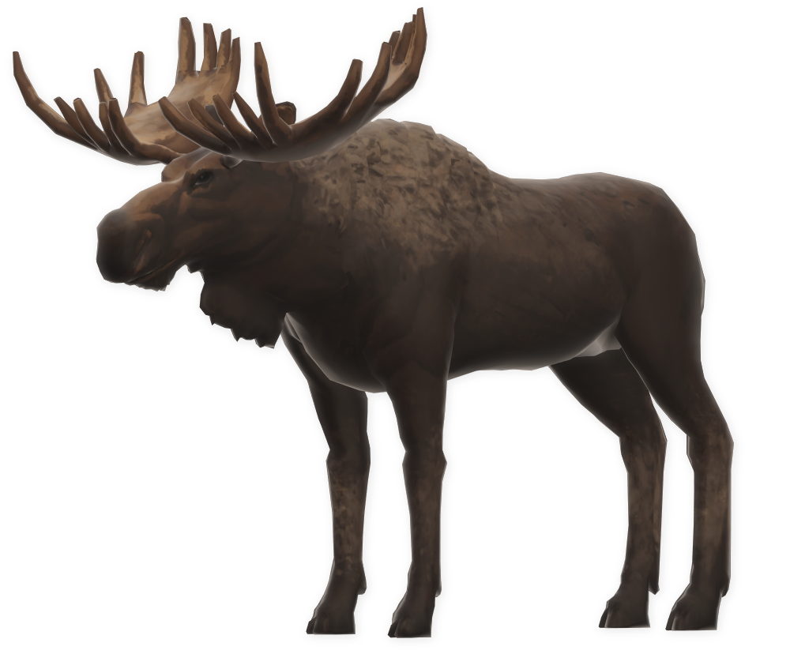
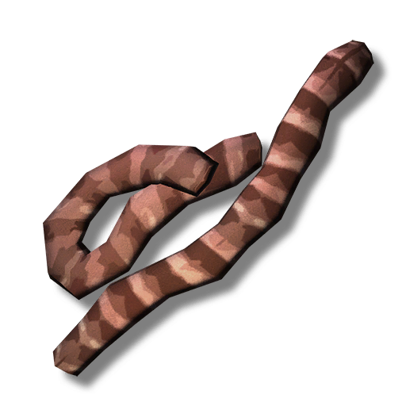
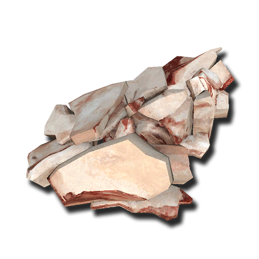
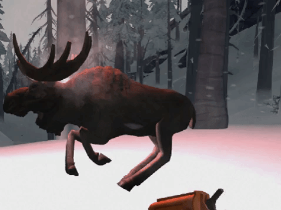
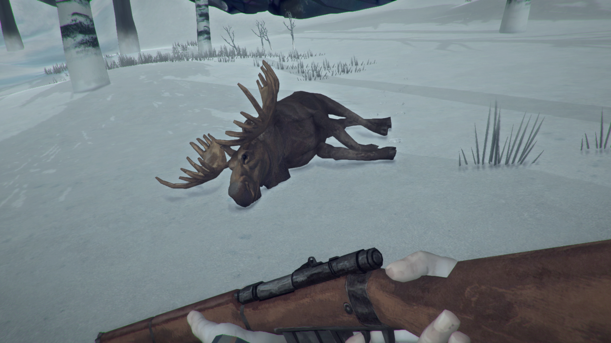
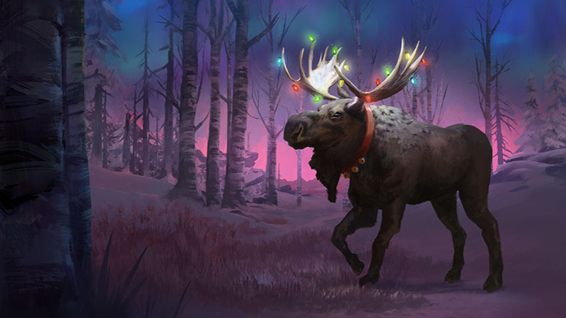

# Moose

**Contents**

- [Overview](#Overview)
- [Drops](#Drops)
- [Behaviour](#Behaviour)
- [Interactions with Wildlife](#Interactions_with_Wildlife)
- [Tree Rubbings](#Tree_Rubbings)
- [Hostility](#Hostility)
- [Trampling](#Trampling)
- [Broken Ribs](#Broken_Ribs)
- [Fleeing](#Fleeing)
- [Hunting](#Hunting)
- [Critical hits](#Critical_hits)
- [Locations](#Locations)
- [Tree Bark Marks](#Tree_Bark_Marks)
- [Ash Canyon](#Ash_Canyon)
- [Blackrock Region](#Blackrock_Region)
- [Bleak Inlet](#Bleak_Inlet)
- [Broken Railroad](#Broken_Railroad)
- [Coastal Highway](#Coastal_Highway)
- [Desolation Point](#Desolation_Point)
- [Forlorn Muskeg](#Forlorn_Muskeg)
- [Hushed River Valley](#Hushed_River_Valley)
- [Mountain Town](#Mountain_Town)
- [Mystery Lake](#Mystery_Lake)
- [Pleasant Valley](#Pleasant_Valley)
- [Timberwolf Mountain](#Timberwolf_Mountain)
- [Forsaken Airfield](#Forsaken_Airfield)
- [Sundered Pass](#Sundered_Pass)
- [Trivia](#Trivia)
- [Gallery](#Gallery)
- [Update history](#Update_history)

<table class="infobox">
<caption>Moose</caption>
<colgroup>
<col style="width: 50%" />
<col style="width: 50%" />
</colgroup>
<tbody>
<tr>
<td colspan="2"><figure>

<figcaption>Moose.png</figcaption>
</figure></td>
</tr>
<tr>
<td colspan="2" class="section">
<strong>Basic Information</strong>
</td>
</tr>
<tr>
<td>
Release
</td>
<td>
<a href="./The%20Long%20Dark%20%E2%80%94%20Changelog.md#1.16" class="wikilink" title="7 December 2017">7 December 2017</a>
</td>
</tr>
<tr>
<td>
Role
</td>
<td>
Prey
</td>
</tr>
<tr>
<td colspan="2" class="section">
<strong>Physical Information</strong>
</td>
</tr>
<tr>
<td>
Color
</td>
<td>
Brown
</td>
</tr>
<tr>
<td>
Size
</td>
<td>
Large
</td>
</tr>
<tr>
<td>
Eyes
</td>
<td>
Brown
</td>
</tr>
</tbody>
</table>

<table>
<colgroup>
<col style="width: 33%" />
<col style="width: 33%" />
<col style="width: 33%" />
</colgroup>
<tbody>
<tr>
<td style="vertical-align: top; font-size: 3em; color: #5d5980; padding-right: 10px">
“
</td>
<td>
If you see trees with scratched bark, this might mean Moose are in the area. Listen for them!

&#10;

<a href="./Load%20Screen.md" class="wikilink" title="Load Screen">Load Screen</a> description

</td>
<td style="vertical-align: bottom; font-size: 3em; color: #5d5980; padding-left: 10px">
”
</td>
</tr>
</tbody>
</table>

**Moose** are large, solitary animals in *<a href="./The%20Long%20Dark.md" class="wikilink" title="The Long Dark">The Long Dark</a>*. They appear rarely in most regions and can be difficult to find. Their hides and meat are useful, but they are aggressive and can cause serious injury when provoked.

## Overview

Moose are the largest and toughest of prey animals and can be dangerous if provoked. Their movements resemble <a href="./Deer.md" class="wikilink" title="Deer">Deer</a>, but a Moose will charge the player if approached close (similar to the behavior of <a href="./Bear.md" class="wikilink" title="Bear">Bears</a>). A moose will first adopt a stiff, threatening posture before charging and snorts to attempt to intimidate the player into backing off. If the player does not leave the immediate vicinity, the moose will charge the player.

## Drops

A <a href="./Moose%20Carcass.md" class="wikilink" title="Moose Carcass">Moose Carcass</a> may be harvested for 30.00-45.00 kg of raw meat, 1 <a href="./Fresh%20Moose%20Hide.md" class="wikilink" title="Fresh Moose Hide">Fresh Moose Hide</a> and 12 guts. Moose hides can be cured to craft <a href="./Moose-Hide%20Satchel.md" class="wikilink" title="Moose-Hide Satchel">Moose-Hide Satchel</a> or <a href="./Moose-Hide%20Cloak.md" class="wikilink" title="Moose-Hide Cloak">Moose-Hide Cloak</a>.

<table>
<colgroup>
<col style="width: 25%" />
<col style="width: 25%" />
<col style="width: 25%" />
<col style="width: 25%" />
</colgroup>
<thead>
<tr>
<th></th>
<th>
Item
</th>
<th>
Quantity
</th>
<th>
Rarity
</th>
</tr>
</thead>
<tbody>
<tr>
<td><figure>

<figcaption>Moose_Meat_(Raw)_icon.png</figcaption>
</figure></td>
<td>
<a href="./Moose%20Meat%20%28Raw%29.md" class="wikilink" title="Moose Meat (Raw)">Moose Meat (Raw)</a>
</td>
<td>
30 - 45
</td>
<td>
Always<a href="#fn1" class="footnote-ref" id="fnref1" role="doc-noteref">1</a>
</td>
</tr>
<tr>
<td><figure>

<figcaption>Moose_Quarter_icon.png</figcaption>
</figure></td>
<td>
<a href="./Moose%20Quarter.md" class="wikilink" title="Moose Quarter">Moose Quarter</a>
</td>
<td>
6 - 9
</td>
<td>
Always<a href="#fn2" class="footnote-ref" id="fnref2" role="doc-noteref">2</a>
</td>
</tr>
<tr>
<td><figure>

<figcaption>Fresh_Moose_Hide_icon.png</figcaption>
</figure></td>
<td>
<a href="./Fresh%20Moose%20Hide.md" class="wikilink" title="Fresh Moose Hide">Fresh Moose Hide</a>
</td>
<td>
1
</td>
<td>
Always
</td>
</tr>
<tr>
<td><figure>

<figcaption>Fresh_Gut_icon.png</figcaption>
</figure></td>
<td>
<a href="./Fresh%20Gut.md" class="wikilink" title="Fresh Gut">Fresh Gut</a>
</td>
<td>
12
</td>
<td>
Always
</td>
</tr>
<tr>
<td></td>
<td></td>
<td></td>
<td></td>
</tr>
</tbody>
</table>
<section id="footnotes" class="footnotes footnotes-end-of-document" role="doc-endnotes">

<ol>
<li id="fn1">If carcass is harvested<a href="#fnref1" class="footnote-back" role="doc-backlink">↩︎</a></li>
<li id="fn2">If carcass is quartered.<a href="#fnref2" class="footnote-back" role="doc-backlink">↩︎</a></li>
</ol>
</section>

Animal Fat is produced automatically when harvesting raw meat. It cannot be harvested separately and does not appear when Harvesting a Carcass.

<table>
<colgroup>
<col style="width: 25%" />
<col style="width: 25%" />
<col style="width: 25%" />
<col style="width: 25%" />
</colgroup>
<thead>
<tr>
<th></th>
<th>
Item
</th>
<th>
Quantity
</th>
<th>
Rarity
</th>
</tr>
</thead>
<tbody>
<tr>
<td><figure>

<figcaption>Animal_Fat_icon.png</figcaption>
</figure></td>
<td>
<a href="./Animal%20Fat.md" class="wikilink" title="Animal Fat">Animal Fat</a>
</td>
<td>
0.15 per kg of meat
</td>
<td>
Always
</td>
</tr>
</tbody>
</table>

## Behaviour

Moose have three paces: walking, fleeing, and charging. They behave similar to deer when roaming, stopping to sniff the ground or raise their head to listen. Moose do not actively hunt the player but will attack if approached or provoked. Possible locations for moose are marked by scratches on trees; moose are rarely far from these marked areas, though they may despawn for extended periods.

## Interactions with Wildlife

\[Missing image: Moose_and_Bear.jpg\] A Moose and Bear ignoring one another Moose will ignore <a href="./Rabbit.md" class="wikilink" title="Rabbit">Rabbit</a>, <a href="./Ptarmigan.md" class="wikilink" title="Ptarmigan">Ptarmigan</a>, <a href="./Deer.md" class="wikilink" title="Deer">Deer</a>, and <a href="./Bear.md" class="wikilink" title="Bear">Bear</a>, but will flee from the presence of a <a href="./Cougar.md" class="wikilink" title="Cougar">Cougar</a>, <a href="./Wolf.md" class="wikilink" title="Wolf">Wolf</a>, <a href="./Timberwolf.md" class="wikilink" title="Timberwolf">Timberwolf</a>, <a href="./Poisoned%20Wolf.md" class="wikilink" title="Poisoned Wolf">Poisoned Wolf</a>. Wolves will not attack and kill a Moose, but instead will flee, making the Moose the only prey animal they will not hunt.

### Tree Rubbings

While wandering within close proximity of a suitable tree, an antler rub on a tree can be found. These markings can be used to triangulate a Moose's location within a region. This can make tree rubbings useful indicators for finding (or avoiding) a Moose.

### Hostility

Moose in hostile posture - The player is too close. Moose have a detection radius within which they become aware of the player. When the player is within the radius, Moose will stop walking and turn to stare at the player, grunting and stomping on the ground as a warning. If the player fails to leave the radius immediately, the Moose will charge and attempt to trample the player (except on Pilgrim, where they stomp and then flee unless provoked).

A Moose will immediately charge any player that fires a projectile or otherwise attacks/attempts to attack it. Similar to Bears, Moose will only charge if it can access the player's location; otherwise it will flee.

### Trampling

Should a charging Moose reach the player, a one-sided <a href="./Struggle.md" class="wikilink" title="Struggle">Struggle</a> will ensue (similar to bear struggles, in that the animal always wins). After which the player will pass out, and wake up 10%-50% <a href="./Condition.md" class="wikilink" title="Condition">Condition</a> lost, the Broken Ribs affliction (see below), their equipped weapon on the ground, and distorted vision. The moose will still be nearby, and may attack again should the player not flee immediately.

### Broken Ribs

Moose attacks inflict a unique <a href="./Afflictions.md" class="wikilink" title="Affliction">Affliction</a>: <a href="./Broken%20Ribs.md" class="wikilink" title="Broken Ribs">Broken Ribs</a>, which reduces carrying capacity and greatly reduces <a href="./Stamina.md" class="wikilink" title="Stamina">Stamina</a> for 120 Hours (in-game) while your character fully heals, even with treatment. Additionally Broken Ribs makes it impossible to <a href="./Rope%20Climbing.md" class="wikilink" title="rope climb">rope climb</a> until the affliction is healed (except temporarily, while under the effects of an <a href="./Emergency%20Stim.md" class="wikilink" title="Emergency Stim">Emergency Stim</a>).

If your character is trampled again whilst already suffering from Broken Ribs, subsequent Broken Ribs Afflictions will take incrementally longer to heal.

### Fleeing

Charging Moose are not deterred by <a href="./Flare.md" class="wikilink" title="flares">flares</a>, <a href="./Torch.md" class="wikilink" title="torches">torches</a>, or <a href="./Simple%20Arrow.md" class="wikilink" title="arrows">arrows</a>: only being fired upon by any firearm will deter it. Also, Moose will turn and retreat if no navigable path to the player is available (e.g., in tight spaces like rock crevice or elevated position such as a rock formation).

- Thrown <a href="./Stone.md" class="wikilink" title="stones">stones</a> outside a Moose's line of sight generally cause them to flee. This can be useful if a Moose is blocking an essential path.
- Repeated shots from firearms will stop a charging Moose in its tracks. Each shot will cause the moose to be stunned momentarily and stop, allowing the player to essentially stun-lock the moose while they escape.
- <a href="./Noisemaker.md" class="wikilink" title="Noisemakers">Noisemakers</a> will scare off an unprovoked Moose.
- Close-impact arrows will also scare off an unprovoked Moose.

## Hunting

Unlike other <a href="./Wildlife.md" class="wikilink" title="Wildlife">Wildlife</a>, Moose do not suffer from <a href="./Blood%20Loss.md" class="wikilink" title="Blood Loss">Blood Loss</a>. This makes killing Moose more difficult, likely requiring multiple shots to bring one down. It is possible to kill a Moose with one shot, most likely a critical hit on their head, but Moose typically require four or more shots from any weapon to down (<a href="./Hunting%20Rifle.md" class="wikilink" title="Hunting Rifle">Hunting Rifle</a>, <a href="./Survival%20Bow.md" class="wikilink" title="Survival Bow">Survival Bow</a>, and <a href="./Distress%20Pistol.md" class="wikilink" title="Distress Pistol">Distress Pistol</a> all roughly equivalent). It is possible to kill Moose without a ranged weapon by using <a href="./Noisemaker.md" class="wikilink" title="Noisemakers">Noisemakers</a>, but this is generally very inefficient as it will require multiple Noisemakers. As there is a lot of <a href="./Moose%20Meat%20%28Raw%29.md" class="wikilink" title="meat">meat</a> on a moose, not to mention a heavy <a href="./Fresh%20Moose%20Hide.md" class="wikilink" title="hide">hide</a> and multiple <a href="./Fresh%20Gut.md" class="wikilink" title="guts">guts</a>, is is advisable to travel light or bring a <a href="./Travois.md" class="wikilink" title="Travois">Travois</a> before going hunting, otherwise the <a href="./Moose%20Carcass.md" class="wikilink" title="carcass">carcass</a> contents will be <a href="./Encumbrance.md" class="wikilink" title="too heavy to transport">too heavy to transport</a>.

- A careful shot from long range, then repeated shots as the Moose charges, hopefully killing it before it reaches the player.
- Distress Pistols are excellent at damaging and scaring Moose.
- Sniper nests in locations inaccessible by the moose, like the rock outcrop near <a href="./Pensive%20Pond.md" class="wikilink" title="Pensive Pond">Pensive Pond</a>. This approach requires competent weapon use, as it is likely to be a long-distance shot(s). Moose usually run a short distance away after the first hit, but return moments later allowing for further shots.
- Moose hunting with a Revolver is dangerous due to the weapon's low stopping power and range. (e.g. 8 Headshots, or Chest: 14, Hind: 16, Foot: 16 on Voyageur)
- An exploding Noisemaker will hurt a moose, and can even kill it if it has been previously injured.

### Critical hits

Critical hits cause the animal to instantly die after being hit by a shot. The following table contains the critical hit chance based on the location that was shot on the animal.

<table style="width:100%;">
<colgroup>
<col style="width: 14%" />
<col style="width: 14%" />
<col style="width: 14%" />
<col style="width: 14%" />
<col style="width: 14%" />
<col style="width: 14%" />
<col style="width: 14%" />
</colgroup>
<thead>
<tr>
<th colspan="2">
Weapon
</th>
<th colspan="5">
Critical Hit Chance
</th>
</tr>
</thead>
<tbody>
<tr>
<td>
Head
</td>
<td>
Neck
</td>
<td>
Torso
</td>
<td>
Hips
</td>
<td>
Limb
</td>
<td></td>
<td></td>
</tr>
<tr>
<td><figure>

<figcaption>Hunting_Rifle_icon.png</figcaption>
</figure></td>
<td>
<a href="./Hunting%20Rifle.md" class="wikilink" title="Hunting Rifle">Hunting Rifle</a>
</td>
<td rowspan="2">
25%
</td>
<td rowspan="2">
20%
</td>
<td rowspan="2">
10%
</td>
<td rowspan="2">
0%
</td>
<td rowspan="2">
0%
</td>
</tr>
<tr>
<td><figure>

<figcaption>Survival_Bow_icon.png</figcaption>
</figure></td>
<td>
<a href="./Survival%20Bow.md" class="wikilink" title="Survival Bow">Survival Bow</a>
</td>
</tr>
<tr>
<td><figure>

<figcaption>Revolver_icon.png</figcaption>
</figure></td>
<td>
<a href="./Revolver.md" class="wikilink" title="Revolver">Revolver</a>
</td>
<td>
10%
</td>
<td>
10%
</td>
<td>
3%
</td>
<td>
0%
</td>
<td>
0%
</td>
</tr>
<tr>
<td><figure>

<figcaption>Distress_Pistol_icon.png</figcaption>
</figure></td>
<td>
<a href="./Distress%20Pistol.md" class="wikilink" title="Distress Pistol">Distress Pistol</a>
</td>
<td>
0%
</td>
<td>
0%
</td>
<td>
0%
</td>
<td>
0%
</td>
<td>
0%
</td>
</tr>
</tbody>
</table>

## Locations

Moose may spawn rarely in all major <a href="./Region.md" class="wikilink" title="Regions">Regions</a> except <a href="./Zone%20of%20Contamination.md" class="wikilink" title="Zone of Contamination">Zone of Contamination</a>, often spawning then despawning for long periods of time. It may take many days before they respawn in the same location.

In particular, most active moose areas have a 25% chance every in-game 48 hours of spawning a moose. Exceptions to this are <a href="./Hushed%20River%20Valley.md" class="wikilink" title="Hushed River Valley">Hushed River Valley</a> spawns with a 35% chance and <a href="./Camp%20Office.md" class="wikilink" title="Camp Office">Camp Office</a> spawn in <a href="./Mystery%20Lake%20%28region%29.md" class="wikilink" title="Mystery Lake (region)">Mystery Lake (region)</a> with a 30% chance. There are also special areas near <a href="./Trapper%27s%20Homestead.md" class="wikilink" title="Trapper&#39;s Cabin">Trapper's Cabin</a>, <a href="./Quonset%20Garage.md" class="wikilink" title="Quonset Garage">Quonset Garage</a>, <a href="./Last%20Resort%20Cannery.md" class="wikilink" title="Last Resort Cannery">Last Resort Cannery</a> and <a href="./Matt%27s%20Truck.md" class="wikilink" title="Matt&#39;s Truck">Matt's Truck</a> where no moose rubbings are present. These rare spawn locations have a 5% chance of spawning a moose every in-game 48 hours. If a moose spawns, it will stay for a 48 hour period until again despawning. After the 48 hour period is over, the moose will despawn when next entering through a loading screen or reloading the game.

### Tree Bark Marks

\[Missing image: Moose_tree_marks.jpg\] Tree Marks on Birch Tree Trunks with bark scratch marks indicate a possible Moose spawn location; typically several marked trees form a rough ring around a possible spawn area.

### Ash Canyon

- <a href="./Miner%27s%20Folly.md" class="wikilink" title="Miner&#39;s Folly">Miner's Folly</a>
- On the pond near <a href="./Climber%27s%20Cave.md" class="wikilink" title="Climber&#39;s Cave">Climber's Cave</a>
- On the ice by the eastern (non-cave) entrance from Timberwolf Mountain.
- Near <a href="./Pillar%27s%20Footrest.md" class="wikilink" title="Pillar&#39;s Footrest">Pillar's Footrest</a>, east of the Timberwolf Mountain transition cave entrance.

### Blackrock Region

- In the <a href="./Blackrock%20Prison.md" class="wikilink" title="Prison">Prison</a> Parking lot.
- By the river bank near <a href="./Grand%20Meadow.md" class="wikilink" title="Grand Meadow">Grand Meadow</a>.
- Near <a href="./Cliff%20Cave.md" class="wikilink" title="Cliff Cave">Cliff Cave</a>.

### Bleak Inlet

- Next to the northernmost <a href="./Hunter%27s%20Blind.md" class="wikilink" title="Hunter&#39;s Blind">Hunter's Blind</a>.
- In the birch forest, west of the transition cave to <a href="./Forlorn%20Muskeg.md" class="wikilink" title="Forlorn Muskeg">Forlorn Muskeg</a>.
- Downstream of the <a href="./Lower%20Raven%20Falls.md" class="wikilink" title="Lower Raven Falls">Lower Raven Falls</a> bridge.
- On the pond below the <a href="./Echo%20One%20Radio%20Tower.md" class="wikilink" title="Echo One Radio Tower">Echo One Radio Tower</a> where the <a href="./Secret%20Mountain%20Path.md" class="wikilink" title="Mountain Path">Mountain Path</a> starts in <a href="./Bleak%20Inlet.md" class="wikilink" title="Bleak Inlet">Bleak Inlet</a>.
- By the road near <a href="./Last%20Resort%20Cannery.md" class="wikilink" title="Last Resort Cannery">Last Resort Cannery</a> (rare spawn).

### Broken Railroad

- South of the wooden bridge leading to the <a href="./Hunting%20Lodge.md" class="wikilink" title="Hunting Lodge">Hunting Lodge</a>.
- Below the rope climb near the <a href="./Maintenance%20Yard.md" class="wikilink" title="Maintenance Yard">Maintenance Yard</a> in <a href="./Broken%20Railroad.md" class="wikilink" title="Broken Railroad">Broken Railroad</a>.

### Coastal Highway

- At the <a href="./Coastal%20Townsite.md" class="wikilink" title="Coastal Townsite">Coastal Townsite</a> north of <a href="./Quonset%20Garage.md" class="wikilink" title="Quonset Garage">Quonset Garage</a> (rare spawn).

### Desolation Point

- Along the road near <a href="./Matt%27s%20Truck.md" class="wikilink" title="Matt&#39;s Truck">Matt's Truck</a> (rare spawn).
- On the sea ice and on the rocks between the <a href="./Lonely%20Lighthouse.md" class="wikilink" title="Lonely Lighthouse">Lonely Lighthouse</a> and <a href="./The%20Riken.md" class="wikilink" title="the Riken">the Riken</a> (rare spawn).

### Forlorn Muskeg

- Northwest of the rail tunnel to <a href="./Mystery%20Lake%20%28region%29.md" class="wikilink" title="Mystery Lake">Mystery Lake</a>, near a cave.
- Southeast area close to the <a href="./Bleak%20Inlet.md" class="wikilink" title="Bleak Inlet">Bleak Inlet</a> transition cave.
- East of <a href="./Marsh%20Ridge.md" class="wikilink" title="Marsh Ridge">Marsh Ridge</a>, near the entrance to the cave next to the Mountain Town transition.

### Hushed River Valley

- On <a href="./Monolith%20Lake.md" class="wikilink" title="Monolith Lake">Monolith Lake</a>.
- On <a href="./Stairsteps%20Lake.md" class="wikilink" title="Stairsteps Lake">Stairsteps Lake</a>.
- Close to the <a href="./Landslide%20%28Hushed%20River%20Valley%29.md" class="wikilink" title="Landslide">Landslide</a> in the valley.

### Mountain Town

- In the <a href="./Picnic%20Area.md" class="wikilink" title="Picnic area">Picnic area</a>, near <a href="./Milton%20Park.md" class="wikilink" title="Milton Park">Milton Park</a> office.
- Behind <a href="./Milton%20House%20%28Grey%20Mother%27s%29.md" class="wikilink" title="Grey Mother&#39;s House">Grey Mother's House</a>.

### Mystery Lake

- Behind <a href="./Trapper%27s%20Homestead.md" class="wikilink" title="Trapper&#39;s Homestead">Trapper's Homestead</a> (rare spawn)
- Around the train tracks at <a href="./Camp%20Office.md" class="wikilink" title="Camp Office">Camp Office</a>.
- Between the <a href="./Logging%20Camp.md" class="wikilink" title="Logging Camp">Logging Camp</a> and the <a href="./Train%20Loading%20Area.md" class="wikilink" title="Train Loading Area">Train Loading Area</a>.

### Pleasant Valley

- West of the <a href="./Lonely%20Homestead.md" class="wikilink" title="Lonely Homestead">Lonely Homestead</a>.
- Across the bridge from the <a href="./Pleasant%20Valley%20Outbuildings.md" class="wikilink" title="Barn">Barn</a>, south of the Lonely Homestead.
- Around <a href="./Lower%20Falls.md" class="wikilink" title="Lower Falls">Lower Falls</a>.
- On the ice near <a href="./Draft%20Dodger%27s%20Cabin.md" class="wikilink" title="Draft Dodger&#39;s Cabin">Draft Dodger's Cabin</a>.
- On the river close to <a href="./End%20of%20the%20Road.md" class="wikilink" title="End of the Road">End of the Road</a>.
- On <a href="./Skeeter%27s%20Ridge.md" class="wikilink" title="Skeeter&#39;s Ridge">Skeeter's Ridge</a> near the basement.

### Timberwolf Mountain

- East of <a href="./Echo%20Peak%20West.md" class="wikilink" title="Echo Peak West">Echo Peak West</a>, near the fallen tree bridge above the entrance to Ash Canyon.
- On the ice below the waterfall next to <a href="./Andre%27s%20Peak.md" class="wikilink" title="Andre&#39;s Peak">Andre's Peak</a>.
- Near the crates north of <a href="./Crystal%20Lake.md" class="wikilink" title="Crystal Lake">Crystal Lake</a>.

### Forsaken Airfield

- On the lake near <a href="./Final%20Approach.md" class="wikilink" title="Final Approach">Final Approach</a>.
- On the pond east of <a href="./Spotter%27s%20Blind.md" class="wikilink" title="Spotter&#39;s Blind">Spotter's Blind</a>.
- On <a href="./Shoulder%20Lake.md" class="wikilink" title="Shoulder Lake">Shoulder Lake</a> in the <a href="./Cove.md" class="wikilink" title="Cove">Cove</a> below <a href="./Island%20Cottage.md" class="wikilink" title="Island Cottage">Island Cottage</a>.

### Sundered Pass

- On <a href="./Ambler%27s%20Lake.md" class="wikilink" title="Ambler&#39;s Lake">Ambler's Lake</a>.
- At <a href="./Ogre%27s%20Teardrop.md" class="wikilink" title="Ogre&#39;s Teardrop">Ogre's Teardrop</a>.
- On a pond northwest of the <a href="./Weather%20Station.md" class="wikilink" title="Weather Station">Weather Station</a>.

## Trivia

- Moose are based off the real world [Moose](https://en.wikipedia.org/wiki/Moose) (***Alces alces***), the largest species of Cervidae. All Moose in game are male bulls.[1](https://en.wikipedia.org/wiki/Moose)
- Raphael van Lierop initially joked about removing Moose if he wouldn't get good programmers in his vacant positions.[^1]
- <a href="./Tin%20of%20Coffee.md" class="wikilink" title="Tin of Coffee">Tin of Coffee</a> is branded as "*Big Moose Kicks Coffee"* with an image of a moose and their tracks.
- Tree Rubs are a real-world phenomena made by male moose during mating season. They occur when moose rub their antlers on trees annually in September when they finish growing, and again in November-March to shed them.
- In real life Moose are one of the deadliest animals in Canada and Alaska, causing [40 deaths and 500 injuries annually](https://books.google.com/books?id=kpBOpT1oszIC&printsec=frontcover&dq=Don%27t+Get+Eaten:+The+Dangers+of+Animals+that+Charge+or+Attack&hl=en&sa=X&ved=2ahUKEwjE3a3N1M7kAhUOWa0KHWw3DfAQ6AEwAHoECAAQAg#v=onepage&q=Don't%20Get%20Eaten%3A%20The%20Dangers%20of%20Animals%20that%20Charge%20or%20Attack&f=false) (mostly from car accidents); more than Black Bear and Grizzly Bear combined).

## Gallery

<table class="gallery">
<colgroup>
<col style="width: 25%" />
<col style="width: 25%" />
<col style="width: 25%" />
<col style="width: 25%" />
</colgroup>
<tbody>
<tr>
<td><figure>
[Missing image: Mooseattack.jpg]
<figcaption>Moose before attacking the player</figcaption>
</figure></td>
<td><figure>
[Missing image: Moose_up_close.jpg]
<figcaption>ditto</figcaption>
</figure></td>
<td><figure>

<figcaption>A running moose</figcaption>
</figure></td>
<td><figure>

<figcaption>Dead moose in <a href="./Timberwolf%20Mountain.md" class="wikilink" title="Timberwolf Mountain">Timberwolf Mountain</a></figcaption>
</figure></td>
</tr>
<tr>
<td><figure>
[Missing image: Moose-trees.jpg]
<figcaption>several marks form a rough ring around a possible spawn area. (Mystery Lake)</figcaption>
</figure></td>
<td><figure>
[Missing image: Moose-mark.jpg]
<figcaption>scratch marks</figcaption>
</figure></td>
<td><figure>
[Missing image: Slayed_Moose_Mini-Base_in_Milton_Basin.jpg]
<figcaption>A slain Moose mini-base in Milton Basin.</figcaption>
</figure></td>
<td><figure>

<figcaption>2020 Christmas Dev log with a moose</figcaption>
</figure></td>
</tr>
<tr>
<td><figure>
[Missing image: Seasons_greetings.jpg]
<figcaption>Ditto</figcaption>
</figure></td>
<td><figure>

<figcaption>Moose on <a href="./Tin%20of%20Coffee.md" class="wikilink" title="Tin of Coffee">Tin of Coffee</a></figcaption>
</figure></td>
<td><figure>

<figcaption>ditto, unused texture</figcaption>
</figure></td>
<td><figure>
[Missing image: Moose_Mug_Coffee_Real.webp]
<figcaption>A real world Cup of Coffee Tin cup with a moose</figcaption>
</figure></td>
</tr>
</tbody>
</table>

## Update history

- UPDATE **10 December 2019 (<a href="./The%20Long%20Dark%20%E2%80%94%20Changelog.md#1.64" class="wikilink" title="Update">Update</a>):**
  - \[Survival\] Black screen no longer appears after being trampled by a Moose.

<!-- -->

- HOTFIX **27 May 2019 (<a href="./The%20Long%20Dark%20%E2%80%94%20Changelog.md#1.52" class="wikilink" title="Update">Update</a>):**
  - \[Survival Mode\] Tuned damage dealt to Bears and Moose when using the Revolver.

<!-- -->

- HOTFIX **8 May 2019 (<a href="./The%20Long%20Dark%20%E2%80%94%20Changelog.md#1.49" class="wikilink" title="Update">Update</a>):**
  - Tuned Revolver effectiveness when used against Moose (reduced) and reduced critical chance against Bears.

<!-- -->

- HOTFIX **27 August 2018 (<a href="./The%20Long%20Dark%20%E2%80%94%20Changelog.md#1.36" class="wikilink" title="Update">Update</a>):**
  - \[ALL\] Fixed improperly focused camera when Harvesting a Moose.
  - \[ALL\] Fixed issue where shooting certain trees with Arrows would cause Moose sound effects to play.

<!-- -->

- UPDATE **14 June 2018 (<a href="./The%20Long%20Dark%20%E2%80%94%20Changelog.md#1.33" class="wikilink" title="Update">Update</a>):**
  - \[All\] Realigned Wolf positioning when it feeds off a Moose carcass.
  - \[Survival Mode\] Fixed Moose getting stuck in running animation when it dies while running.
  - \[Survival Mode\] Fixed Moose entering hold position when player is holding a light source.
  - \[Survival Mode\] Improved Moose pathfinding when under trees.
  - \[Survival Mode\] Fixed Moose scratch texture on trees appearing stretched.

<!-- -->

- HOTFIX **20 March 2018 (<a href="./The%20Long%20Dark%20%E2%80%94%20Changelog.md#1.27" class="wikilink" title="Update">Update</a>):**
  - \[Both\] Moose sign scratches now appear with the correct color and texture across all Regions.
  - \[Survival Mode\] Improved camera position and framing of Moose carcass during Harvesting

<!-- -->

- UPDATE **7 December 2017 (<a href="./The%20Long%20Dark%20%E2%80%94%20Changelog.md#1.16" class="wikilink" title="Update">Update</a>):**
  - Added the Moose to all Survival Mode regions.

==References== **Template:reflist** **Lua execution error in Module:Navbox function navbox**

<a href="ru:%D0%9B%D0%BE%D1%81%D1%8C" class="wikilink" title="ru:Лось">ru:Лось</a> <a href="es:Alce" class="wikilink" title="es:Alce">es:Alce</a>

## Notes

[^1]: [Twitter. Raphael van Lierop on Twitter. 14 November 2017.](https://twitter.com/RaphLife/status/930584907968954368)
