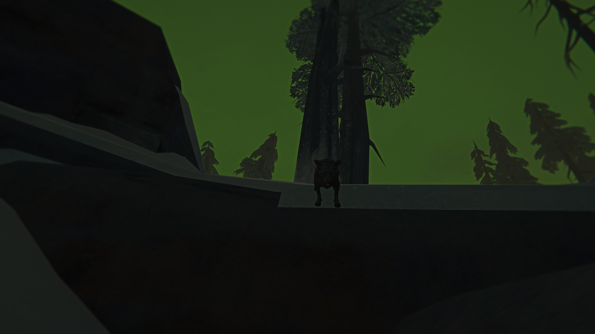

# Mountain Goating

**Categories:** Gameplay · **Source:** [Fandom](https://thelongdark.fandom.com/wiki/Mountain_Goating)

The term **Mountain Goating** is an informal term popularized on the [Hinterland Forums](https://hinterlandforums.com) (similar to [Daisy Chaining](./Daisy%20Chaining.md) and [Hibernation](./Hibernation.md)), which is used to refer to the gameplay practice of players "sticking" to extremely steep terrain that is not normally climbable.

<!-- #Premise -->
​

<!-- #premise -->
## Premise

The premise of Mountain Goating relies on how the game calculates slopes. When a slope exceeds a certain steepness, the player character will not be able to walk uphill (gain y-levels). However, as long as there's no overhang on the slope, the player character will not slide downhill, and can walk across the slope (change x and z position) as easily as if the ground were level.

While this technique is most often used for going downhill, careful, strategic planning can allow players to climb _up_ hills and even cliffs that look at first glance to be unclimbable. Going uphill generally involves walking across a steep, unclimbable slope to reach a spot where the slope is sufficiently shallow to allow the player character to walk uphill. When the player has climbed up as far as is possible in that location, they walk across the slope again until they find another spot where they can walk uphill. Climbing up a long, steep cliff may require going back and forth across a crag several times.

<!-- #Benefits -->
​

<!-- #benefits -->
## Benefits

Mountain Goating's main benefit is to enable players to take shortcuts. For example, a popular option is to climb down the [Summit](./Summit.md) of [Timberwolf Mountain](./Timberwolf%20Mountain.md) on the side facing [Crystal Lake](./Crystal%20Lake.md). This enables players to carry far more load than normal, and also avoids the fatigue of climbing down ropes. With careful planning, this technique can also be used to evade chasing [wildlife](./Wildlife.md), as animals won't be able to path on any terrain that the player character can't walk up. _A wolf that's unable to reach the player due to uneven terrain._

<!-- #Drawbacks -->
​

<!-- #drawbacks -->
## Drawbacks

The main drawback of Mountain Goating is that there's a high likelihood of getting sprains, [torn clothing](./Torn%20Clothing.md), and injuries, as it requires walking across very steep slopes and falling from substantial heights. [Crampons](./Crampons.md) or [Improvised Crampons](./Improvised%20Crampons.md) along with not being encumbered can help mitigate this risk somewhat, but won't eliminate it. Another danger of Mountain Goating is falling if players accidentally walk towards an overhang they didn't see. Additionally, certain areas of the game were filled with death planes by the developers to stop Mountain Goating being used there, most notable example being Ravine, which eliminates most routes that allow the player to avoid rope climbing to get into lower part of the region.

Another drawback, only applicable to players who have purchased [Tales from the Far Territory](./Tales%20from%20the%20Far%20Territory.md), is that it is impossible to use a deployed [Travois](./Travois.md) when Mountain Goating. However, since speed is rarely a priority when Mountain Goating and the player can still move (albeit slowly) as long as [Encumbrance](./Encumbrance.md) is not in excess of 30 kg, it is possible to move all the gear from the Travois into the player's backpack, Mountain Goat through the difficult terrain, and re-deploy the Travois on flatter ground.
