# Mountain Pass

<table class="infobox">
<caption>Mountain Pass</caption>
<colgroup>
<col style="width: 50%" />
<col style="width: 50%" />
</colgroup>
<tbody>
<tr>
<td colspan="2"><figure>

<figcaption>No_picture.png</figcaption>
</figure></td>
</tr>
<tr>
<td colspan="2" class="section">
<strong>Location on <a href="./Great%20Bear%20Island.md" class="wikilink" title="Great Bear Island">Great Bear Island</a></strong>
</td>
</tr>
<tr>
<td colspan="2"><figure>

<figcaption>No_picture.png</figcaption>
</figure></td>
</tr>
<tr>
<td colspan="2" class="section">
<strong>Details</strong>
</td>
</tr>
<tr>
<td>
Difficulty
</td>
<td>
Intermediate
</td>
</tr>
</tbody>
</table>

<table style="width:100%;">
<colgroup>
<col style="width: 16%" />
<col style="width: 16%" />
<col style="width: 16%" />
<col style="width: 16%" />
<col style="width: 16%" />
<col style="width: 16%" />
</colgroup>
<tbody>
<tr>
<td width="40px"><figure>

<figcaption>The_Long_Development_White_Logo.png</figcaption>
</figure></td>
<td>
<strong>Modded Content.</strong> 

This page is about content that was not officially created by <a href="./Hinterland%20Studio%20Inc..md" class="wikilink" title="Hinterland Studio Inc.">Hinterland Studio Inc.</a> It is not canon to the world of <a href="./The%20Long%20Dark.md" class="wikilink" title="The Long Dark">The Long Dark</a>.

</td>
<td>
|}{| style="margin:auto"
</td>
<td style="vertical-align: top; font-size: 3em; color: #5d5980; padding-right: 10px">
“
</td>
<td>
A large sprawling rocky region featuring winding fissures, a large basin, ample hunting space, and a railway track that bisects it all.

&#10;

TLDEV Region Description

</td>
<td style="vertical-align: bottom; font-size: 3em; color: #5d5980; padding-left: 10px">
”
</td>
</tr>
</tbody>
</table>

*Not to be confused with <a href="./Sundered%20Pass.md" class="wikilink" title="Sundered Pass">Sundered Pass</a>.*

**Mountain Pass** is the 5th <a href="./The%20Long%20Development.md" class="wikilink" title="Modded Region">Modded Region</a> added to the game, as part of The Long Development's unofficial region mods.

## Locations

Although this location is still under construction, there are a number of accessible locations:

- Ambitious Depot
- Dilapidated Derricks
- Fortified Homestead
- Frontier Lake
- Hollow Promises Cave
- Penultimate Approach
- Pricett's Retirement
- Ravine Respite
- Throughline Trestle

**Lua execution error in Module:Navbox function navbox**

