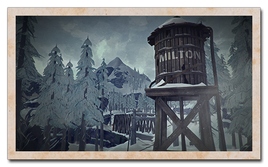
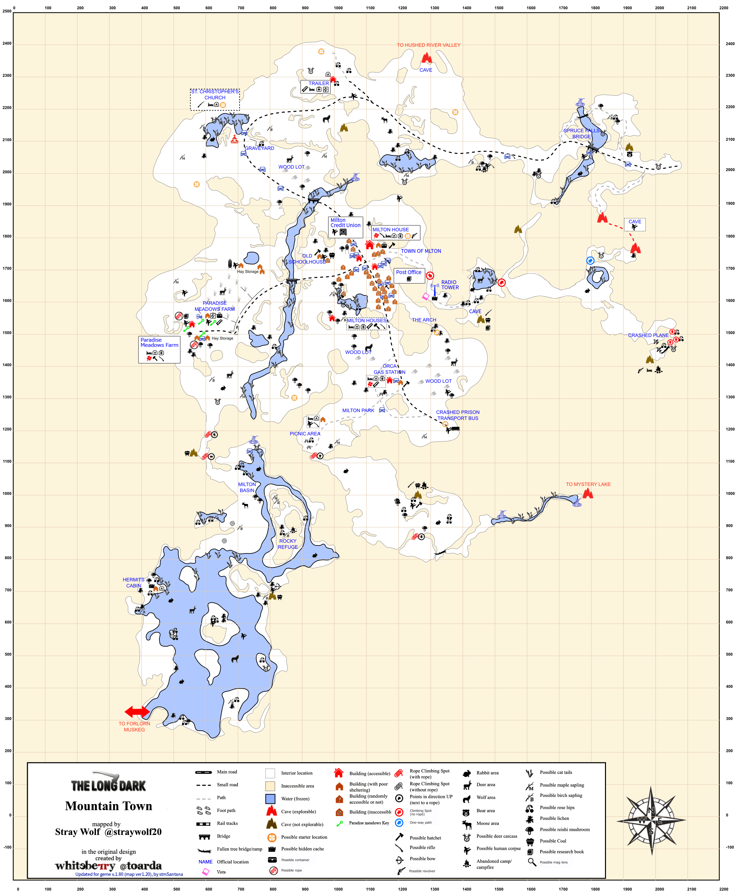
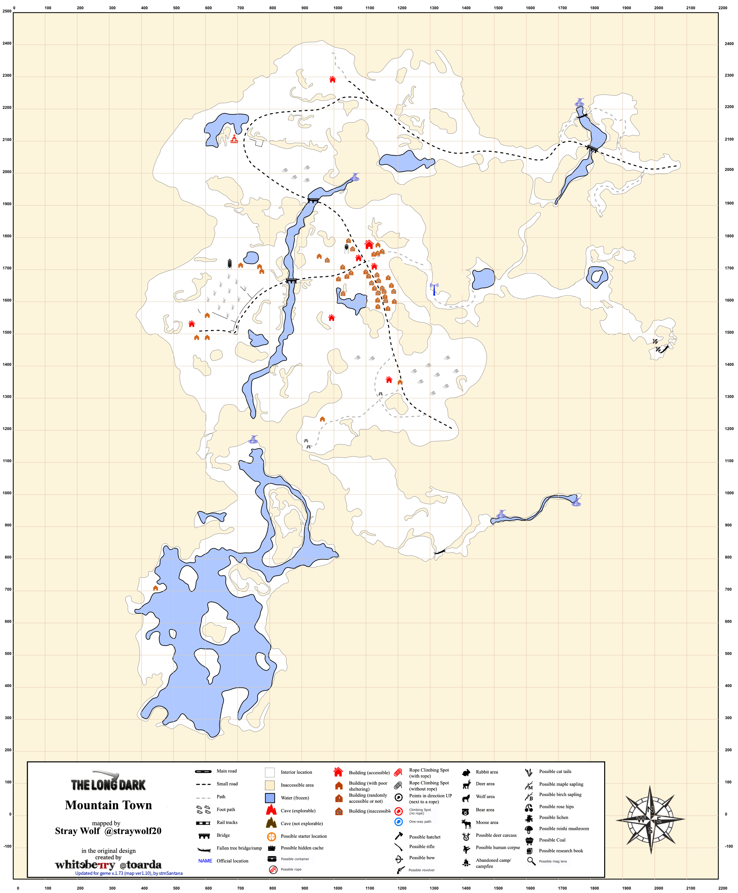

# Mountain Town

**Contents**

- [Description](#Description)
- [Harvestable Plants](#Harvestable_Plants)
- [Locations](#Locations)
- [Notes](#Notes)
- [Maps](#Maps)
- [Game History](#Game_History)
- [References](#References)

<table class="infobox">
<caption>Mountain Town</caption>
<colgroup>
<col style="width: 50%" />
<col style="width: 50%" />
</colgroup>
<tbody>
<tr>
<td colspan="2"><figure>

<figcaption>Mountain_town_titlecard.png</figcaption>
</figure></td>
</tr>
<tr>
<td colspan="2" class="section">
<strong>Location on <a href="./Great%20Bear%20Island.md" class="wikilink" title="Great Bear Island">Great Bear Island</a></strong>
</td>
</tr>
<tr>
<td colspan="2"><figure>
[Missing image: Mountain_Town_Location.png]
<figcaption>Mountain_Town_Location.png</figcaption>
</figure></td>
</tr>
<tr>
<td colspan="2"><figure>

<figcaption>Mountain_Town_map.png</figcaption>
</figure></td>
</tr>
<tr>
<td colspan="2" class="section">
<strong>Details</strong>
</td>
</tr>
<tr>
<td>
Description
</td>
<td>
A small abandoned town nestled in the mountains.
</td>
</tr>
<tr>
<td>
Connecting Regions
</td>
<td>
<a href="./Mystery%20Lake%20%28region%29.md" class="wikilink" title="Mystery Lake">Mystery Lake</a>, <a href="./Forlorn%20Muskeg.md" class="wikilink" title="Forlorn Muskeg">Forlorn Muskeg</a>, <a href="./Hushed%20River%20Valley.md" class="wikilink" title="Hushed River Valley">Hushed River Valley</a>
</td>
</tr>
<tr>
<td>
Characters
</td>
<td>
<a href="./Grey%20Mother.md" class="wikilink" title="Grey Mother">Grey Mother</a> <a href="./Methuselah.md" class="wikilink" title="Methuselah">Methuselah</a>
</td>
</tr>
<tr>
<td>
Difficulty
</td>
<td>
Beginner
</td>
</tr>
<tr>
<td>
Interloper Region Spawn
</td>
<td>
No
</td>
</tr>
<tr>
<td>
Locations
</td>
<td>
27
</td>
</tr>
<tr>
<td>
Date Added
</td>
<td>
Story mode: Aug 2017 Survival mode: Dec 2017
</td>
</tr>
</tbody>
</table>

<table>
<colgroup>
<col style="width: 33%" />
<col style="width: 33%" />
<col style="width: 33%" />
</colgroup>
<tbody>
<tr>
<td style="vertical-align: top; font-size: 3em; color: #5d5980; padding-right: 10px">
“
</td>
<td>
For new players. Although deep in decline, Milton still offers many sturdy shelters and plentiful wildlife. But if you leave town for the surrounding hills and fields, beware!

&#10;

- In game description

</td>
<td style="vertical-align: bottom; font-size: 3em; color: #5d5980; padding-left: 10px">
”
</td>
</tr>
</tbody>
</table>

**Mountain Town** is 8th <a href="./Region.md" class="wikilink" title="Region">Region</a> released in *<a href="./The%20Long%20Dark.md" class="wikilink" title="The Long Dark">The Long Dark</a>* on <a href="./Great%20Bear%20Island.md" class="wikilink" title="Great Bear Island">Great Bear Island</a>, and is centered around the small, recently abandoned town of <a href="./Milton.md" class="wikilink" title="Milton">Milton</a>.

It is the setting for <a href="./Episode%201%20-%20Do%20Not%20Go%20Gentle.md" class="wikilink" title="Episode 1">Episode 1</a> of <a href="./Wintermute.md" class="wikilink" title="Wintermute">Wintermute</a>, as well as the 8th region added to <a href="./Survival%20Mode.md" class="wikilink" title="Survival Mode">Survival Mode</a>. Milton is accessible via <a href="./Mystery%20Lake%20%28disambiguation%29.md" class="wikilink" title="Mystery Lake">Mystery Lake</a> (through a cave near the <a href="./Trapper%27s%20Homestead.md" class="wikilink" title="Trapper&#39;s Homestead">Trapper's Homestead</a>), <a href="./Forlorn%20Muskeg.md" class="wikilink" title="Forlorn Muskeg">Forlorn Muskeg</a> (at <a href="./Marsh%20Ridge.md" class="wikilink" title="Marsh Ridge ">Marsh Ridge </a>through a Rose Bush climb to <a href="./Milton%20Basin.md" class="wikilink" title="Milton Basin">Milton Basin</a>), and to <a href="./Hushed%20River%20Valley.md" class="wikilink" title="Hushed River Valley">Hushed River Valley</a> (through a cave between the <a href="./Trailer%20%28Mountain%20Town%20Region%29.md" class="wikilink" title="Trailer">Trailer</a> and <a href="./Spruce%20Falls%20Bridge.md" class="wikilink" title="Spruce Falls Bridge">Spruce Falls Bridge</a>).

## Description

Milton, the major point of interest in this region, is located approximately in the center of the map, and features a number of houses that can be searched for supplies, along with vehicles, a <a href="./Milton%20Post%20Office.md" class="wikilink" title="post office">post office</a> and a <a href="./Milton%20Credit%20Union.md" class="wikilink" title="bank">bank</a>. While <a href="./Wolf.md" class="wikilink" title="wolves">wolves</a> do occasionally wander into town, they can often be avoided by ducking into a vehicle or building.

From the center of the region, at the crossroads near the bank, players can follow the roads and travel out of town in four different directions. Heading northwards will take them via a woodlot to <a href="./St.%20Christopher%27s%20Church.md" class="wikilink" title="St. Christopher&#39;s Church">St. Christopher's Church</a>, which features abundant natural resources nearby. From here, the region becomes less developed, and, while richer in natural resources, is frequented by wolves and the occasional <a href="./Moose.md" class="wikilink" title="moose">moose</a>. Continuing along the road, players will pass by a <a href="./Trailer%20%28Mountain%20Town%20Region%29.md" class="wikilink" title="Trailer">Trailer</a> with a <a href="./Work%20Bench.md" class="wikilink" title="Work Bench">Work Bench</a>, followed by the cave leading to the <a href="./Hushed%20River%20Valley.md" class="wikilink" title="Hushed River Valley">Hushed River Valley</a>. The road ends shortly after <a href="./Spruce%20Falls%20Bridge.md" class="wikilink" title="Spruce Falls Bridge">Spruce Falls Bridge</a>, where there are lots of vehicles from which to hunt the <a href="./Bear.md" class="wikilink" title="bear">bear</a> that spawns nearby.

Going out of town towards the east will first lead players to a <a href="./Radio%20Tower.md" class="wikilink" title="Radio Tower">Radio Tower</a> after a short climb (no rope). Passing a shallow cave to the right (which can provide <a href="./Coal.md" class="wikilink" title="coal">coal</a>), players will encounter a small pond, which provides a safe place for hunting <a href="./Deer.md" class="wikilink" title="deer">deer</a> and <a href="./Snare.md" class="wikilink" title="snaring">snaring</a> <a href="./Rabbit.md" class="wikilink" title="rabbits">rabbits</a> without the threat of wolves. Continuing up another root climb will lead players past another small pond, and eventually into a ravine where <a href="./Mackenzie%27s%20Crashed%20Plane.md" class="wikilink" title="Mackenzie&#39;s Crashed Plane">Mackenzie's Crashed Plane</a> lies. Moderately valuable loot often spawns around the crashed plane.

Players leaving town towards the south will initially pass by the <a href="./Orca%20Gas%20Station.md" class="wikilink" title="Orca Gas Station">Orca Gas Station</a>, located in the center of a <a href="./Wood%20Lot.md" class="wikilink" title="Wood Lot">Wood Lot</a>. The gas station can't be opened without a <a href="./Prybar.md" class="wikilink" title="prybar">prybar</a>, but once inside, usually yields a fair amount of food and a few items of clothing. The nearby <a href="./Crashed%20Prison%20Transport%20Bus.md" class="wikilink" title="crashed bus">crashed bus</a> has some importance in <a href="./Episode%201%20-%20Do%20Not%20Go%20Gentle.md" class="wikilink" title="story mode">story mode</a>, but is merely a landmark in survival mode. Continuing southwards will lead players to <a href="./Milton%20Park.md" class="wikilink" title="Milton Park">Milton Park</a> and the <a href="./Picnic%20Area.md" class="wikilink" title="Picnic Area">Picnic Area</a>, featuring a small building and a rope climb down. Going down this rope and up the next will eventually lead players to <a href="./Mystery%20Lake%20%28region%29.md" class="wikilink" title="Mystery Lake">Mystery Lake</a>, after a walk along a frozen brook and through a cave.

Finally, players can head out of town towards the west. The first major destination is the <a href="./Paradise%20Meadows%20Farm.md" class="wikilink" title="Paradise Meadows Farm">Paradise Meadows Farm</a>, which initially requires a key found nearby to unlock. The farm usually has an abundance of food, and mid-level clothing. Beyond the farm, going down two long climbing ropes will lead to Milton Basin. This location has lots of natural resources, but explorers should watch for the moose that spawns nearby. Walking along the frozen lake past the <a href="./Hermit%27s%20Cabin.md" class="wikilink" title="Hermit&#39;s Cabin">Hermit's Cabin</a> (mostly destroyed, but offering a stove), players will find the connection to <a href="./Forlorn%20Muskeg.md" class="wikilink" title="Forlorn Muskeg">Forlorn Muskeg</a>.

Players who wish to have their <a href="./Safehouse.md" class="wikilink" title="safe house">safe house</a> in this region should keep in mind that entering/leaving Mountain Town from any other <a href="./Region.md" class="wikilink" title="region">region</a> besides the Hushed River Valley will require the use of <a href="./Rope%20Climbing.md" class="wikilink" title="rope climbing">rope climbing</a>, making a <a href="./Travois.md" class="wikilink" title="Travois">Travois</a> impractical and limiting the amount of gear a player can take along.

## Harvestable Plants

Mountain Town is a region rich in <a href="./Cat%20Tail.md" class="wikilink" title="Cat Tails">Cat Tails</a> and <a href="./Rose%20Hip.md" class="wikilink" title="Rose Hips">Rose Hips</a>. Cat Tails can be found in abundance along the banks of the river passing by <a href="./Milton.md" class="wikilink" title="Milton">Milton</a> and at a pond in town, throughout the <a href="./Milton%20Basin.md" class="wikilink" title="Milton Basin">Milton Basin</a>, behind <a href="./St.%20Christopher%27s%20Church.md" class="wikilink" title="St. Christopher&#39;s Church">St. Christopher's Church</a>, near the <a href="./Trailer%20%28Mountain%20Town%20Region%29.md" class="wikilink" title="Trailer">Trailer</a>, under the <a href="./Spruce%20Falls%20Bridge.md" class="wikilink" title="Spruce Falls Bridge">Spruce Falls Bridge</a>, and near the <a href="./Radio%20Tower.md" class="wikilink" title="Radio Tower">Radio Tower</a>. The region also features high density of Rose Hips, particularly around and near <a href="./Mackenzie%27s%20Crashed%20Plane.md" class="wikilink" title="Mackenzie&#39;s Crashed Plane">Mackenzie's Crashed Plane</a>. There is also the highest concentration of <a href="./Oak%20Tree.md" class="wikilink" title="Oak Trees">Oak Trees</a> of all regions, along with corresponding high amount of harvestable <a href="./Acorns.md" class="wikilink" title="Acorns">Acorns</a>, present especially around the Milton Park and Picnic Area.

## Locations

The region has a number of distinctive areas and named locations, most of which are located in or a short distance from the town itself:

<table>
<colgroup>
<col style="width: 50%" />
<col style="width: 50%" />
</colgroup>
<tbody>
<tr>
<td><ul>
<li><a href="./Bank%20Manager%27s%20House.md" class="wikilink" title="Bank Manager&#39;s House">Bank Manager's House</a> (Wintermute <a href="./Episode%201%20-%20Do%20Not%20Go%20Gentle.md" class="wikilink" title="Episode 1">Episode 1</a> only)</li>
<li><a href="./Cave%20%28Mountain%20Town%20location%29.md" class="wikilink" title="Cave (Mountain Town location)">Cave (Mountain Town location)</a></li>
<li>Crashed Plane (<a href="./Mackenzie%27s%20Crashed%20Plane.md" class="wikilink" title="Mackenzie&#39;s Crashed Plane">Mackenzie's Crashed Plane</a>)</li>
<li><a href="./Crashed%20Prison%20Transport%20Bus.md" class="wikilink" title="Crashed Prison Transport Bus">Crashed Prison Transport Bus</a></li>
<li><a href="./Graveyard.md" class="wikilink" title="Graveyard">Graveyard</a></li>
<li><a href="./Hermit%27s%20Cabin.md" class="wikilink" title="Hermit&#39;s Cabin">Hermit's Cabin</a></li>
<li><a href="./Milton%20Basin.md" class="wikilink" title="Milton Basin">Milton Basin</a></li>
<li><a href="./Milton%20Credit%20Union.md" class="wikilink" title="Milton Credit Union">Milton Credit Union</a></li>
<li><a href="./Milton%20House%20%28Grey%20Mother%27s%29.md" class="wikilink" title="Milton House (Grey Mother&#39;s)">Milton House (Grey Mother's)</a></li>
<li><a href="./Milton%20Park.md" class="wikilink" title="Milton Park">Milton Park</a></li>
<li><a href="./Milton%20Post%20Office.md" class="wikilink" title="Milton Post Office">Milton Post Office</a></li>
<li><a href="./Old%20Schoolhouse.md" class="wikilink" title="Old Schoolhouse">Old Schoolhouse</a></li>
<li><a href="./Orca%20Gas%20Station.md" class="wikilink" title="Orca Gas Station">Orca Gas Station</a></li>
<li><a href="./Paradise%20Meadows%20Farm.md" class="wikilink" title="Paradise Meadows Farm">Paradise Meadows Farm</a></li>
</ul></td>
<td data-valign="top" style="width: 50%"><ul>
<li><a href="./Picnic%20Area.md" class="wikilink" title="Picnic Area">Picnic Area</a></li>
<li><a href="./Radio%20Tower.md" class="wikilink" title="Radio Tower">Radio Tower</a></li>
<li><a href="./Rocky%20Refuge.md" class="wikilink" title="Rocky Refuge">Rocky Refuge</a></li>
<li><a href="./Spruce%20Falls%20Bridge.md" class="wikilink" title="Spruce Falls Bridge">Spruce Falls Bridge</a></li>
<li><a href="./St.%20Christopher%27s%20Church.md" class="wikilink" title="St. Christopher&#39;s Church">St. Christopher's Church</a></li>
<li><a href="./The%20Arch%20%28Mountain%20Town%20location%29.md" class="wikilink" title="The Arch">The Arch</a></li>
<li>To Cave System (Region Transition to <a href="./Hushed%20River%20Valley.md" class="wikilink" title="Hushed River Valley">Hushed River Valley</a>)</li>
<li>To Cave System (Region Transition to <a href="./Mystery%20Lake%20%28region%29.md" class="wikilink" title="Mystery Lake (region)">Mystery Lake (region)</a>)</li>
<li>To Forlorn Muskeg (Region Transitions to <a href="./Forlorn%20Muskeg.md" class="wikilink" title="Forlorn Muskeg">Forlorn Muskeg</a>)</li>
<li>Town of Milton (<a href="./Milton.md" class="wikilink" title="Milton">Milton</a>)</li>
<li><a href="./Wood%20Lot.md" class="wikilink" title="Wood Lot">Wood Lot</a></li>
<li><a href="./Wood%20Lot.md" class="wikilink" title="Wood Lot">Wood Lot</a> 3 separate Wood Lots</li>
<li><a href="./Wood%20Lot.md" class="wikilink" title="Wood Lot">Wood Lot</a></li>
</ul></td>
</tr>
</tbody>
</table>

A few other locations can be found in the region:

- 1 <a href="./Prepper%20Cache.md" class="wikilink" title="Prepper Cache">Prepper Cache</a> is found near the pond close to <a href="./Mackenzie%27s%20Crashed%20Plane.md" class="wikilink" title="Mackenzie&#39;s Crashed Plane">Mackenzie's Crashed Plane</a>, accessed by traveling across <a href="./Spruce%20Falls%20Bridge.md" class="wikilink" title="Spruce Falls Bridge">Spruce Falls Bridge</a> and through the cave system.
- A <a href="./Trailer%20%28Mountain%20Town%20Region%29.md" class="wikilink" title="Trailer">Trailer</a> can be found in the mountains near the Region Transition to <a href="./Hushed%20River%20Valley.md" class="wikilink" title="Hushed River Valley">Hushed River Valley</a>.
- Several <a href="./Milton%20House.md" class="wikilink" title="Milton Houses">Milton Houses</a> can be found in the town.

## Notes

- According to the game's developer, the name *Mountain Town* was intended to be an "internal name only" for the Milton area;[^1] however the name appears on both the Great Bear Island map and the region map of the area.
- In Survival Mode, 'returning' to the original plane crash site (the starting area in <a href="./Wintermute.md" class="wikilink" title="Wintermute">Wintermute</a>) is actually worthwhile, as the site itself (or rarely, a car leading to the site) may yield a copy of "<a href="./Skills.md" class="wikilink" title="Advanced Guns, Guns, Guns!"><em>Advanced Guns, Guns, Guns!</em></a>" and a number of <a href="./Rose%20Hip.md" class="wikilink" title="Rose Hips">Rose Hips</a>. Also, the green crates at the site can be broken down, potentially revealing loot inside. In addition, the <a href="./Spruce%20Falls%20Bridge.md" class="wikilink" title="Spruce Falls Bridge">Spruce Falls Bridge</a> holds numerous lootable cars, of which one single trunk/frozen corpse will contain a mid-to-high tier coat or parka (randomly placed).
- The region has an unusually high number of <a href="./Wolf.md" class="wikilink" title="Wolves">Wolves</a> in Survival Mode, even on lower difficulties. In Story mode, <a href="./Grey%20Mother.md" class="wikilink" title="Grey Mother">Grey Mother</a> and <a href="./Will%20Mackenzie.md" class="wikilink" title="Will">Will</a> discuss the inordinately large number of wolves in the area, with Grey Mother commenting that *"wolves are quick to move in when the people go"*.

## Maps

<table class="gallery">
<colgroup>
<col style="width: 25%" />
<col style="width: 25%" />
<col style="width: 25%" />
<col style="width: 25%" />
</colgroup>
<tbody>
<tr>
<td><figure>
[Missing image: MT_map_default.png]
<figcaption>A detailed map of Mountain Town v2.35 (spoilers)</figcaption>
</figure></td>
<td><figure>
[Missing image: MT_map_loper.png]
<figcaption>Map of Mountain Town v2.35 (Interloper/Misery edition, contains spoilers)</figcaption>
</figure></td>
<td><figure>

<figcaption>In-game map</figcaption>
</figure></td>
<td><figure>

<figcaption>Detailed map. Updated for v1.81</figcaption>
</figure></td>
</tr>
<tr>
<td><figure>

<figcaption>No spoiler map for v1.73</figcaption>
</figure></td>
<td><figure>
[Missing image: Mountain-town-map-the-long-dark-scaled.jpg]
<figcaption>Map Updated for v.1.56</figcaption>
</figure></td>
<td><figure>
[Missing image: Mountain_Town_Map_full.jpg]
<figcaption>The map found in <a href="./Episode%201%20-%20Do%20Not%20Go%20Gentle.md" class="wikilink" title="Episode 1">Episode 1</a> is different from Survival Mode</figcaption>
</figure></td>
<td></td>
</tr>
</tbody>
</table>

## Game History

- Mountain Town was added to the game on 1 August 2017 in the <a href="./The%20Long%20Dark%20%E2%80%94%20Changelog.md#1.00" class="wikilink" title="Wintermute update">Wintermute update</a>.
- Mountain Town became available in Survival Mode on 7 December 2017 in the <a href="./The%20Long%20Dark%20%E2%80%94%20Changelog.md#1.16" class="wikilink" title="Rugged Sentinel">Rugged Sentinel</a> update.
- Mountain Town map has changed with Wintermute Redux update.

## References

**Lua execution error in Module:Navbox function navboxLua execution error in Module:Navbox function navbox**

<a href="ru:%D0%9C%D0%B8%D0%BB%D1%82%D0%BE%D0%BD" class="wikilink" title="ru:Милтон">ru:Милтон</a>

<a href="es:Pueblo_de_monta%C3%B1a" class="wikilink" title="es:Pueblo de montaña">es:Pueblo de montaña</a> <a href="fr:Milton" class="wikilink" title="fr:Milton">fr:Milton</a>

## Notes

[^1]: Raphael van Lierop‏, *Twitter*, 5 August 2017 <https://twitter.com/RaphLife/status/893702535973752832>
