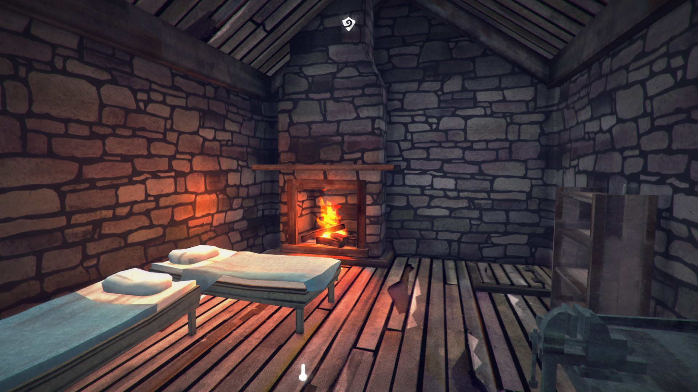
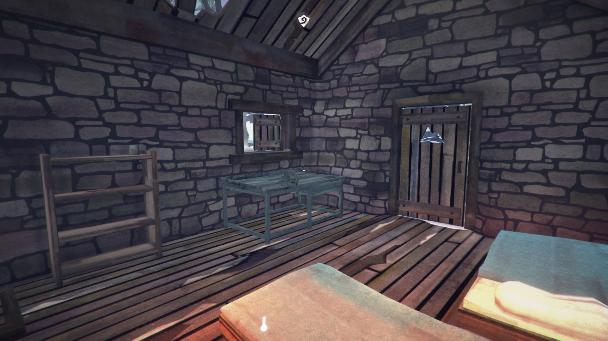
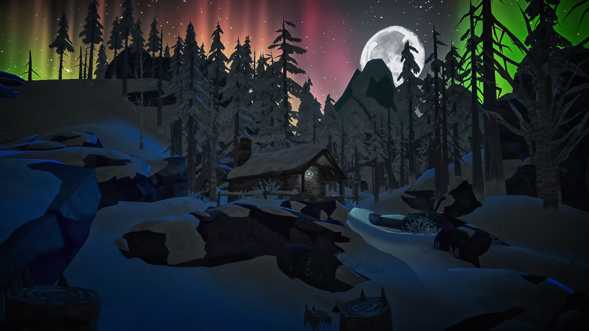
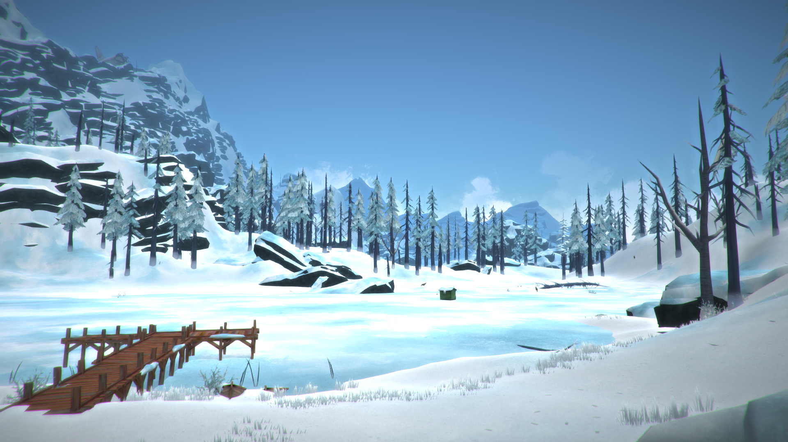
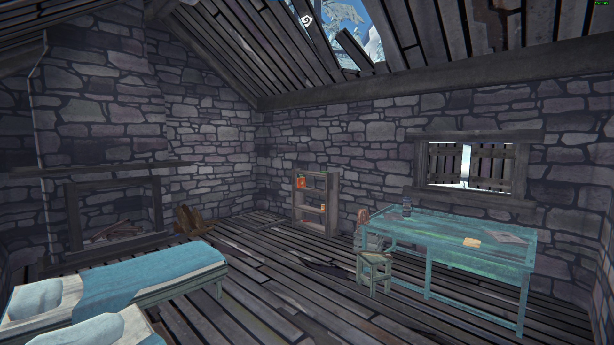
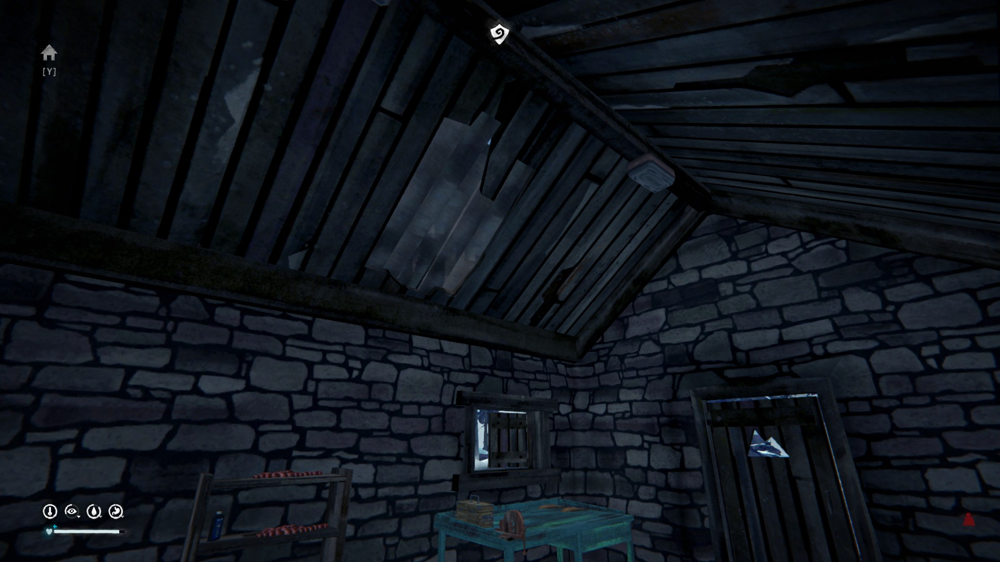

# Mountaineer's Hut

**Categories:** Locations, Locations in Timberwolf Mountain, Locations with a workbench, Sheltered locations · **Source:** [Fandom](https://thelongdark.fandom.com/wiki/Mountaineer's_Hut)

**Mountaineer's Hut**

| Property | Details |
| --- | --- |
| | [Mountaineer's Hut](../assets/Mountaineer%27s_Hut.png) |
| **Location** | |
| | [Mountaineer's Hut Location](../assets/Mountaineer%27s_Hut_Location.png) |
| Region | [Timberwolf Mountain](./Timberwolf%20Mountain.md) |
| Location | On the bank of [Crystal Lake](./Crystal%20Lake.md) |
| **General** | |
| Firebox | |
| [Bed icon](../assets/Bed_icon.png) | Has a bed |
| [Workbench icon green](../assets/Workbench_icon_green.png) | Has a workbench |
| | Provides some shelter |

**Mountaineer's Hut** is a small hut located in [Timberwolf Mountain](./Timberwolf%20Mountain.md), on the southern shore of [Crystal Lake](./Crystal%20Lake.md).

## Overview

It is the only suitable man-made location for setting up a [Safe House](./Safehouse.md) in the entire region, and many players choose to use it as their main base. This is because it has all the essentials: a [Work Bench](./Work%20Bench.md), two [beds](./Bed.md), and a fireplace. There is also a large hatch in the floor that can hold up to 40 kg of items. Hides, guts, and saplings can be cured inside the building. Furthermore, there is [ice fishing](./Ice%20Fishing.md) on Crystal Lake nearby, along with [Bear](./Bear.md), [Moose](./Moose.md), [Deer](./Deer.md), [Wolf](./Wolf.md), and [Rabbit](./Rabbit.md) hunting opportunities in the local area. Although being far from a [forge](./Forge.md) may make it difficult to replace lost arrows and damaged tools, the Mountaineer's Hut is fairly close to the [Milling Machine](./Milling%20Machine.md) and [Ammunition Work Bench](./Ammunition%20Work%20Bench.md) at [Blackrock Prison](./Blackrock%20Prison.md), making it easier to maintain tools and replace used ammunition.

A small number of harvestable items like crates, a shelf, and a stool can be found inside. The hut also contains a [climber's journal page](./Climber%27s%20Journal%20Page.md). A few relatively rare supplies may also be found in the hut, along with a chance to spawn a [Mountaineering Rope](./Mountaineering%20Rope.md) on the front porch.

The hut is not properly insulated, and there is a big hole in the roof. Unlike indoor areas that have a loading screen and an absolute inside temperature, the hut is more similar to a shallow cave and does not have a fixed temperature, rather providing protection from wind and a relative warmth bonus of +30 °C compared to the weather outside (+33 °C with repaired roof). In very cold weather, the hut does not provide adequate protection, so it is recommended the player wear high-quality clothing and/or maintain a fire to avoid freezing. Repairing the roof of the mountaineer's hut using safe house customization provides an additional +3 C to the structure's warmth bonus, and requires:

- [Woodworking tools](./Woodworking%20Tools.md)
- 20 [Cedar Firewood](./Cedar%20Firewood.md)
- 3 hours of repair time

It is not possible for wildlife to enter the hut, even if the door is left open.

Note that despite being considered "outside" in terms of [Decay](./Decay.md), leather can be [Cured](./Curing.md) inside, and you can still get [Cabin Fever](./Cabin%20Fever.md).

## Possible supplies

The following may spawn inside of the hut:

- Firewood
- [Firearm Cleaning Kit](./Firearm%20Cleaning%20Kit.md)
- [Mountaineering Rope](./Mountaineering%20Rope.md)
- [Research Books](./Skills.md)
- 3x [Flare Shell](./Flare%20Shell.md)
- Assorted [food and drinks](./Food%20And%20Drink.md)
- [Magnifying Lens](./Magnifying%20Lens.md)
- [Heavy Hammer](./Heavy%20Hammer.md)

- Mid quality clothes
- Materials
- [Hunting Knife](./Hunting%20Knife.md)
- [Hacksaw](./Hacksaw.md)
- [Storm Lantern](./Storm%20Lantern.md)
- 3x [Simple Arrow](./Simple%20Arrow.md)
- Matches (Interloper)

There may be a [Fishing Tackle](./Fishing%20Tackle.md) on one of the boats near the lake.

Between the hut and the [Summit](./Tail%20Section.md) there are two [Cargo Containers](./Cargo%20Container.md), on the first hill (does not spawn on [Interloper](./Survival%20Mode.md)).

The [Cargo Container](./Cargo%20Container.md) on the left (doesn't spawn in Interloper) as you look towards the Summit contains:

- Upper door: [Airline Food - Chicken](./Airline%20Food%20-%20Chicken.md), [Airline Food - Vegetarian](./Airline%20Food%20-%20Vegetarian.md), [condensed milk](./Condensed%20Milk.md) and [tomato soup](./Tomato%20Soup.md)
- Lower door: [water bottles](./Water%20%28Potable%29.md) and [summit sodas](./Summit%20Soda.md)

The [Cargo Container](./Cargo%20Container.md) on the right (doesn't spawn in Interloper) as you look towards the Summit contains:

- Upper door: [can openers](./Can%20Opener.md), [firestrikers](./Firestriker.md) and [sewing kits](./Sewing%20Kit.md)
- Lower door: [Simple Parka](./Simple%20Parka.md), [Old Fashioned Parka](./Old%20Fashioned%20Parka.md), [Sport Vest](./Sport%20Vest.md), [Wool Ear Wrap](./Wool%20Ear%20Wrap.md), [toques](./Wool%20Toque.md) and [Fleece Mittens](./Fleece%20Mittens.md)

## Gallery

