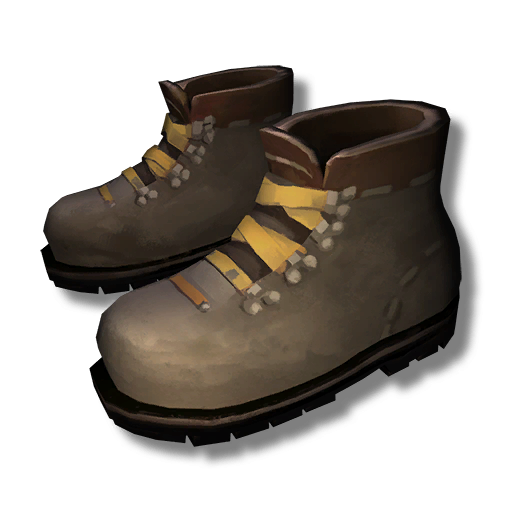
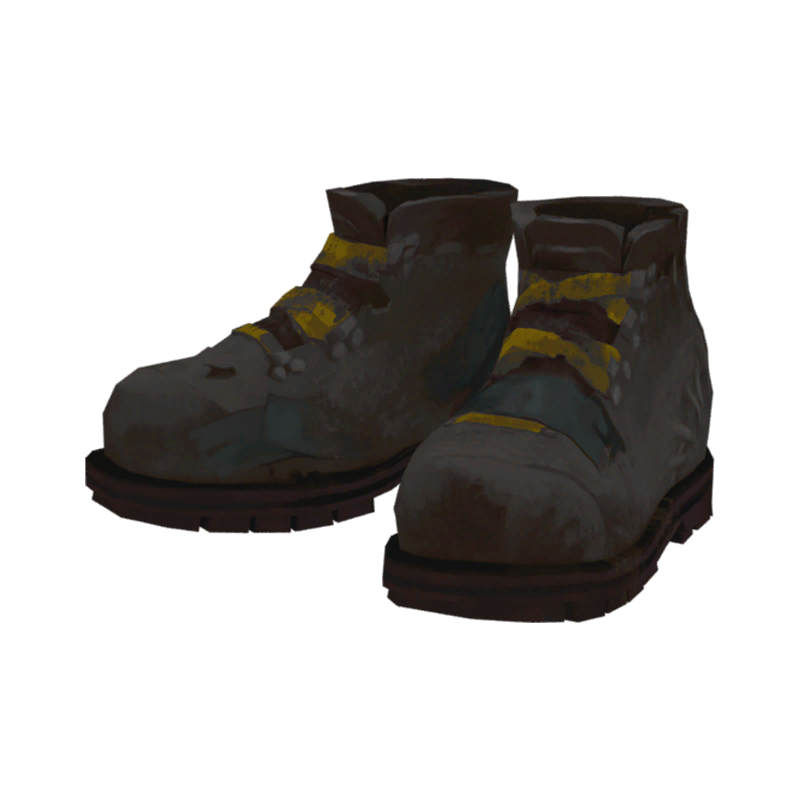

# Mountaineering Boots

**Contents**

- [Overview](#overview)
- [Redux Episode 1](#redux-episode-1)
- [Predux Episode 1](#predux-episode-1)
- [Trivia](#trivia)
- [Update history](#update-history)

**Mountaineering Boots**

| Property | Details |
| --- | --- |
|  |  / *Mountaineering\_Boots\_icon.png* |
| **General** |  |
| Item Type | Clothing\|- |
| **Statistics** |  |
| Weight | 1.00 kg(2.2 lbs) |
| Warmth bonus | 2.5 °C(4.5 °F) |
| Windproof bonus | 2.0 °C(3.6 °F) |
| Waterproof bonus | 40% |
| Protection | 5% |
| Mobility | -3% |
| Harvest | 2 × [Cured Leather](./Cured%20Leather.md) / 90 minutes |
| Repair | 1 × [Cured Leather](./Cured%20Leather.md), / 1 × [Cloth](./Cloth.md) / 90 minutes / 50% condition |

| Column 1 | Column 2 | Column 3 |
| --- | --- | --- |
|  / *2120907963\_TLD-Wintermute-v2.png.de8a285930f6a8f5ad9cf5878754cf5b.png* | **Wintermute-Exclusive content.** / This content only appears in [Wintermute](./Wintermute.md). | \|} / > “**Especially rugged boots given to you by Grey Mother.**” / > / > — In-game description / > “**Don't be so stubborn, Mainlander. Here... Take these old boots. [They belonged to my](./Lilith%20Barker.md)...oh, never mind. Just take them. They are some of the best you can get for climbing. They'll help you keep going.**” / > / > — Grey Mother in Predux Episode 1 after earning her Trust / **Mountaineering Boots** are a type of [Clothing](./Clothing.md) in *[The Long Dark](./The%20Long%20Dark.md)* obtained exclusively in [Wintermute](./Wintermute.md). / ## Overview / Mountaineering Boots stats are identical to [Mukluks](./Mukluks.md), except they are 0.50kg lighter. / Their appearance is similar to [Trail Boots](./Trail%20Boots.md), but with yellow laces instead of red ones. / ## Redux Episode 1 / Mountaineering Boots are given to the player by [Grey Mother](./Grey%20Mother.md) in [Wintermute](./Wintermute.md) if the player completes the side mission [One Last Thing](./One%20Last%20Thing.md). / They can be carried into [Episode 2: Luminance Fugue](./Episode%202%20-%20Luminance%20Fugue.md) if they are still in the player's inventory, but are otherwise unique to Episode 1. / The Boots are lost in [Episode 4: Fury, Then Silence](./Episode%204%20-%20Fury%2C%20Then%20Silence.md) if they were in the player's inventory at the end of Episode 2, likely discarded by [Mathis](./Mathis.md) in order to make transporting Mackenzie easier. / ## Predux Episode 1 / They are given by Grey Mother once the player fully raises her Trust and selects the "BETTER BOOTS" dialogue option. / They can be carried into Episode 2: Luminance Fugue if they are still in the player's inventory, but are otherwise unique to Episode 1. / ## Trivia / It's implied by Grey Mother that these boots once belonged to [Lilith Barker](./Lilith%20Barker.md), since they are the best footwear for climbing mountains. / \| Column 1 \| Column 2 \| / \| --- \| --- \| / \|  / *Clothing model icon* \|  / *Clothing model icon damaged* \| / ## Update history / - UPDATE **1 August 2017 ([Update](./The%20Long%20Dark%20%E2%80%94%20Changelog.md#1.00)):** / - Added to game / - UPDATE **17 December 2018 ([Update](./The%20Long%20Dark%20%E2%80%94%20Changelog.md#1.41)):** / - As part of the Redux edition update, Grey Mother now awards the boots when completing [One Last Thing](./One%20Last%20Thing.md) instead of as the last Trust reward. / - Also changed the description from "Especially rugged boots given to you by Grey Mother, for earning her Trust." / **Lua execution error in Module:Navbox function navbox** / [ru:Альпинистские ботинки](ru:%D0%90%D0%BB%D1%8C%D0%BF%D0%B8%D0%BD%D0%B8%D1%81%D1%82%D1%81%D0%BA%D0%B8%D0%B5_%D0%B1%D0%BE%D1%82%D0%B8%D0%BD%D0%BA%D0%B8) |
| “ | **Especially rugged boots given to you by Grey Mother.** / In-game description | ” |
| “ | **Don't be so stubborn, Mainlander. Here... Take these old boots. [They belonged to my](./Lilith%20Barker.md)...oh, never mind. Just take them. They are some of the best you can get for climbing. They'll help you keep going.** / Grey Mother in Predux Episode 1 after earning her Trust | ” |
|  / *Clothing model icon* |  / *Clothing model icon damaged* |  |
