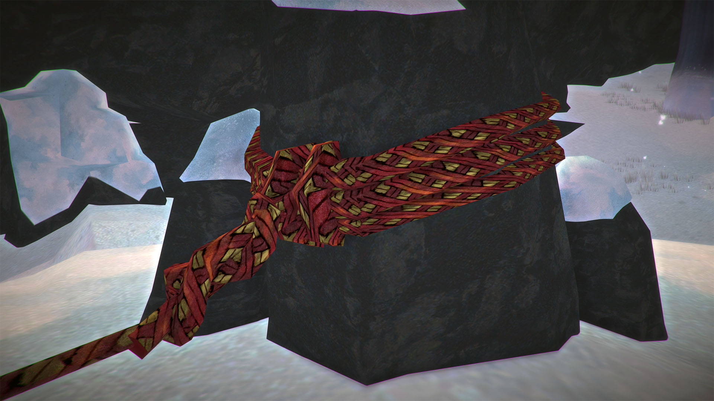

# Mountaineering Rope

**Categories:** Pages with update history, Tools · **Source:** [Fandom](https://thelongdark.fandom.com/wiki/Mountaineering_Rope)

**Contents**

- [Overview](#overview)
- [Locating](#locating)
- [Game history](#game-history)
- [Gallery](#gallery)
- [Update history](#update-history)

**Mountaineering Rope**

| Property | Details |
| --- | --- |
| | [Mountaineering Rope icon](../assets/Mountaineering_Rope_icon.png) |
| Release | [16 December 2015](./The%20Long%20Dark%20%E2%80%94%20Early%20Access%20Changelog.md#0-298-timberwolf-mountain-update) |
| Wintermute | No |
| **Properties** | |
| Item type | [Tools](./Tools.md) |
| Equipable | No |
| Stackable | No |
| Examine | Heavy-duty rope designed for climbing. |
| **Values** | |
| Weight | 5.00 kg (11 lbs) |
| **Actions** | |
| Backpack | Examine |

**Mountaineering Rope** is a tool used for [climbing](./Rope%20Climbing.md) cliff faces.

## Overview

The mountaineering rope is used in conjunction with the [rope climbing](./Rope%20Climbing.md) gameplay mechanic to allow the player to ascend and descend vertical cliffs. The rope must be attached to a certain type of rock feature at the top of a climbable cliff before the climb can be made. While important for traversing mountainous terrain in some regions and caves, using mountaineering ropes can quickly exhaust the player, possibly leading to injury or death from a fall or trapping the player on an inhospitable cliff side.

## Locating

Many ropes are already deployed from rocks over climbable cliffs, but these can be removed and deployed from other cliffs instead. Non-deployed ropes might be found in the following areas:

- [Timberwolf Mountain](./Timberwolf%20Mountain.md)
  - inside the [Mountaineer's Hut](./Mountaineer%27s%20Hut.md)
  - in the shallow cave just below the summit
  - within the cave on the summit
  - inside a crate in the [Tail Section](./Tail%20Section.md)
- [Mountain Town](./Mountain%20Town.md)
  - in the barn of [Paradise Meadows Farm](./Paradise%20Meadows%20Farm.md)
  - on a shelf behind Paradise Meadows Farm
- [Desolation Point](./Desolation%20Point.md)
  - [Matt's Truck](./Matt%27s%20Truck.md)
  - in the two wooden row-boats south of the [Stone Church](./Stone%20Church.md)
- [Mystery Lake](http://thelongdark.wikia.com/wiki/Mystery_Lake_%28region%29)
  - [Destroyed Lookout](http://thelongdark.wikia.com/wiki/Destroyed_Lookout)
- [Broken Railroad](./Broken%20Railroad.md)
  - in the metal tub or on a shelf in the [Maintenance Shed](./Maintenance%20Yard.md)
  - on a shelf in the basement of the [Hunting Lodge](./Hunting%20Lodge.md)
- [Coastal Highway](./Coastal%20Highway.md)
  - [Fishing Camp](./Fishing%20Camp.md)
  - [Abandoned Lookout](./Abandoned%20Lookout.md)
  - in an Ice Fishing Hut
- [The Ravine](./The%20Ravine.md)
  - in the train crash
  - at the lip of the cave along a side path
- [Pleasant Valley](./Pleasant%20Valley.md)
  - outside one of the burned down houses on [Skeeter's Ridge](./Skeeter%27s%20Ridge.md)

- [Ash Canyon](./Ash%20Canyon.md)
  - On top of the coal bin behind the broken ice fishing hut in [Bitter Marsh](./Bitter%20Marsh.md)
  - Inside the [Homesteader's Respite](./Homesteader%27s%20Respite.md)
  - On a bridge on the route towards the [Mining Camp](./Mining%20Camp.md) and [Wolf's Jaw Overlook](./Wolf%27s%20Jaw%20Overlook.md), west of the [Miner's Folly](./Miner%27s%20Folly.md)
  - By an old campfire in the clearing at the end of the trail above [Homesteader's Respite](./Homesteader%27s%20Respite.md)
  - Next to a frozen body between two deployed climbing ropes below the [High Meadow](./High%20Meadow.md)
- [Bleak Inlet](./Bleak%20Inlet.md)
  - Hanging from a peg outside the door to [Pensive Lookout](./Pensive%20Lookout.md)
  - In a wheelbarrow within the workshop of [Last Resort Cannery](./Last%20Resort%20Cannery.md)
  - On a Metal table near the [Fire Barrel](./Fire%20Barrel.md) in the workshop of [Last Resort Cannery](./Last%20Resort%20Cannery.md)
- [Far Range Branch Line](./Far%20Range%20Branch%20Line.md)
  - Inside the [Train Shuttle](./Train%20Shuttle.md) on [Surfeit Trestle](./Surfeit%20Trestle.md)

### Game history

- The mountaineering rope was added on 16 December 2015 in [version 0.298](./The%20Long%20Dark%20%E2%80%94%20Early%20Access%20Changelog.md#0-298-timberwolf-mountain-update).
- [Version 0.321](./The%20Long%20Dark%20%E2%80%94%20Early%20Access%20Changelog.md#0-321-tireless-menace-update) extends the use of ropes to maps other than [Timberwolf Mountain](./Timberwolf%20Mountain.md) and makes the spawn locations Added.

## Gallery

## Update history

- UPDATE **16 December 2015 ([Update](./The%20Long%20Dark%20%E2%80%94%20Early%20Access%20Changelog.md#0-298-timberwolf-mountain-update)):**
  - Added to game.
