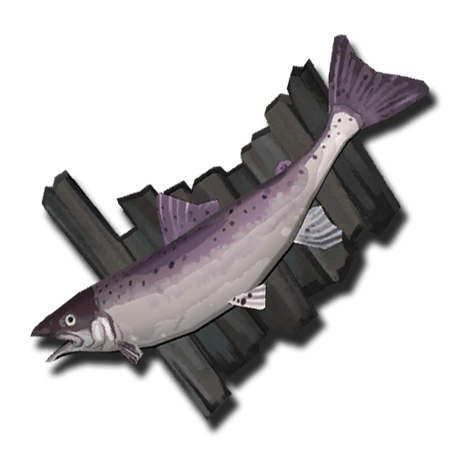

# Mounted Coho Salmon

**Categories:** Interactable Objects · **Source:** [Fandom](https://thelongdark.fandom.com/wiki/Mounted_Coho_Salmon)

**Mounted Coho Salmon**

| Property | Details |
| --- | --- |
|  |  / _Mounted\_Coho\_Salmon\_icon.png_ |
| Release | [TFTFT Part 6 Broken Silence](./The%20Long%20Dark%20%E2%80%94%20Changelog.md#2.33) |
| **Values** |  |
| Weight | 0.50 kg (1.1 lbs) |
| **Actions** |  |
| Backpack | Drop, Place |

The **Mounted Coho Salmon** is a [Decorations](./Decorations.md) item that can be [Crafted](./Crafting.md) as part of the [Safehouse Customization](./Safehouse%20Customization.md) feature.

## Overview

A taxidermized [Coho Salmon](./Coho%20Salmon%20%28Raw%29.md) with a makeshift mount, a Mounted Coho Salmon can be crafted at a [Furniture Workbench](./Furniture%20Workbench.md), but requires [Woodworking Tools](./Woodworking%20Tools.md).

Once crafted, the item is automatically placed into the player's inventory. It can only be placed on walls when in Customization Mode. It can later be picked up and placed back into the player's inventory or destroyed (yielding no resources).

## Crafting

**Mounted Coho Salmon**

| Property | Details |
| --- | --- |
|  | - |
|  | - |
|  | 240 minutes (4 hour 0 minutes) |
| **Requirements** |  |
| Facility | **Template:iconlink** |
| Tool | **Template:iconlink** |
| **Materials** |  |
| **Template:iconlink plain** |  |
| Item | [Fir Firewood](./Fir%20Firewood.md) |
| Quantity | 1 |
| **Template:iconlink plain** |  |
|  | [Coho Salmon (Raw)](./Coho%20Salmon%20%28Raw%29.md) |
|  | 1 |

## Update History
